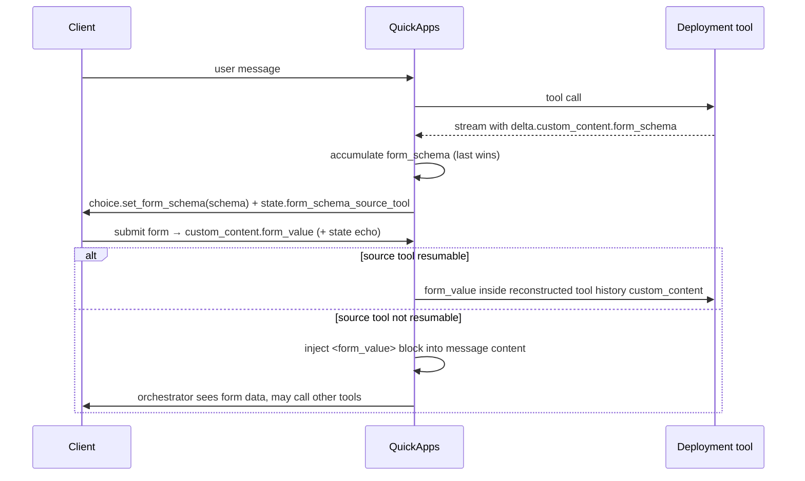

# Design: Form Schema Propagation and Form Value Routing
- **Status:** Implemented
- **User-facing:** [CONFIGURATION — Form schema propagation](../../CONFIGURATION.md#form-schema-propagation)
- **Dependencies:**
  - [subagents_conversation_mode.md](subagents_conversation_mode.md) — `form_value` routing reuses `conversation_mode.resumable` to decide where the submitted form data goes.

## Problem Statement

A DIAL application used as a deployment tool can emit an interactive form by putting a JSON schema under
`choices[].delta.custom_content.form_schema`. Before this change, QuickApps dropped that field on the floor:
the stream parser (`NormalizedCustomContentBuilder`) only understood `attachments`, `stages`, and `state`, so a
form returned by a subagent never reached the app's own answer, and the client had no way to render it.

The reverse direction was equally broken. When a client submits a filled form, it sends the values back as
`custom_content.form_value` on the user message. QuickApps had no concept of `form_value`: it was neither
forwarded to the deployment tool that produced the form (unless that tool happened to be resumable and the
value rode along in tool history), nor visible to the orchestrator model — `_ScrubExtraFieldsTransformer`
stripped undeclared `custom_content` fields before the messages reached the LLM. So a non-resumable tool that
asked the user for input via a form got no answer at all, and the orchestrator could not use the submitted data
to call other tools.

## Design Goals

- A deployment tool can opt in per tool (or per `dial-app` toolset) to forward its `custom_content.form_schema`
  to the app's choice, where the client renders it as an interactive form.
- The SDK allows `choice.set_form_schema` only once per response — when several tools return a schema in one
  turn, exactly one (the first) is propagated and the rest are dropped with a debug log.
- The tool that produced the form is recorded in the response state (`form_schema_source_tool`), so the next
  request can route the submitted `form_value` correctly.
- `form_value` routing depends on the source tool's `conversation_mode`: resumable tools receive the value via
  `custom_content` in their reconstructed history; non-resumable tools get it as a `<form_value>` JSON block
  appended to the message content, so the orchestrator model can act on it.
- The orchestrator model never sees the raw `custom_content.form_value` field — it is scrubbed before the LLM
  call in all cases.
- Fully backward-compatible: with the flag unset (`null`, the default), behavior is identical to before.

---

## Use Cases

### UC-1: Subagent returns a form, client renders it

**Trigger:** The orchestrator calls a `dial-deployment-simple` tool configured with
`propagate_form_schema_to_choice: true`. The deployment's stream contains
`delta.custom_content.form_schema`.
**Behavior:** The schema flows through the stream parser → accumulator → `ToolCallResult.form_schema` →
`Orchestrator._send_form_schema`, which calls `choice.set_form_schema(schema)` and records the tool name in
state under `form_schema_source_tool`.
**Outcome:** The client renders the interactive form on the app's answer.

### UC-2: User submits the form; source tool is resumable

**Trigger:** The client echoes `form_schema_source_tool` in state and sends the filled values as
`custom_content.form_value` on the next user message. The source tool has `conversation_mode.resumable: true`.
**Behavior:** `_FormValueContentTransformer` detects the resumable source and leaves the messages untouched;
`BaseDeploymentTool._build_assistant_message` copies `form_value` into the assistant message's
`custom_content` of the reconstructed tool history.
**Outcome:** The deployment receives the submitted values inside its conversation history, exactly as if the
user had typed them in that subagent's thread.

### UC-3: User submits the form; source tool is not resumable

**Trigger:** Same as UC-2, but the source tool has no `conversation_mode` (or `resumable: false`).
**Behavior:** `_FormValueContentTransformer` deep-copies each message carrying `form_value`, appends a
`<form_value>\n{json}\n</form_value>` block to its content, and clears `custom_content.form_value` on the copy.
The request's own messages are left untouched, so deployment tools can still read the raw field.
**Outcome:** The orchestrator model sees the submitted data in the message content and can, e.g., pass it to
another tool. `_ScrubExtraFieldsTransformer` additionally strips `form_value` from `custom_content` so the raw
field never reaches the LLM.

### UC-4: Several tools return a form in one turn

**Trigger:** Two deployment tools with the flag enabled both emit `form_schema` during the same orchestrator
turn.
**Behavior:** `Orchestrator.__form_schema_sent` guards `_send_form_schema`: the first schema wins, subsequent
ones are skipped with a debug log (SDK constraint: `set_form_schema` may be called only once per choice).
**Outcome:** The client renders exactly one form; no SDK error.

### UC-5: Deployment clears the form

**Trigger:** A deployment sends `custom_content.form_schema: {}` (empty object) to dismiss the current form.
**Behavior:** The parser distinguishes "chunk carries no `form_schema`" (`None`) from "`form_schema: {}`"
via a `_has_form_schema` flag; the accumulator uses replace semantics — the last chunk carrying a schema wins.
**Outcome:** An empty schema is propagated and clears the rendered form on the client.

### UC-6: Tool without the flag

**Trigger:** A deployment tool returns `form_schema` but `propagate_form_schema_to_choice` is unset (`null`).
**Behavior:** `BaseDeploymentTool` nulls out `result.form_schema` unless the flag is truthy.
**Outcome:** Identical to pre-change behavior; the schema is dropped at the tool boundary.

---

## Proposed Design

### 1. Config flag `propagate_form_schema_to_choice`

**What:** A `bool | None = None` field added to `DialDeploymentTool`
(`src/quickapp/config/tools/deployment.py`), `DialDeploymentSimpleTool`
(`src/quickapp/config/tools/deployment_simple.py`), and `DialAppToolSet`
(`src/quickapp/config/toolsets/dial_app.py`).
**Owner:** config layer; threaded onto the synthetic `DialDeploymentTool` by
`_DeploymentToolInitializer` (toolsets) and `dial_app_tooling/_dial_app_resolver.py` (`dial-app`).
**Semantics:** `null`/`false` — drop the schema at the tool boundary; `true` — propagate. On `DialAppToolSet`
it applies only to the chat-completion branch; when the toolset resolves to MCP the value is ignored with a
warning (same pattern as `conversation_mode`).
**Change:** new optional field on three config models; schema regenerated via `make dump_app_schema`.

### 2. Stream parsing and accumulation of `form_schema`

**What:** `NormalizedCustomContent` gains `form_schema: dict[str, Any] | None`
(`common/chat_completion_stream/models.py`); `NormalizedCustomContentBuilder.set_form_schema` accepts a dict and
tracks presence with a `_has_form_schema` flag so `{}` (clear) is distinguishable from absent
(`parse.py`); `AccumulationSink` forwards it to `ChatStreamAccumulator.set_form_schema`, which uses replace
semantics — the last chunk carrying a schema wins (`accumulation_stream_sink.py`, `stream_result.py`).
**Owner:** `common/chat_completion_stream/` package.
**Semantics:** per-chunk normalization, per-response accumulation with last-wins.
**Change:** four small additions in the stream pipeline; no changes to existing fields.

### 3. Tool result and orchestrator propagation

**What:** `ToolCallResult` gains `form_schema: dict[str, Any] | None`
(`common/tool_call_result.py`); `DialCompletionService` copies it from the deployment's accumulated result
(`dial_completion_service.py`); `BaseDeploymentTool` nulls it unless the config flag is set
(`base_deployment_tool.py`); `Orchestrator` calls `_send_form_schema` when applying tool results.
**Owner:** `dial_deployment_tooling/` produces, `core/agent/orchestrator.py` consumes.
**Semantics:** `_send_form_schema` is guarded by `__form_schema_sent` (first wins, SDK allows one call per
choice) and records the producing tool's name via `__state_holder.add_state(STATE_KEY_FORM_SCHEMA_SOURCE_TOOL,
tool_name)`.
**Change:** new field on `ToolCallResult`, one guard method on `Orchestrator`, one state key in
`core/agent/models.py`.

### 4. Routing `form_value` on the next request

**What:** New `_FormValueContentTransformer` (`core/agent/_form_value_content_transformer.py`), registered
first in `AgentModule.provide_message_transformers` (before `_ScrubExtraFieldsTransformer`, so injection
happens before scrubbing).
**Owner:** `core/agent/` message-transformer chain.
**Semantics:** reads the latest `form_schema_source_tool` from any message's `custom_content.state`; looks up
that tool's `conversation_mode` in the app config. Only full `DialDeploymentTool` entries inside a
`DeploymentToolSet` are matched (by `open_ai_tool.function.name`, skipping disabled tools) —
`DialDeploymentSimpleTool` has no `open_ai_tool` attribute, so a simple tool is never matched and is treated
as non-resumable (see Out of Scope). If the source tool is resumable → no-op (the value travels via tool
history, see concern 5). Otherwise → inject a `<form_value>` JSON block into the content of a deep-copied
message and clear `form_value` on the copy. If no source tool is identifiable → no-op.
**Change:** one new transformer class + DI binding; `_ScrubExtraFieldsTransformer` additionally excludes
`custom_content.form_value` whenever it is present, so the raw field never reaches the orchestrator model.

### 5. `form_value` in resumable tool history

**What:** `BaseDeploymentTool._build_assistant_message` copies `custom_content.form_value` (SDK field, or
`model_extra` fallback for forward compatibility) into the assistant message's `custom_content` when
reconstructing tool history.
**Owner:** `dial_deployment_tooling/base_deployment_tool.py`.
**Semantics:** only relevant for resumable tools, whose history is rebuilt per call; the submitted form data
rides along with the thread.
**Change:** a few lines in the history builder.

---

## Secondary Fixes

- `_ScrubExtraFieldsTransformer` now treats `custom_content.form_value` as an undeclared extra field and strips
  it from messages sent to the orchestrator model — previously it would have been scrubbed only incidentally via
  the generic extras mechanism, with no explicit guarantee.

---

## Out of Scope

- **MCP branch propagation.** `propagate_form_schema_to_choice` on a `dial-app` toolset that resolves to MCP is
  ignored with a warning; MCP tool results do not carry `custom_content.form_schema` through this path. Would
  require an MCP-side representation of forms — deferred until the MCP capabilities design covers it.
- **Multiple forms per response.** The SDK permits a single `set_form_schema` per choice; supporting several
  concurrent forms is a client/SDK limitation, not something QuickApps can fix server-side.
- **Form validation server-side.** QuickApps forwards the schema and the submitted value verbatim; validating
  `form_value` against `form_schema` is the client's and the deployment's responsibility.
- **Form state beyond one turn.** `form_schema_source_tool` reflects the *latest* marker echoed in state; if
  the client submits a form for an older tool after a newer form was shown, routing follows the latest marker.
- **Resumable `dial-deployment-simple` tools.** `_find_tool_conversation_mode` matches source tools by
  `open_ai_tool.function.name`, which only full `deployment-tool` entries have. A `dial-deployment-simple`
  tool with `conversation_mode.resumable: true` is not matched, so its submitted `form_value` is routed to
  message content (the non-resumable path) instead of tool history. The value still reaches the deployment via
  the raw `custom_content` on the request's own messages, but the orchestrator also sees it as a `<form_value>`
  block. Matching simple tools would require resolving `deployment_id` → tool name at transform time.

---

## Configuration / Usage Examples

Enable propagation on a simple deployment tool:

```json
{
  "type": "dial-deployment-simple",
  "deployment_id": "report-generator",
  "propagate_form_schema_to_choice": true
}
```

On a `dial-app` toolset (chat-completion branch only):

```json
{
  "type": "dial-app",
  "name": "report-generator",
  "propagate_form_schema_to_choice": true
}
```

Full flow:



---

## Migration

### Breaking changes

None. The new config field defaults to `null`, which preserves the old drop-at-tool-boundary behavior.

### Non-breaking changes

- `propagate_form_schema_to_choice: true` opts a tool into form propagation; existing manifests need no change.
- `custom_content.form_value` on incoming messages is now consumed (routed to tool history or content) instead
  of being silently scrubbed; clients that sent it before saw it ignored by the orchestrator, so no working
  flow regresses.
- `docs/generated-app-schema.json` regenerated; `CONFIGURATION.md` and the `docs/README.md` capability map
  updated.

## Summary of Changes

| Component | Change |
|---|---|
| `config/tools/deployment.py`, `config/tools/deployment_simple.py`, `config/toolsets/dial_app.py` | New `propagate_form_schema_to_choice: bool \| None` field |
| `common/chat_completion_stream/models.py` | `NormalizedCustomContent.form_schema` field |
| `common/chat_completion_stream/parse.py` | `set_form_schema` + `_has_form_schema` presence flag (distinguishes absent from `{}`) |
| `common/chat_completion_stream/stream_result.py` | `ChatStreamAccumulator.form_schema` property + `set_form_schema` (replace semantics) |
| `common/chat_completion_stream/accumulation_stream_sink.py` | Forward normalized `form_schema` to the accumulator |
| `common/tool_call_result.py` | `ToolCallResult.form_schema` field |
| `dial_deployment_tooling/dial_completion_service.py` | Copy `form_schema` from deployment result into `ToolCallResult` |
| `dial_deployment_tooling/base_deployment_tool.py` | Null `form_schema` unless flag set; copy `form_value` into resumable tool history |
| `dial_deployment_tooling/_deployment_tool_initializer.py`, `dial_app_tooling/_dial_app_resolver.py` | Thread the flag onto synthetic deployment tools |
| `core/agent/models.py` | New `STATE_KEY_FORM_SCHEMA_SOURCE_TOOL = "form_schema_source_tool"` |
| `core/agent/orchestrator.py` | `_send_form_schema` (first-wins guard) + state marker recording |
| `core/agent/_form_value_content_transformer.py` | New transformer: routes `form_value` to content as `<form_value>` block for non-resumable source tools |
| `core/agent/_scrub_extra_fields_transformer.py` | Explicitly scrub `custom_content.form_value` from orchestrator-bound messages |
| `core/agent/agent_module.py` | Bind `_FormValueContentTransformer`, register first in the transformer chain |
| `CONFIGURATION.md`, `docs/README.md`, `docs/generated-app-schema.json` | User docs, capability map row, regenerated schema |
| `src/tests/unit_tests/...` | New tests for transformer, scrubber, parser, accumulator, orchestrator, deployment tool |
