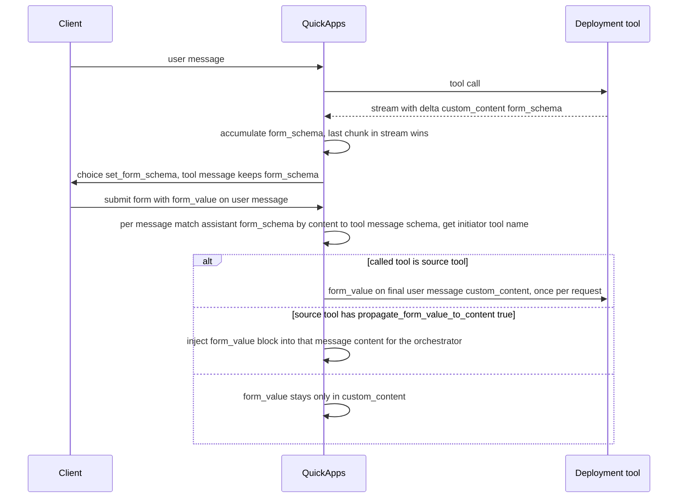

# Design: Form Schema Propagation and Form Value Routing
- **Status:** Implemented
- **User-facing:** [CONFIGURATION — Form schema propagation](../../CONFIGURATION.md#form-schema-propagation)
- **Dependencies:**
  - [subagents_conversation_mode.md](subagents_conversation_mode.md) — related: resumable subagent conversations.

## Problem Statement

A DIAL application used as a deployment tool can emit an interactive form by putting a JSON schema under
`choices[].delta.custom_content.form_schema`. Before this change, QuickApps dropped that field on the floor:
the stream parser (`NormalizedCustomContentBuilder`) only understood `attachments`, `stages`, and `state`, so a
form returned by a subagent never reached the app's own answer, and the client had no way to render it.

The reverse direction was equally broken. When a client submits a filled form, it sends the values back as
`custom_content.form_value` on the user message. QuickApps had no concept of `form_value`: it was not
forwarded to the deployment tool that produced the form. So a tool that asked the user for input via a form
never got an answer.

## Design Goals

- A deployment tool can opt in per tool (or per `dial-app` toolset) to forward its `custom_content.form_schema`
  to the app's choice, where the client renders it as an interactive form.
- The SDK allows `choice.set_form_schema` only once per response — when several tools return a schema in one
  turn, exactly one (the first) is propagated and the rest are dropped with a debug log.
- The source tool is resolved by **matching schema content** between the two messages of a form turn:
  the client echoes the **assistant** message back with `custom_content.form_schema` (the schema the UI
  actually rendered) plus its `tool_calls` (the **initiator**); the **tool** message carries the schema the
  deployment returned (the **generator**) and its `tool_call_id`. `form_source_tool_name_before` finds the
  latest assistant message with a schema (first per turn — SDK allows one form per choice), then matches a
  tool message whose `form_schema` equals it by content and whose `tool_call_id` is in that assistant's
  `tool_calls`; the initiator's tool call name is the source. Fallback: tool message alone → `tool_call_id` →
  assistant tool call. No state markers are used.
- `form_value` routing is decided **per message**: for each message carrying `form_value`, the form's source
  tool is resolved from the history *before* that message, and the value goes either to that tool's request
  (when it is the tool being called) or into the message content as a `<form_value>` block
  (`propagate_form_value_to_content: true` on that tool).
- Injection covers **all** messages with `form_value`, not just the last one — dropping older ones would lose
  data and break the KV cache (the message prefix must stay stable across turns).
- `custom_content.form_value` is a declared SDK field and is **kept** in messages (not scrubbed): deployment
  tools read it from the request's own messages, and the orchestrator sees the `<form_value>` content block.
- Fully backward-compatible: with the flag unset (`null`, the default), behavior is identical to before.

---

## Use Cases

### UC-1: Subagent returns a form, client renders it

**Trigger:** The orchestrator calls a `dial-deployment-simple` tool configured with
`propagate_form_schema_to_choice: true`. The deployment's stream contains
`delta.custom_content.form_schema`.
**Behavior:** The schema flows through the stream parser → accumulator → `ToolCallResult.form_schema` →
`Orchestrator._send_form_schema`, which calls `choice.set_form_schema(schema)`. The tool message built from
the result keeps the schema in `custom_content.form_schema`, so it stays in the conversation history.
**Outcome:** The client renders the interactive form on the app's answer.

### UC-2: User submits the form; source tool is the one being called

**Trigger:** The client sends the filled values as `custom_content.form_value` on the next user message.
The latest assistant message in history carries `custom_content.form_schema` (echoed by the client — the
schema the UI rendered); the tool message with the same schema resolves to the tool the orchestrator is
about to call.
**Behavior:** `BaseDeploymentTool._form_value_for_this_tool` matches the form's source tool (from history,
cutoff at the last user message with `form_value`) against the tool being called, takes `form_value` from
that message, and `DialCompletionService` attaches it to the final user message of the deployment request
as `custom_content.form_value`. Additionally, `_build_assistant_message` copies `form_value` from tool
messages into the reconstructed history's assistant messages.
**Outcome:** The deployment receives the submitted values both in its conversation history and on the
current request's user message.

### UC-3: User submits the form; source tool has `propagate_form_value_to_content: true`

**Trigger:** Same as UC-2, but the tool being called is not the form's source (or the source is another
tool); the source tool has `propagate_form_value_to_content: true`.
**Behavior:** `_FormValueContentTransformer` deep-copies the message, appends a
`<form_value>\n{json}\n</form_value>` block to its content, while `custom_content.form_value` is kept on the
copy (deployment tools read it from the raw request messages). The request's own messages are left
untouched. This happens for **every** message carrying `form_value` (KV-cache stability). With the flag
unset/false, no injection happens — the value stays only in `custom_content`.
**Outcome:** The orchestrator model sees the submitted data in the message content and can, e.g., pass it to
another tool.

### UC-4: Several tools return a form in one turn

**Trigger:** Two deployment tools with the flag enabled both emit `form_schema` during the same orchestrator
turn.
**Behavior:** `Orchestrator.__form_schema_sent` guards `_send_form_schema`: the first schema wins, subsequent
ones are skipped with a debug log (SDK constraint: `set_form_schema` may be called only once per choice).
**Outcome:** The client renders exactly one form; no SDK error.

### UC-5: Deployment clears the form

**Trigger:** A deployment sends `custom_content.form_schema: {}` (empty object) to dismiss the current form.
**Behavior:** The parser distinguishes "chunk carries no `form_schema`" (`None`) from "`form_schema: {}`"
via a `_has_form_schema` flag; the accumulator uses replace semantics — the last chunk carrying a schema wins.
**Outcome:** An empty schema is propagated and clears the rendered form on the client.

### UC-6: Tool without the flag

**Trigger:** A deployment tool returns `form_schema` but `propagate_form_schema_to_choice` is unset (`null`).
**Behavior:** `BaseDeploymentTool` nulls out `result.form_schema` unless the flag is truthy.
**Outcome:** Identical to pre-change behavior; the schema is dropped at the tool boundary.

---

## Proposed Design

### 1. Config flag `propagate_form_schema_to_choice`

**What:** A `bool | None = None` field added to `DialDeploymentTool`
(`src/quickapp/config/tools/deployment.py`), `DialDeploymentSimpleTool`
(`src/quickapp/config/tools/deployment_simple.py`), and `DialAppToolSet`
(`src/quickapp/config/toolsets/dial_app.py`).
**Owner:** config layer; threaded onto the synthetic `DialDeploymentTool` by
`_DeploymentToolInitializer` (toolsets) and `dial_app_tooling/_dial_app_resolver.py` (`dial-app`).
**Semantics:** `null`/`false` — drop the schema at the tool boundary; `true` — propagate. On `DialAppToolSet`
it applies only to the chat-completion branch; when the toolset resolves to MCP the value is ignored with a
warning (same pattern as `conversation_mode`).
**Change:** new optional field on three config models; schema regenerated via `make dump_app_schema`.

### 1b. Config flag `propagate_form_value_to_content`

**What:** A `bool | None = None` field added next to `propagate_form_schema_to_choice` on the same three
config models (`DialDeploymentTool`, `DialDeploymentSimpleTool`, `DialAppToolSet`), threaded onto the
synthetic `DialDeploymentTool` by the same two paths.
**Semantics:** gates the `<form_value>` content injection in `_FormValueContentTransformer` for
non-resumable source tools. `null`/`false` — the submitted value stays only in `custom_content` (consumed
by deployment tools); `true` — additionally appended to the message content for the orchestrator model.
**Change:** new optional field on three config models; read from the runtime tool instance in the
transformer; schema regenerated.

### 2. Stream parsing and accumulation of `form_schema`

**What:** `NormalizedCustomContent` gains `form_schema: dict[str, Any] | None`
(`common/chat_completion_stream/models.py`); `NormalizedCustomContentBuilder.set_form_schema` accepts a dict and
tracks presence with a `_has_form_schema` flag so `{}` (clear) is distinguishable from absent
(`parse.py`); `AccumulationSink` forwards it to `ChatStreamAccumulator.set_form_schema`, which uses replace
semantics — the last chunk carrying a schema wins (`accumulation_stream_sink.py`, `stream_result.py`).
**Owner:** `common/chat_completion_stream/` package.
**Semantics:** per-chunk normalization, per-response accumulation with last-wins.
**Change:** four small additions in the stream pipeline; no changes to existing fields.

### 3. Tool result and orchestrator propagation

**What:** `ToolCallResult` gains `form_schema: dict[str, Any] | None`
(`common/tool_call_result.py`); `DialCompletionService` copies it from the deployment's accumulated result
(`dial_completion_service.py`); `BaseDeploymentTool` nulls it unless the config flag is set
(`base_deployment_tool.py`); `Orchestrator` calls `_send_form_schema` when applying tool results.
**Owner:** `dial_deployment_tooling/` produces, `core/agent/orchestrator.py` consumes.
**Semantics:** `_send_form_schema` is guarded by `__form_schema_sent` (first wins, SDK allows one call per
choice). The tool message built from the result (`ToolCallResult.to_tool_message`) carries the schema in
`custom_content.form_schema`, so the source tool stays recoverable from history on the next request.
**Change:** new field on `ToolCallResult` (also serialized into the tool message's `custom_content`), one
guard method on `Orchestrator`.

### 4. `form_value` routed per message by the form's source tool

**What:** two cooperating pieces, both resolving the source tool from history by content
(`common/form_utils.py`: `form_source_tool_name_before` — latest assistant message with
`custom_content.form_schema` (the schema shown to the client) matched by content to the tool message
carrying the same schema; the assistant's `tool_calls` give the initiator name;
`find_tool_conversation_mode` / `is_resumable`):

- `_FormValueContentTransformer` (`core/agent/_form_value_content_transformer.py`, registered first in
  `AgentModule.provide_message_transformers`, before the scrubber): for **every** message carrying
  `custom_content.form_value`, resolves the source tool from the history *before* that message; if the
  source is not resumable **and** its config has `propagate_form_value_to_content: true`, appends a
  `<form_value>{json}</form_value>` block to a deep-copied message's content (keeping `form_value` in
  `custom_content`). Injection into all messages (not just the last) is deliberate: it keeps data and
  keeps the KV-cache prefix stable across turns.
- `BaseDeploymentTool._form_value_for_this_tool` + `DialCompletionService.complete_request_async(form_value=...)`:
  when the tool being called **is** the form's source (resolved with the cutoff at the last user message
  carrying `form_value`), takes `form_value` from that message in the working history and attaches it to
  the final user message of the deployment request's `custom_content` (at most once per request).
  Separately, `_build_assistant_message` copies `form_value` from tool messages into the reconstructed
  history's assistant messages.

**Owner:** `core/agent/` transformer chain + `dial_deployment_tooling/`.
**Semantics:** the form is identified by content in history (the schema itself), not by state markers or
client echo; each `form_value` goes either to its source tool's request or into the orchestrator's
message content (if `propagate_form_value_to_content: true` on that tool).
**Change:** new `common/form_utils.py`; new transformer + DI binding; `form_value` parameter on
`complete_request_async`.

---

## Secondary Fixes

- `_ScrubExtraFieldsTransformer` no longer strips `custom_content.form_value` — it is a declared SDK field
  consumed by deployment tools from the request's own messages.

---

## Out of Scope

- **MCP branch propagation.** `propagate_form_schema_to_choice` on a `dial-app` toolset that resolves to MCP is
  ignored with a warning; MCP tool results do not carry `custom_content.form_schema` through this path. Would
  require an MCP-side representation of forms — deferred until the MCP capabilities design covers it.
- **Multiple forms per response.** The SDK permits a single `set_form_schema` per choice; supporting several
  concurrent forms is a client/SDK limitation, not something QuickApps can fix server-side.
- **Form validation server-side.** QuickApps forwards the schema and the submitted value verbatim; validating
  `form_value` against `form_schema` is the client's and the deployment's responsibility.
- **Form state beyond one turn.** The latest turn segment carrying a `form_schema` wins (first schema within
  it, matching what the client rendered); if the client submits a form for an older tool after a newer form
  was shown, routing follows the latest one. The cutoff is the last user message carrying `form_value`, so
  tool results produced later in the same request do not shadow the submitted form.
- **Source-tool resolution for non-deployment tools.** `form_source_tool_name_before` resolves the tool name
  from assistant tool calls in history; tools without an LLM-facing function name cannot be matched and are
  treated as unknown source (no content injection unless the flag is set on a matched tool).

---

## Configuration / Usage Examples

Enable propagation on a simple deployment tool:

```json
{
  "type": "dial-deployment-simple",
  "deployment_id": "report-generator",
  "propagate_form_schema_to_choice": true
}
```

On a `dial-app` toolset (chat-completion branch only):

```json
{
  "type": "dial-app",
  "name": "report-generator",
  "propagate_form_schema_to_choice": true
}
```

Full flow:



---

## Migration

### Breaking changes

None. The new config field defaults to `null`, which preserves the old drop-at-tool-boundary behavior.

### Non-breaking changes

- `propagate_form_schema_to_choice: true` opts a tool into form propagation; existing manifests need no change.
- `custom_content.form_value` on incoming messages is kept in `custom_content` (not scrubbed); it is
  forwarded to the form's source tool via its request, and surfaced to the orchestrator as a
  `<form_value>` content block when the source tool has `propagate_form_value_to_content: true`.
- `docs/generated-app-schema.json` regenerated; `CONFIGURATION.md` and the `docs/README.md` capability map
  updated.

## Summary of Changes

| Component | Change |
|---|---|
| `config/tools/deployment.py`, `config/tools/deployment_simple.py`, `config/toolsets/dial_app.py` | New `propagate_form_schema_to_choice: bool \| None` and `propagate_form_value_to_content: bool \| None` fields |
| `common/chat_completion_stream/models.py` | `NormalizedCustomContent.form_schema` field |
| `common/chat_completion_stream/parse.py` | `set_form_schema` + `_has_form_schema` presence flag (distinguishes absent from `{}`) |
| `common/chat_completion_stream/stream_result.py` | `ChatStreamAccumulator.form_schema` property + `set_form_schema` (replace semantics) |
| `common/chat_completion_stream/accumulation_stream_sink.py` | Forward normalized `form_schema` to the accumulator |
| `common/tool_call_result.py` | `ToolCallResult.form_schema` field, serialized into the tool message's `custom_content.form_schema` (and restored by `tool_call_result_from_tool_message`) |
| `dial_deployment_tooling/dial_completion_service.py` | Copy `form_schema` from deployment result into `ToolCallResult` |
| `dial_deployment_tooling/base_deployment_tool.py` | Null `form_schema` unless flag set; `_form_value_for_this_tool` routes `form_value` from the working history when this tool is the form source (cutoff at last user message with `form_value`); copy `form_value` into history assistant messages |
| `dial_deployment_tooling/dial_completion_service.py` | `form_value` param on `complete_request_async`; attached to final user message `custom_content` |
| `dial_deployment_tooling/_deployment_tool_initializer.py`, `dial_app_tooling/_dial_app_resolver.py` | Thread the flag onto synthetic deployment tools |
| `core/agent/orchestrator.py` | `_send_form_schema` (first-wins guard); no state markers — source tool is recovered from history |
| `common/form_utils.py` | Shared history-based source-tool resolution (`form_source_tool_name_before`, `find_tool_conversation_mode`, `is_resumable`) |
| `core/agent/_form_value_content_transformer.py` | Per-message `<form_value>` content injection when the source tool (resolved from history) is not resumable **and** has `propagate_form_value_to_content: true`; registered before the scrubber |
| `core/agent/agent_module.py` | Bind `_FormValueContentTransformer`, register first in the transformer chain |
| `core/agent/_scrub_extra_fields_transformer.py` | No longer special-cases `custom_content.form_value` — it is a declared SDK field and stays in messages |
| `CONFIGURATION.md`, `docs/README.md`, `docs/generated-app-schema.json` | User docs, capability map row, regenerated schema |
| `src/tests/unit_tests/...` | New tests for transformer, scrubber, parser, accumulator, orchestrator, deployment tool |
