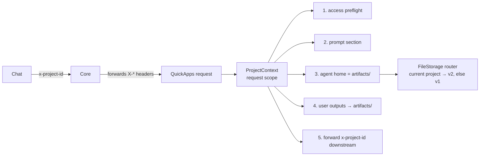

# Design: Projects support

- **Status:** Approved
- **Issue:** [I#656](https://github.com/epam/ai-dial-quickapps-backend/issues/656)
- **Dependencies:**
  - Core [I#1930](https://github.com/epam/ai-dial-core/issues/1930) (app resource dependencies), see
    [External dependencies](#external-dependencies)

## Problem Statement

- DIAL Chat ships projects (behind `PROJECTS_ENABLED`): a project holds instructions, context files and chats. On every
  model call of a project chat Chat sends one header, `x-project-id: projects/{bucket}/{path}`, and adds nothing else
  for the project: no system message, no project-file attachment
  ([ai-dial-chat PR#9649](https://github.com/epam/ai-dial-chat/pull/9649)). Files the user attaches to a message
  arrive as usual.
- QuickApps ignores the header. In a project chat the agent:
  - doesn't see the project instructions or context files;
  - keeps its files in its own appdata, so chats in one project share nothing;
  - writes tool outputs to appdata, so Chat's project **Outputs** section (`artifacts/`) stays empty.
- Project files are a Core v2 resource (`projects/…`). `DialFileService` and aidial-client only speak the v1 `files/…`
  API.
- Without a grant, a file tool reports Core's 403 as an invalid parameter (`_DialFileTool._check_permission_denied` in
  `dial_files_tooling/_base_file_tool.py`, worded "try to call the tool again" by `common/staged_base_tool.py`), so the
  agent retries other paths for 30+ steps before it gives up.

## Design Goals

- `x-project-id` is the only link to the project. No app-config switch is needed.
- In a project the agent sees the project instructions and the list of context files, and works in the project's
  `artifacts/` folder. The ten file tools and `web_fetch` keep their interfaces.
- The agent can't modify `PROJECT.md`, `context/` or `conversations/`.
- Files that tools produce for the user land in `artifacts/` and show up in Chat's Outputs.
- No access to the project → the turn fails within one call, with a message that names the fix.
- Without the header, or with `ENABLE_PREVIEW_FEATURES=false`, behaviour is unchanged, except for the changes listed
  as ungated in [Gating](#gating).

---

## Use Cases

### UC-1: Instructions and context in a project chat

**Trigger:** The user chats with a QuickApp inside a project that has instructions and `tickets.csv` in its context.
**Behavior:** QuickApps reads `PROJECT.md` and lists `context/`, then adds both as a system-prompt section.
**Outcome:** The answer follows the instructions. If the app has file tools, the agent reads `tickets.csv` by its path
when needed.

### UC-2: Files shared across the project's chats

**Trigger:** In chat 1 the agent saves `notes.md`. In chat 2 the user asks about something in those notes.
**Behavior:** Both chats resolve the agent home to `projects/{b}/{p}/files/artifacts/`.
**Outcome:** Chat 2 finds the note. `notes.md` also appears in the project's Outputs. The home is shared by **every app**
used in the project, not only every chat: app A's `notes.md` is app B's `notes.md`.

### UC-3: Tool output in a project

**Trigger:** An MCP tool returns a PDF, or the interpreter draws a chart.
**Behavior:** The file is written flat into `artifacts/` instead of the appdata root.
**Outcome:** The file is attached to the answer and listed in Outputs.

### UC-4: No access

**Trigger:** The app has no approved dependency on the project (consent missing or revoked, or a shared project that
the declaration doesn't cover).
**Behavior:** One metadata call at request start returns 403.
**Outcome:** The turn ends before any LLM call with 403 `project_access_denied` and an admin hint. A 404 (project
deleted or renamed) ends it with its own message.

### UC-5: Agent tries to edit project instructions

**Trigger:** The agent calls `write_file` / `edit_file` / `delete_file` on `projects/{b}/{p}/files/PROJECT.md` or
`context/…`.
**Behavior:** Home confinement rejects the absolute path before calling Core.
**Outcome:** The tool says the file is read-only and writes go to the working folder (a relative path). The agent
reports it or writes a copy under `artifacts/`.

---

## Proposed Design



### Decisions

| # | Decision | Why |
|---|---|---|
| D1 | The header `x-project-id` is the only link. QuickApps percent-decodes it, then re-encodes each segment the way Core returns URLs. Nested paths are allowed. A malformed header → no project (`None`) + a WARNING log, not a 400. | Chat's shipped contract. The header is literal for spaces and percent-encoded for non-ASCII and `%`. A bad header must not break the chat. |
| D2 | Layout under Core's `projects/{b}/{p}/files/`: `PROJECT.md` (YAML frontmatter + body), `context/`, `conversations/`, `artifacts/`. | A shared agreement between Chat and the apps. Core imposes none. |
| D3 | Agent home in a project = `artifacts/`, shared by every app in the project. `agent_home_dir` is ignored. | Chat shows `artifacts/` as Outputs and keeps it out of its `contentVersion`, so agent writes don't make the user's edit fail with 409 ([PR#9692](https://github.com/epam/ai-dial-chat/pull/9692)). |
| D4 | The agent writes only under `artifacts/`, enforced by the existing home confinement (write-side tools accept relative paths only, no `..`). No separate guard. | Core grants WRITE on the whole project, so it won't protect `PROJECT.md` / `context/` / `conversations/`. Home confinement already blocks every write path outside the home. |
| D5 | User-facing tool outputs keep today's naming and overwrite behaviour. Only the root changes: `artifacts/` instead of the appdata root. | Parity with non-project behaviour. Collision-safe names are a separate change. |
| D6 | Large-result offloads and promoted external URLs stay in appdata. | Offloads are internal context. Promoted URLs feed deployments and the interpreter, which can't read `projects/` URLs (C4). |
| D7 | Permissions come from Core (#1930 resource dependencies). QuickApps never grants itself anything. Phase 1 = static dependencies with admin consent. | The header carries no permission. Core forwards it but grants nothing from it. |
| D8 | `projects/` URLs are recognised only when the request has a project, and only under **that** project's root. Any other `projects/…` string behaves as today. | Keeps non-project chats unchanged (`projects/notes.md` stays a valid relative path). Also narrows the phase-1 grant, which opens all of the user's projects, to the current one on QuickApps' side. |
| D9 | No access → hard fail (UC-4). Projects stay on the shared `ENABLE_PREVIEW_FEATURES` flag; no project-only switch. Environments whose Core lacks C1 keep the flag off (owner: the deployment's config). | A degraded mode would answer without the project and hide the missing grant. Accepted cost: the flag off also disables the other preview features there (tool-result offload, MCP per-tool config). |

### Gating

| Change | Gated by |
|---|---|
| `PROJECT_CONTEXT` | `None` when `ENABLE_PREVIEW_FEATURES` is off |
| `ProjectModule` (prompt section, preflight) | module filter (`@preview_module`) |
| `projects/` routing in `RoutedFileStorage`, `projects/` in the path transformer, `reject_absolute_path`, `web_fetch`, `classify_url`, home = `artifacts/`, output root | `PROJECT_CONTEXT is not None` and the URL is under its root |
| File-tool 403 → non-retryable permission error | ungated (a secondary fix, see [Secondary Fixes](#secondary-fixes)) |
| `x-project-id` stripped from REST API tool calls | ungated (the header only exists in project chats) |
| `x-project-id` to nested apps and MCP | unchanged: the existing `X-*` catch-all, raw header value |

### Project context (PR1)

- **What:** `ProjectContext` (frozen model): canonical project URL, plus `instructions_url`, `context_root`,
  `artifacts_root`. Rejects empty, `.`, `..` and `files` segments.
- **Owner:** `ProjectContext` and the `PROJECT_CONTEXT` key live in `common/project_context.py`, so `common/` code
  (`classify_url`) can use them. `AppModule` provides `PROJECT_CONTEXT` from the request context, the same way as
  `CLIENT_CHANNEL_ID` and `TIMEZONE_HEADER_VALUE`. It is `None` when the preview flag is off. `ProjectModule`
  (`@preview_module`) holds only the prompt provider and the preflight (PR2).
- **Semantics:** no header, a malformed header, or the flag off → `None` → every consumer behaves as today.

### Project storage (PR1)

- **What:** file I/O goes through a `FileStorage` interface (`dial_core_services/storage/`): download, upload, delete,
  list a level, copy, move.

  | Class | Role |
  |---|---|
  | `V1FileStorage` | `files/…` through the v1 API (native conditional upload, copy, move) |
  | `ProjectFileStorage` | current-project files through a small v2 client (`_project_files.py`); copy/move = download + upload |
  | `RoutedFileStorage` | the only `project.contains()` check: current-project URLs → project storage, everything else (other `projects/…` included) → v1; copy/move between the two = download + upload |

  DI returns `V1FileStorage` when there is no project, `RoutedFileStorage` otherwise. `DialFileService` (cache, write
  semantics) and `DialDownloader` sit on top and don't know about projects.
- **Reads:** projects have no per-file metadata call, so a project file is read as a streamed GET: the size limit is
  checked from `Content-Length` before the body is read, or while reading when the header is missing (needs
  aidial-client ≥ 0.19, which maps error statuses on streamed requests).
- **Writes:** Core checks `If-Match` / `If-None-Match` against the **project** ETag, which every write anywhere in the
  project changes (Chat saving `conversations/`, parallel tool calls). So QuickApps checks the file's own state and
  then sends a plain `PUT`, with no project ETag and no 412 loop.

  | Write | Flow |
  |---|---|
  | Unconditional (`overwrite=True`, no ETag; uploads) | one `PUT` |
  | Conditional overwrite (file ETag given) | file ETag matches (ranged GET) → `PUT`; otherwise the same "file changed" error as v1 |
  | Create-only (`write_file` default, `write_bytes`, copy/move with `overwrite=False`) | file absent → `PUT`; otherwise the same "already exists" error as v1 |

  - Accepted: the check and the `PUT` aren't atomic. Only the agent writes `artifacts/`, so the window matters only
    for two parallel writes of the same path. One conditional `PUT` replaces this once Core checks per file (C3).
  - Move = copy + delete, not atomic. If the delete fails after the copy, the error says the destination was written
    and the source still exists.
- **Change:** the v2 client reuses AsyncDial's HTTP client (base URL, auth, timeouts, typed 404/412). It is replaced by
  aidial-client once that has a v2 project API.

### Agent home and prompt (PR2)

- **Home:** `HomePathResolver` returns `artifacts_root` when a project is present, and appdata otherwise. URLs under the
  current project's root are accepted as absolute next to `files/` in the path transformer, `reject_absolute_path`,
  `web_fetch` and `classify_url` (D8). `classify_url` stays a pure function with a new optional `project` argument;
  its callers inject `PROJECT_CONTEXT`. A current-project URL is `UrlScheme.DIAL`:

  | Call site | Current-project URL |
  |---|---|
  | file tools, `web_fetch`, file loader | v2 through `DialFileService` (PR1) |
  | `dial_file_promoter.py` (DIAL branch) | v2 metadata (PR3) |
  | `_attachment_resolver.py` | passes through (PR3) |
  | `input_file_handler.py` (interpreter input) | fast tool error: "project files can't be passed to the interpreter yet" (PR3) |
- **Read-only files:** for a project URL outside `artifacts/`, `reject_absolute_path` says "read-only project file; write
  under the working folder with a relative path" instead of the generic message (D4, UC-5).
- **Prompt:** a `PromptPartProvider` adds sections after the app's own system prompt:

  | Section | Content | Defaults and limits |
  |---|---|---|
  | Project instructions | `PROJECT.md` body, frontmatter stripped | missing or empty → no section; malformed frontmatter → the whole file is the body; capped at 32 000 characters with a truncation note; framed as user context: the app's system prompt wins on conflict |
  | Project files | the working folder **named** (not listed; "holds files from earlier chats"), then `context/` files by full path, read-only | only when the app has file tools (`features.dial_files`); recursive, capped at 100 entries with "and N more" |

- **Appdata in a project:** not the home; reachable only by full URL.

### Access preflight (PR2)

- A `CompletionInitializer` bound in `ProjectModule`, ordered before `_DialAppResolver` (−100), so UC-4 fails before any
  MCP connect or skill fetch: one `GET /v2/metadata/projects/{b}/{p}` with the per-request key.
- The error goes out as an aidial-sdk `HTTPException` (status, code and `display_message` pass through the existing
  resolver unchanged):

  | Core | Wire | Message |
  |---|---|---|
  | 403 | 403 `project_access_denied` | "An administrator must approve the app's access to projects (resource dependencies)." |
  | 404 | 404 `project_not_found` | "The project was not found. It may have been deleted or renamed." |
  | 401, other | as today | the generic error |

### Downstream propagation (PR3)

- Nested DIAL apps and MCP toolsets keep receiving `x-project-id` through the existing `X-*` catch-all (raw value).
- Strip it from REST API tool calls (`rest_api_tooling/_rest_api_tool.py`): it carries the user's bucket and project
  name to external hosts. The orchestrator model call goes through Core and keeps it.
- Nested apps declare and get their own grants (#1930 resolves dependencies at every hop of a chain).
- `AttachmentResolver`: home-relative and current-project URLs pass through without the v1 metadata call. A deployment
  that can't read `projects/` URLs (anything but a QuickApp, C4) returns its own error, surfaced as a tool error.
- Remove the remaining `files/`-only assumptions: lazy `get_content`, `config/dial_files.py`, the attachment
  strategies, the promoter's DIAL branch (`dial_file_promoter.py`, v1 `files.get_metadata`).

### User outputs into `artifacts/` (PR4)

- Split the upload API by root:

  | Caller | Root |
  |---|---|
  | MCP tool files (`_mcp_tool.py` → `upload_attachment_to_core`) | output root: `artifacts/` in a project, the appdata root otherwise (as today) |
  | REST response files (`_rest_api_tool.py`) | output root |
  | Interpreter charts (`_publish_to_bucket`, folded into `AttachmentService`) | output root |
  | Offloads (`_offload_processor.py`) | appdata (D6) |
  | Promoted external URLs (`dial_file_promoter.py`) | appdata (D6) |

- **Trade-off:** in a project chat, MCP/REST outputs saved to `artifacts/` can't be forwarded to a non-QuickApps
  deployment or to the interpreter (C4). Outside projects they still can.

### External dependencies

Status checked on 2026-11-05.

| # | Owner | Need | Status | Blocks |
|---|---|---|---|---|
| C1 | Core | #1930: `projects` as a declarable target type (`projects/{current-user}/`) | The stack is not on `development`: rd/1–rd/3 are open ([PR#1940](https://github.com/epam/ai-dial-core/pull/1940)–[1942](https://github.com/epam/ai-dial-core/pull/1942)), rd/4–rd/9 are merged into rd/3. `projects` is not declarable until the stack is rebased ([PR#1946](https://github.com/epam/ai-dial-core/pull/1946)). | Any project access through Core: PR2 end to end, PR4 |
| C2 | Admin UI | Resource Dependencies tab + `projects` targets | [admin-frontend PR#5313](https://github.com/epam/ai-dial-admin-frontend/pull/5313) open. Consent works only for apps the admin can see (public). | Rollout |
| C3 | Core | Per-file `If-Match` / `If-None-Match` on project file writes (today checked against the project ETag) | Issue drafted, not filed | Atomic conditional writes (one `PUT` instead of check + `PUT`) |
| C4 | Ecosystem | `projects/` v2 URLs in adapter-dial, RAG, code interpreter, aidial-client | Nothing started | Sub-agents and interpreter on project files (out of scope) |
| C5 | Memory | User vs project scope (the server receives the header but ignores it) | Undecided | Project-scoped memory (out of scope) |

- **Grant scope:** the declaration `projects/{current-user}/` opens **all** of the user's own projects, not just the
  one in the header. Accepted for phase 1; QuickApps itself touches only the current project (D8).
- **Shared projects:** Chat lets edit-access recipients chat in a shared project
  ([PR#9733](https://github.com/epam/ai-dial-chat/pull/9733)), so the header bucket can be another user's.
  `projects/{current-user}/` doesn't cover it, so UC-4 applies (see Out of Scope).
- **Proven locally** (Core with #1930 + a `projects` target patch, admin-frontend PR#5313, Chat `development`):
  instructions, read, write and cross-chat sharing with the per-request key; a nested app gets its own grant; revoking
  consent → UC-4 in ~1 s.

---

## Secondary Fixes

### File-tool 403 is not retryable

`_DialFileTool._check_permission_denied` raises `InvalidToolCallParameterException` on a Core 403, which tells the
model to "try to call the tool again". Raise a new `DialFilePermissionException` instead. It goes through the tool's
`fallback_configuration.strategies` (default `ContinueStrategyModel`) with "access denied; don't retry with other
paths". Applies in every chat (ungated).

---

## Out of Scope

| Item | Why deferred / what it needs |
|---|---|
| Passing project files to sub-agents and deployments (RAG, adapters) | C4; Core also refuses to share a single project file downstream. Nested QuickApps work through their own grant. |
| Interpreter reading project files | C4 (v2 in the interpreter), plus accepting agent-home paths as inputs |
| Project-scoped memory | C5 |
| Shared projects (chatting in another user's project) | `projects/{current-user}/` covers only the user's own bucket. Needs a Core grant for shared projects; until then UC-4. |
| Dynamic dependencies / "consent required" signal (ask the user mid-turn, resume after approval) | Announced by Core, no issue or error format yet |
| Collision-safe output names | Same gap outside projects (MCP `uri` names and promoted URLs overwrite). A separate change for both. |
| MCP `dial_url` per-file grants on `projects/` URLs | Unverified. Relies on #1930 covering toolsets. |

---

## Configuration / Usage Examples

App declaration with #1930 (phase 1). It covers all of the user's own projects:

```json
"resourceDependencies": [
  { "kind": "...", "linkId": "project-read",  "target": { "path": "projects/{current-user}/" }, "access": ["READ"],  "required": false },
  { "kind": "...", "linkId": "project-write", "target": { "path": "projects/{current-user}/" }, "access": ["WRITE"], "required": false }
]
```

Record shape per Core [PR#1940](https://github.com/epam/ai-dial-core/pull/1940) (`kind`, `linkId`, `target.path`,
`access`, `required`). Exact `kind` values are to be confirmed when the stack lands.

`required: false` is the default for QuickApps: Core checks dependencies on every call to the app, project chat or
not. Without consent, `true` makes Core reject **every** call (403 "Required resource dependencies are not
accessible"), so the app stops working outside projects too; `false` keeps it working and project chats end with
`project_access_denied`. With consent both behave the same. Use `true` only for apps that make no sense outside a
project.

Paths in a project `projects/{b}/My%20Project`:

| Agent says | Resolves to |
|---|---|
| `notes.md` | `projects/{b}/My%20Project/files/artifacts/notes.md` |
| `projects/{b}/My%20Project/files/context/tickets.csv` | read ✅, write ❌ ("read-only project file") |
| `projects/{b}/Other/files/x.md` (another project) | not a project URL: home-relative, as today, so it resolves under `artifacts/` (read → 404) |
| `files/{bucket}/appdata/…/x.md` (app context) | unchanged, v1 |

---

## Documentation

| Level | Change |
|---|---|
| L0 `docs/README.md` | Preview row "Projects" |
| L1 `CONFIGURATION.md` | The `resourceDependencies` declaration admins add for project access |
| L2 `docs/projects.md` (new) | How projects work, plus `### Known issues`: shared projects end in UC-4; the phase-1 grant opens all of the user's projects; project files can't go to deployments or the interpreter; MCP `dial_url` grants on `projects/` are unverified; after a project rename, files attached in earlier turns keep the old URL and return 404; the system-prompt cache is one entry per project, rewritten when `PROJECT.md` or `context/` changes. Troubleshooting row: 403 `project_access_denied` → an admin approves the app's resource dependencies |

---

## Migration

### Breaking changes

None for non-project chats. Project behaviour is preview-gated and triggered only by the header (see [Gating](#gating)).

### Non-breaking changes

- File tools report Core 403 as a non-retryable permission error, in every chat ([Secondary Fixes](#secondary-fixes)).
- `x-project-id` is no longer sent to REST API tools.

## Delivery

| PR | Scope | Depends on | Merge-safe without Core |
|---|---|---|---|
| 1 | `ProjectContext` / `PROJECT_CONTEXT`, v2 client, `FileStorage` routing, write flows, streamed reads | — | yes (no header → no-op) |
| 2 | Home = `artifacts/`, prompt section, read-only message, preflight, 403 secondary fix, L0–L2 docs | PR1 | yes, with preview off where Core lacks C1 (D9) |
| 3 | REST header strip, attachment resolver, interpreter input error, remaining `files/` assumptions | PR2 | yes |
| 4 | Split upload roots; user outputs into `artifacts/` | PR2 | yes, useful after C1 |
| 5 | Core-path integration suite (per-request key) in CI | PR1–4, C1 released | n/a |

## Summary of Changes

| Component | Change |
|---|---|
| `common/project_context.py` (new), `core/application/` (`AppModule`, request context) | `ProjectContext`, `PROJECT_CONTEXT` |
| `shared/project/` (new, PR2) | `ProjectModule` (`@preview_module`): project prompt provider, access preflight |
| `shared/home_path/` | home = `artifacts/` in a project |
| `dial_core_services/` | `_project_files.py` (v2 client); `storage/` (`FileStorage`, v1 and project storages, `RoutedFileStorage` = current-project routing); `PartialMoveException` in `exceptions.py`; `AttachmentService` split into home-rooted and appdata-rooted uploads |
| `dial_files_tooling/` (`_base_file_tool.py`, `_utils.py`, `_path_argument_transformer.py`), `web_tooling/`, `common/url_classification.py` | current-project URLs as absolute; read-only message; `DialFilePermissionException` on 403 |
| `rest_api_tooling/`, `dial_deployment_tooling/_attachment_resolver.py`, `dial_core_services/dial_file_promoter.py`, `internal_tooling/…/input_file_handler.py` | REST strip; project URLs pass through; interpreter input error |
| `internal_tooling/py_interpreter_tooling/handlers/display_content_processor.py` | `_publish_to_bucket` folded into `AttachmentService` |
| `docs/README.md`, `CONFIGURATION.md`, `docs/projects.md` | L0–L2 |
