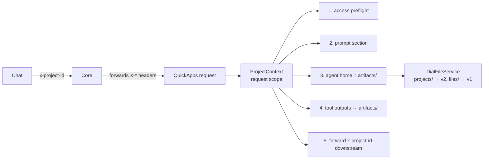

# Design: Projects support

- **Status:** Draft
- **Issue:** [I#656](https://github.com/epam/ai-dial-quickapps-backend/issues/656)
- **Dependencies:**
  - Core [I#1930](https://github.com/epam/ai-dial-core/issues/1930) (app resource dependencies), see
    [External dependencies](#external-dependencies)

## Problem Statement

- DIAL Chat ships projects (behind `PROJECTS_ENABLED`): a project holds instructions, context files and chats. On every
  model call of a project chat Chat sends one header, `x-project-id: projects/{bucket}/{path}`, and nothing else: no
  system message and no attachment ([ai-dial-chat PR#9649](https://github.com/epam/ai-dial-chat/pull/9649)).
- QuickApps ignores the header. In a project chat the agent:
  - doesn't see the project instructions or context files;
  - keeps its files in its own appdata, so chats in one project share nothing;
  - writes tool outputs to appdata, so Chat's project **Outputs** section (`artifacts/`) stays empty.
- Project files are a Core v2 resource (`projects/…`). `DialFileService` and aidial-client only speak the v1 `files/…`
  API.
- Without a grant, a file tool reports Core's 403 as an invalid parameter ("try to call the tool again",
  `common/staged_base_tool.py`), so the agent retries other paths for 30+ steps before it gives up.

## Design Goals

- `x-project-id` is the only link to the project. No app-config switch is needed.
- In a project the agent sees the project instructions and the list of context files, and works in the project's
  `artifacts/` folder. All nine file tools and `web_fetch` follow without changes.
- The agent can't modify `PROJECT.md`, `context/` or `conversations/`.
- Files that tools produce for the user land in `artifacts/` and show up in Chat's Outputs.
- No access to the project → the turn fails within one call, with a message that names the fix.
- Without the header, or with `ENABLE_PREVIEW_FEATURES=false`, behaviour is unchanged.

---

## Use Cases

### UC-1: Instructions and context in a project chat

**Trigger:** The user chats with a QuickApp inside a project that has instructions and `tickets.csv` in its context.
**Behavior:** QuickApps reads `PROJECT.md` and lists `context/`, then adds both as a system-prompt section.
**Outcome:** The answer follows the instructions, and the agent reads `tickets.csv` by its path when needed.

### UC-2: Files shared across the project's chats

**Trigger:** In chat 1 the agent saves `notes.md`. In chat 2 the user asks about something in those notes.
**Behavior:** Both chats resolve the agent home to `projects/{b}/{p}/files/artifacts/`.
**Outcome:** Chat 2 finds the note. `notes.md` also appears in the project's Outputs.

### UC-3: Tool output in a project

**Trigger:** An MCP tool returns a PDF, or the interpreter draws a chart.
**Behavior:** The file is written flat into `artifacts/` instead of the appdata root.
**Outcome:** The file is attached to the answer and listed in Outputs.

### UC-4: No access

**Trigger:** The app has no approved dependency on the project (consent missing or revoked, or a shared project that
the declaration doesn't cover).
**Behavior:** One metadata call at request start returns 401/403/404.
**Outcome:** The turn ends before any LLM call with 403 `project_access_denied` and an admin hint.

### UC-5: Agent tries to edit project instructions

**Trigger:** The agent calls `write_file` / `edit_file` / `delete_file` on `projects/{b}/{p}/files/PROJECT.md` or
`context/…`.
**Behavior:** The write guard refuses before calling Core.
**Outcome:** The tool returns a non-retryable "read-only project file" error, and the agent reports it.

---

## Proposed Design



### Decisions

| # | Decision | Why |
|---|---|---|
| D1 | The header `x-project-id` is the only link. QuickApps percent-decodes it, then re-encodes each segment the way Core returns URLs. Nested paths are allowed. | Chat's shipped contract. The header is literal for spaces and percent-encoded for non-ASCII and `%`. |
| D2 | Layout under Core's `projects/{b}/{p}/files/`: `PROJECT.md` (YAML frontmatter + body), `context/`, `conversations/`, `artifacts/`. | A shared agreement between Chat and the apps. Core imposes none. |
| D3 | Agent home in a project = `artifacts/`. `agent_home_dir` is ignored. | Chat shows `artifacts/` as Outputs and keeps it out of its `contentVersion`, so agent writes don't make the user's edit fail with 409 ([PR#9692](https://github.com/epam/ai-dial-chat/pull/9692)). |
| D4 | The agent may write only under `artifacts/`. QuickApps enforces this. | Core grants WRITE on the whole project, so it won't protect `PROJECT.md` / `context/` / `conversations/`. |
| D5 | Tool outputs keep today's naming and overwrite behaviour. Only the root changes: `artifacts/` instead of the appdata root. | Parity with non-project behaviour. Collision-safe names are a separate change. |
| D6 | Large-result offloads stay in appdata. | They are internal context, not user output, and would clutter Outputs. |
| D7 | Permissions come from Core (#1930 resource dependencies). QuickApps never grants itself anything. Phase 1 = static dependencies with admin consent. | The header carries no permission. Core forwards it but grants nothing from it. |
| D8 | Everything is a `@preview_module`. | Merge-safe before Core and Chat are generally available. |

### Project context (PR1)

- **What:** `ProjectContext` (frozen model): canonical project URL, plus `instructions_url`, `context_root`,
  `artifacts_root`. Rejects empty, `.`, `..` and `files` segments.
- **Owner:** `ProjectModule` (`shared/project/`, `@preview_module`) binds the request-scoped `PROJECT_CONTEXT` from
  `ForwardedHeaders`. `HomePathModule` binds the `None` default, so consumers always have the key.
- **Semantics:** no header, or the flag off → `None` → every consumer behaves as today.

### Project storage (PR1)

- **What:** `DialFileService` dispatches on the `projects/` prefix to a small v2 client
  (`dial_core_services/_project_files.py`). It covers read, list, write, delete, and copy/move (download + upload).
  `DialDownloader` dispatches the same way.
- **Semantics:**
  - Same size limits and error mapping as v1.
  - Conditional writes: Core checks `If-Match` against the **project** ETag, which every write changes. So: read the
    project ETag (`GET /v2/metadata/projects/{b}/{p}`) → check the file's own ETag → `PUT If-Match: <project ETag>`
    → retry on 412 (5 attempts). This is the same flow as Chat.
- **Change:** the v2 client reuses AsyncDial's HTTP client (base URL, auth, timeouts, typed 404/412). It is replaced by
  aidial-client once that has a v2 project API.

### Agent home, prompt and write guard (PR2)

- **Home:** `HomePathResolver` returns `artifacts_root` when a project is present, and appdata otherwise. `projects/` is
  accepted as an absolute prefix next to `files/` in the path transformer, `reject_absolute_path`, `web_fetch` and
  `classify_url`.
- **Prompt:** a `PromptPartProvider` adds two sections:
  - "Project instructions": the `PROJECT.md` body, with the frontmatter stripped;
  - "Project files": the working folder first ("holds files from earlier chats"), then the `context/` files by full
    path, read-only.
- **Guard:** a write, edit, delete or move whose target is under the project but outside `artifacts/` fails with a
  non-retryable permission error before calling Core.
- **Unchanged:** app context files (absolute `files/…` URLs) and message attachments work as before. Agent appdata is
  reachable only by full URL.

### Access preflight and 403 handling (PR2)

- **Preflight:** before the first LLM call, one `GET /v2/metadata/projects/{b}/{p}` with the per-request key. A
  401/403/404 raises `ProjectAccessDeniedException` → wire status 403, `code: project_access_denied`, with the message
  "An administrator must approve the app's access to projects (resource dependencies)".
- **File tools:** a Core 403 becomes a non-retryable permission error instead of `InvalidToolCallParameterException`.

### Downstream propagation (PR3)

- Forward `x-project-id` explicitly to nested DIAL apps and MCP toolsets, not through the `X-*` catch-all, so it
  survives any later tightening of that list.
- Nested apps declare and get their own grants (#1930 resolves dependencies at every hop of a chain).
- `AttachmentResolver`: home-relative and `projects/` URLs pass through without the v1 metadata call.
- Remove the remaining `files/`-only assumptions: lazy `get_content`, `config/dial_files.py`, the attachment
  strategies.

### Tool outputs into `artifacts/` (PR4)

- `AttachmentService.upload_bytes` and the interpreter's `_publish_to_bucket` (folded into `AttachmentService`) take
  their root from `HomePathResolver`: `artifacts/` in a project, the appdata root otherwise (unchanged).
- Covers MCP files, REST response files, interpreter charts and promoted external URLs. `OffloadProcessor` keeps
  appdata (D6).

### External dependencies

Status checked on 2026-11-05.

| # | Owner | Need | Status | Blocks |
|---|---|---|---|---|
| C1 | Core | #1930: `projects` as a declarable target type (`projects/{current-user}/`) | The stack is not on `development`: rd/1–rd/3 are open ([PR#1940](https://github.com/epam/ai-dial-core/pull/1940)–[1942](https://github.com/epam/ai-dial-core/pull/1942)), rd/4–rd/9 are merged into rd/3. `projects` is not declarable until the stack is rebased ([PR#1946](https://github.com/epam/ai-dial-core/pull/1946)). | Any project access through Core: PR2 end to end, PR4 |
| C2 | Admin UI | Resource Dependencies tab + `projects` targets | [admin-frontend PR#5313](https://github.com/epam/ai-dial-admin-frontend/pull/5313) open. Consent works only for apps the admin can see (public). | Rollout |
| C3 | Core | Per-file ETags (today `If-Match` is checked against the project ETag) | Not planned | Performance only (3 calls per conditional write) |
| C4 | Ecosystem | `projects/` v2 URLs in adapter-dial, RAG, code interpreter, aidial-client | Nothing started | Sub-agents and interpreter on project files (out of scope) |
| C5 | Memory | User vs project scope (the server receives the header but ignores it) | Undecided | Project-scoped memory (out of scope) |

- **Grant scope:** the declaration `projects/{current-user}/` opens **all** of the user's own projects, not just the
  one in the header. Accepted for phase 1.
- **Shared projects:** Chat lets edit-access recipients chat in a shared project
  ([PR#9733](https://github.com/epam/ai-dial-chat/pull/9733)), so the header bucket can be another user's.
  `projects/{current-user}/` doesn't cover it, so UC-4 applies (see Out of Scope).
- **Proven locally** (Core with #1930 + a `projects` target patch, admin-frontend PR#5313, Chat `development`):
  instructions, read, write and cross-chat sharing with the per-request key; a nested app gets its own grant; revoking
  consent → UC-4 in ~1 s.

---

## Out of Scope

| Item | Why deferred / what it needs |
|---|---|
| Passing project files to sub-agents and deployments (RAG, adapters) | C4; Core also refuses to share a single project file downstream. Nested QuickApps work through their own grant. |
| Interpreter reading project files | C4 (v2 in the interpreter), plus accepting agent-home paths as inputs |
| Project-scoped memory | C5 |
| Shared projects (chatting in another user's project) | `projects/{current-user}/` covers only the user's own bucket. Needs a Core grant for shared projects; until then UC-4. |
| Dynamic dependencies / "consent required" signal (ask the user mid-turn, resume after approval) | Announced by Core, no issue or error format yet |
| Collision-safe output names | Same gap outside projects (MCP `uri` names and promoted URLs overwrite). A separate change for both. |
| MCP `dial_url` per-file grants on `projects/` URLs | Unverified. Relies on #1930 covering toolsets. |

---

## Configuration / Usage Examples

App declaration with #1930 (phase 1). It covers all of the user's own projects:

```json
"resourceDependencies": [
  { "kind": "...", "linkId": "project-read",  "target": { "path": "projects/{current-user}/" }, "access": "READ",  "required": true },
  { "kind": "...", "linkId": "project-write", "target": { "path": "projects/{current-user}/" }, "access": "WRITE", "required": true }
]
```

Record shape per Core [PR#1940](https://github.com/epam/ai-dial-core/pull/1940) (`kind`, `linkId`, `target.path`,
`access`, `required`). Exact `kind` values are to be confirmed when the stack lands.

Paths in a project `projects/{b}/My%20Project`:

| Agent says | Resolves to |
|---|---|
| `notes.md` | `projects/{b}/My%20Project/files/artifacts/notes.md` |
| `projects/{b}/My%20Project/files/context/tickets.csv` | read ✅, write ❌ (guard) |
| `files/{bucket}/appdata/…/x.md` (app context) | unchanged, v1 |

---

## Migration

### Breaking changes

None. Everything is preview-gated and triggered only by the header.

### Non-breaking changes

- File tools report Core 403 as a non-retryable permission error (outside projects too).
- `x-project-id` is forwarded explicitly (it is already forwarded today by the `X-*` catch-all).

## Delivery

| PR | Scope | Depends on | Merge-safe without Core |
|---|---|---|---|
| 1 | `ProjectContext`, `ProjectModule`, v2 client, `DialFileService` / `DialDownloader` dispatch, conditional write | — | yes (no header → no-op) |
| 2 | Home = `artifacts/`, prompt section, write guard, preflight, 403 mapping | PR1 | yes (without C1 a project chat ends with UC-4) |
| 3 | Explicit header forwarding, attachment resolver, remaining `files/` assumptions | PR2 | yes |
| 4 | Tool outputs into `artifacts/` | PR2 | yes, useful after C1 |
| 5 | Core-path integration suite (per-request key) in CI | PR1–4, C1 released | n/a |

## Summary of Changes

| Component | Change |
|---|---|
| `shared/project/` (new) | `ProjectContext`, `ProjectModule` (`@preview_module`), project prompt provider, access preflight |
| `shared/home_path/` | `PROJECT_CONTEXT` default `None`; home = `artifacts/` in a project |
| `dial_core_services/` | `_project_files.py` (v2 client); `projects/` dispatch in `DialFileService`, `DialDownloader`; `AttachmentService` root from `HomePathResolver` |
| `dial_files_tooling/`, `web_tooling/`, `common/url_classification.py` | `projects/` as an absolute prefix; write guard |
| `common/staged_base_tool.py`, `core/application/_exception_message_resolver.py` | 403 → non-retryable permission error; `ProjectAccessDeniedException` → 403 `project_access_denied` |
| `common/forwarded_headers.py`, `dial_deployment_tooling/_attachment_resolver.py`, `mcp_tooling/` | Explicit `x-project-id` forwarding; `projects/` URLs pass through |
| `internal_tooling/py_interpreter_tooling/handlers/display_content_processor.py` | `_publish_to_bucket` folded into `AttachmentService` |
