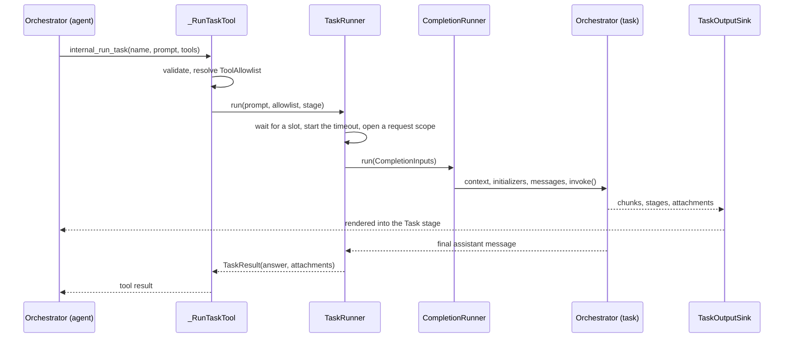

# Design: Run task tool (`internal_run_task`)

- **Status:** Draft
- **Dependencies:**
  - [Dynamic tool discovery](dynamic_tool_discovery.md): an explicit tool list turns it off in the task.
  - [Hook context and lifecycle events](hook_context_and_lifecycle_events.md): a task inherits some hooks.
- **Issue:** [#181](https://github.com/epam/ai-dial-quickapps-backend/issues/181)
- **History:** replaces the subagents design from [PR #513](https://github.com/epam/ai-dial-quickapps-backend/pull/513)
  (closed without merging). That PR's run machinery is ported; declared subagent types are dropped.

## Problem Statement

An agent that needs a result from several tool calls (search, read, compute) carries every intermediate
result in its context, even when it only needs the conclusion. There is no way to hand a self-contained
piece of work off and get back just the answer.

## Design Goals

- The agent can run a self-contained task in an isolated context and receive only its final answer.
- The agent chooses the task's tools per call, and can never give a task a tool it doesn't have itself.
- A task gets the same config resolution and initialization checks as a user request.
- Tasks are bounded in time and in concurrency per process.
- A failed task reaches the agent as an error, never as an empty successful answer.

---

## Use Cases

### UC-1: Parallel lookups

**Trigger:** The user asks to compare the weather in three cities.
**Behavior:** The agent calls `internal_run_task` three times in one turn, each with only the location and
weather tools.
**Outcome:** Three `Task: <name>` stages show progress; the agent receives three one-line answers and ranks them.

### UC-2: Reasoning-only task

**Trigger:** The agent wants a long text summarised without keeping the reasoning in its context.
**Behavior:** It calls the tool with `tools: []` and the text in `prompt`.
**Outcome:** The task gets no capability tools and returns only the summary.

### UC-3: Unknown tool name

**Trigger:** The agent names a tool that doesn't exist.
**Behavior:** The call fails before any task runs; the error lists the valid names.
**Outcome:** The agent retries with a valid list.

### UC-4: Task runs out of time or iterations

**Trigger:** A task hits its timeout or its `max_iterations` budget.
**Behavior:** The tool call fails with an error saying which limit was hit.
**Outcome:** The agent retries with a narrower task, or answers without it.

---

## Proposed Design

### Tool contract

Owner: `_RunTaskTool`. `internal_run_task(name: str, prompt: str, tools: list[str])`, enabled per app by the
preview field `features.run_task` (`enabled`, `max_iterations`, `timeout_seconds`). With `features.run_task`
omitted or `null`, the tool is off; `enabled` defaults to `false`.

- `name` — a short label written by the model, used as the stage title. Not logged.
- `prompt` — the complete task. It is the task's only message; see [What a task inherits](#what-a-task-inherits)
  for the rest of its context.
- `tools` — `["inherit"]` (or a bare `"inherit"`) means every tool the agent sees except `internal_run_task`;
  otherwise a list of exact tool names. `"inherit"` must be the only item. The tool-schema models have no
  `anyOf`, so the `"inherit" | list[str]` union is carried by an array with one reserved value.
- Unknown names fail the call with `InvalidToolCallParameterException`, listing the valid names (capped at 60).
- An explicit list always also gets the readers for content the task can be pointed at regardless of the list:
  - `internal_skills_read_skill`, `internal_attachments_available_context`, `internal_attachments_get_content`,
    `read_mcp_resource` — their prompt parts are always rendered;
  - `internal_file_read_lines`, `internal_file_search` — an offloaded tool result points at them.

  `[]` therefore means "no capability tools". Names the app doesn't have are harmless: the allowlist only narrows.

The valid names come from `_DelegableToolNames`, which resolves `list[StagedBaseTool]` and `list[StaticTool]`
lazily at call time: the tool is itself part of that list, so resolving it at construction would cycle. Deferred
tools are included; model-hidden and client tools are not, and neither are `internal_run_task` and
`internal_tool_search`.

### Child run lifecycle



Ported from PR #513:

- **`CompletionInputs`** (`common/completion_inputs.py`) — everything one run needs. `from_request` is the only
  reader of the SDK request.
- **`CompletionRunner`** (`core/application/`, behind `BaseCompletionRunner` in `common/abstract/`) — context →
  initializers → messages → initialization issues → orchestrator. The HTTP handler and the task runner both use it,
  so `task_tooling` never imports `core`.
- **`TaskRunner`** (`task_tooling/`) — compiles the child manifest, enters a fresh request scope inside its own
  `asyncio.Task` (the scope key is a `ContextVar`, copied per task, so scopes can't leak), and runs the
  `CompletionRunner` with the caller's credentials, forwarded headers, language and time zone.
- **`compile_task_manifest`** — deep copy of the parent's **resolved** manifest, narrowed as in the table below.
  `_RequestContextSetup` runs `ConfigResolver` over it again, which relies on resolution staying idempotent.
- **`TaskOutputSink`** — backs the child's `Choice`; renders its prose and closed stages into the `Task` stage and
  collects attachments for the tool result.

### What a task inherits

| Item | In the task |
|---|---|
| Deployment, toolsets, contexts, skills, MCP resources | Inherited |
| `on_request_start` hooks | Inherited; they see the task prompt as the last user message. See the note below |
| Other hook events (`on_completion`, any added later) | Cleared, so `on_completion` fires once per user turn |
| System prompt | The built-in task prompt, then the app's prompt under "Rules from the application" |
| `max_iterations` | Inherited, unless `features.run_task.max_iterations` is set |
| Tool discovery | Inherited with `inherit`; turned off with an explicit list |
| `features.run_task`, conversation starters | Cleared (depth 1) |
| Conversation history and attached files | Not passed; the prompt is the only message |
| Client tools | None |
| Credentials, forwarded headers, language, time zone | The caller's |

The compiler deep-copies the manifest and changes only the rows above: **a manifest field added later is
inherited unless the compiler clears it**, and a new hook event runs in tasks only once it's added to the
compiler's list. Whoever adds either decides.

Claude Opus 4.6 and 4.7 ignore a hook result when its tool isn't in `tools`
([known issue](../hooks.md#known-issues)), and an explicit list makes that more likely. The built-in task prompt
carries the documented workaround paragraph; see also [Run Task known issues](../agent.md#run-task).

### Tool filtering

A `ToolAllowlist` (`names: frozenset[str] | None`, `None` = all) travels on `CompletionInputs` into the request
context and is provided by `AppModule`. It is never set from an HTTP request. It is applied in three places:

1. `AgentModule.provide_openai_tools` — what the model sees (staged and static tools).
2. `ToolExecutor` — what can run; a disallowed call gets the existing unknown-tool reply.
3. `ChatStreamSinkFactory` — which tools may open a streaming stage.

Framework-driven paths (hooks, synthetic injectors) stay unfiltered.

Deferred tools: with an explicit list, the compiler sets `orchestrator.tool_discovery = None`. A named deferred
tool then becomes a regular tool, `internal_tool_search` disappears, and nothing outside the list can be loaded.
With `inherit`, the app's discovery setup is kept. `"inherit"` needs no filter at all: clearing
`features.run_task` removes the tool itself, and the child has no client tools.

### Limits and failures

Owners: `RunTaskSettings`, `TaskSemaphore`, `TaskRunner`.

- `RUN_TASK_MAX_CONCURRENT` (4) is a process-wide semaphore; extra tasks wait for a slot. There is no per-request
  share: one turn that fans out into four tasks holds every slot on the replica until they finish. This keeps the
  model simple; a per-request cap can be added under the process-wide one if it becomes a problem.
- `RUN_TASK_TIMEOUT_SECONDS` (600) caps one task; `features.run_task.timeout_seconds` may shorten it. The wait for
  a slot and the run each get this budget: queue time isn't charged to the run, and the wait itself is bounded, so
  a busy replica fails the call instead of stalling it indefinitely. Worst case, one call takes twice the budget
  (wait plus run): 20 minutes with the defaults.
- Task tokens reach the turn's usage table through `ToolCallResult.usage`: the task's own model calls get a row
  under the tool's name, and tools it called keep their rows. The child also shows its own usage stage inside
  the `Task` stage.
- On timeout or cancellation, the child's open stages close as failed and still render in the `Task` stage;
  attachments on those stages have already reached the parent. Only choice-level attachments collected so far
  are lost. A client disconnect cancels running tasks with the parent request.

Every failure reaches the agent as an error through the tool's fallback, so it can retry:

| Failure | Error the agent gets |
|---|---|
| Malformed arguments, `"inherit"` mixed with names | `InvalidToolCallParameterException` naming the problem |
| Unknown tool names | `InvalidToolCallParameterException` listing the valid names |
| No slot frees up in time | `TaskToolErrorException`: "Too many tasks are running right now" |
| Timeout | `TaskToolErrorException`: "did not finish within its Ns budget" |
| `max_iterations` exhausted | `TaskToolErrorException`: "ran out of its max_iterations budget" |
| Empty or missing final answer | `TaskToolErrorException`: "finished without an answer" |
| Task config can't be resolved (defensive: the manifest is already resolved) | `TaskToolErrorException`: "configuration could not be resolved" |
| A tool in the task hits a `hard_stop` fallback | The whole turn stops, as it would if the agent had called the tool |
| Any other exception in the task (model API error, uncaught tool error) | The tool's catch-all fallback forwards the error text |

### Alternatives considered

- **Wire a QuickApp in as a DIAL deployment tool** (the existing subagent route,
  [subagents conversation mode](subagents_conversation_mode.md)). It needs a separate deployed app per kind of
  task, chosen by the builder in advance, and a round-trip through DIAL Core. A task here is ad hoc: the agent
  writes the prompt and picks tools per call, from the tools it already has.
- **Replace the app's system prompt, or keep it.** Replacing it entirely would drop the builder's rules
  (guardrails, output language, tool-usage rules) in a task, while `inherit` hands the task every tool. Prepending
  the task prompt to the app's prompt keeps the rules but buries the task framing under app instructions written
  for a conversation. The task prompt comes first and the app's prompt follows as a labelled section, so the
  framing leads and the rules still apply, at the cost of the app prompt's tokens per task.
- **A separate task timeout** next to the unified tool timeouts ([configurable timeouts](configurable_timeouts.md)).
  `tool_defaults.timeout_seconds` bounds one client call and may raise the env default; the task budget bounds a
  whole agent run on the replica's shared event loop, so an app may only shorten the admin ceiling.
- **Reuse the parent's tool instances** instead of a fresh scope. That saves re-initialization (MCP connects,
  skill fetches, `on_request_start` hooks run again per task), but tool instances hold request-scoped state, and
  sharing them would break isolation between parallel tasks. A fresh scope also gives the task the same
  initialization checks as a user request. The cost: if a toolset fails to initialize in the child, an explicit
  list that passed validation runs with fewer tools. The initialization issues are rendered to the user inside the
  `Task` stage, not reported to the agent, and the parent's own issues repeat in every task. Initialization isn't
  narrowed either: the allowlist filters after it, so even `tools: []` initializes every toolset (e.g. connects to
  every MCP server). And because the task forwards the user's client channel, a sign-in the user denied or let
  time out in the parent prompts again in each task, and that wait counts against the task's budget.
- **Declared task types** with fixed prompts and tools (PR #513). Review found that agent-chosen tools cover the
  use cases in #181 with far less configuration; types can be added later on top of this tool.

---

## Out of Scope

- Declared, builder-authored task types: not needed for #181's use cases; can be layered on later.
- A per-task model override: the task uses the app's deployment until there's a need for cheaper task models.
- Nested tasks (depth > 1): bounded cost and simpler reasoning about limits come first.
- A "fork" mode that copies the conversation history into the task: it defeats the context saving that motivates
  the tool.
- Skipping toolsets that hold no listed tool, or that failed in the parent: needs a name-to-toolset map from the
  parent's tools; a follow-up if initialization cost or repeated sign-in prompts show up in practice.
- A per-request share of the task slots: see Limits.
- Telling the agent when a tool it named failed to initialize in the task: the user sees the issue in the `Task`
  stage; surfacing it in the tool result is a follow-up.

## Configuration / Usage Examples

Manifest:

```json
{
  "features": {
    "run_task": { "enabled": true, "max_iterations": 10, "timeout_seconds": 120 }
  }
}
```

Tool-call arguments:

```json
{ "name": "Survey the repo", "prompt": "List the modules that import httpx.", "tools": ["inherit"] }
{ "name": "Berlin weather", "prompt": "What is the weather in Berlin now?", "tools": ["get_location", "get_weather"] }
{ "name": "Summarise notes", "prompt": "Summarise the text below in five bullets: ...", "tools": [] }
```

## Migration

### Breaking changes

None.

### Non-breaking changes

A new preview field `features.run_task`, two env vars (`RUN_TASK_TIMEOUT_SECONDS`, `RUN_TASK_MAX_CONCURRENT`),
and regenerated schema files.

## Summary of Changes

- `common/completion_inputs.py` — `CompletionInputs`; `_RequestContextSetup.setup_context(inputs)` takes it.
- `common/abstract/completion_runner.py`, `core/application/_completion_runner.py` — `BaseCompletionRunner`,
  `CompletionRunner`; the HTTP handler becomes an adapter over them.
- `common/tool_allowlist.py` — `ToolAllowlist`, applied in `agent_module.py`, `tool_executor.py`,
  `chat_stream_sink_factory.py`.
- `config/run_task.py` — `RunTaskConfig`; `Features.run_task` as a `PreviewField`.
- `common/abstract/completed_run.py` — `CompletedRun`, what a caller reads from a finished run (usage);
  `Orchestrator.usage_statistics` provides it.
- `common/staged_base_tool.py` — `FallbackAgentStopException` passes through a tool body.
- `task_tooling/` — `TaskToolingModule` (`@preview_module`), singletons `RunTaskSettings` and `TaskSemaphore`,
  `TaskRunner`, `_RunTaskTool`, `_DelegableToolNames`, `_TaskStageWrapper`, `compile_task_manifest`,
  `TaskOutputSink`.
- Docs: `CONFIGURATION.md`, `docs/agent.md`, `docs/README.md`; a `run_task_demo` app in
  `docker_compose_files/core/configuration/applications.json`.
