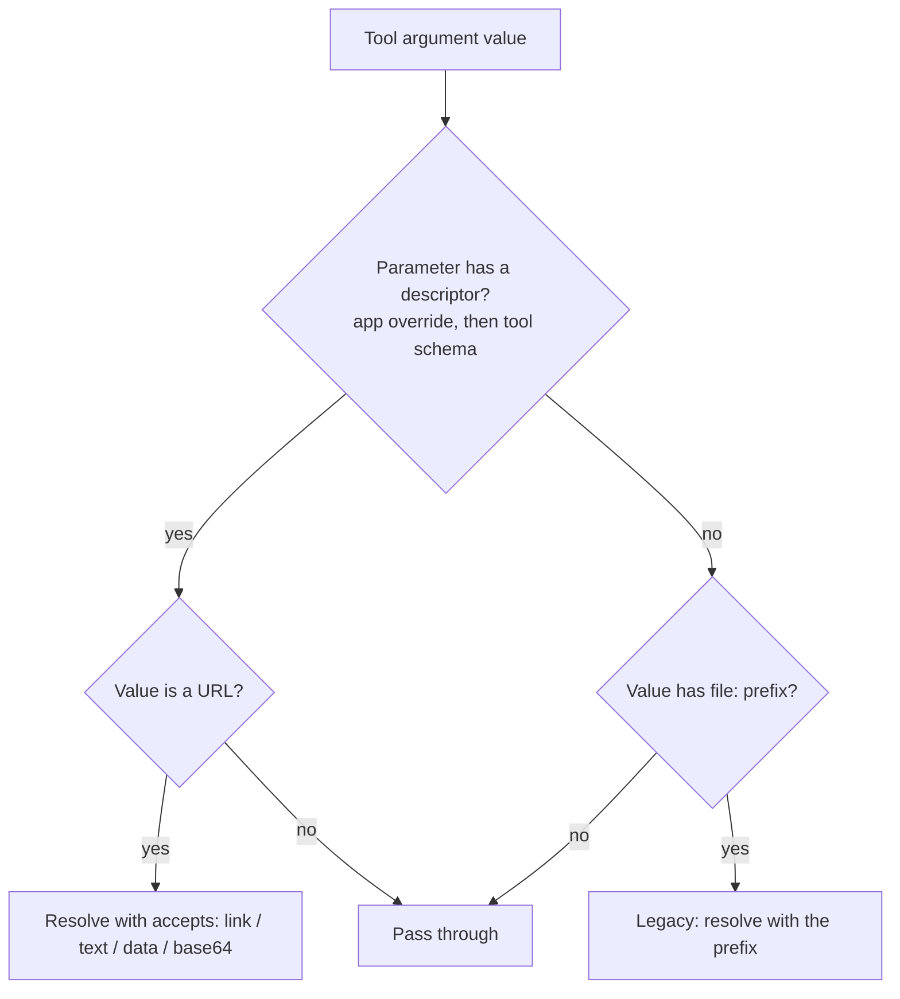

# Design: Schema-Declared File Parameters

- **Status:** Draft
- **Issue:** TBD
- **Dependencies:**
  - [Skill File References in Tool Calls](skill_file_references.md) ([#420](https://github.com/epam/ai-dial-quickapps-backend/issues/420))
    — ships first; this design builds on its skill-URL resolver and `dial_url` resource-type list.

## Problem Statement

Every file a tool needs reaches it through the `file:{prefix}::{url}` convention
([Skills and File Transfer](skills_and_file_transfer.md)): the **model** decides, per call, whether the tool wants the
link (`url`), the text (`text`), a `data:` URI (`data`) or raw base64 (`base64`), by reading the parameter's free-text
description. That has costs:

- **Non-deterministic.** The same tool may get `data` on one call and `base64` on the next; a wrong pick is a failed
  call, and a missing prefix is a reject-and-retry turn.
- **Always-on context.** The `tool-call-file-parameter-formatting` skill is injected into **every** conversation, even
  when no configured tool takes a file.
- **Two handles per file.** The model sees a file as a plain URL (attachments, `<skill_files>`) but must rewrite it
  into a prefixed form for each tool call.
- **Split knowledge.** `dial_url: true` already lets a tool declare "this parameter takes a DIAL link" — but only that
  one mode, and only for MCP; the other three modes have no declaration at all.

## Design Goals

- **G1 — One handle.** The model passes a file as its plain URL — `files/...`, `skills/.../files/...` or `https://...`
  — to every tool, with no prefix.
- **G2 — Deterministic delivery.** What a tool receives for a file is decided by the parameter's declaration, not by
  the model.
- **G3 — Tool independence.** QuickApps reads what a parameter declares; it never special-cases a tool by name.
- **G4 — Works for tools that declare nothing.** Third-party MCP and REST tools that will never add a DIAL key can still
  receive files.
- **G5 — Smaller context.** No always-injected formatting instructions for apps whose tools all declare their file
  parameters.
- **G6 — Backward compatible.** Existing conversations and skills keep working.

---

## Use Cases

### UC-1: Declared parameter

**Trigger:** An interpreter's `code` parameter declares `accepts: text`; the model passes
`skills/<bucket>/pdf-page-count/files/scripts/count_pages.py`.
**Behavior:** QuickApps resolves the URL (containment, inventory, size) and replaces it with the file's text.
**Outcome:** The tool runs the script; the model wrote a plain URL.

### UC-2: Undeclared third-party tool, admin override

**Trigger:** A third-party MCP tool's `image` parameter wants a `data:` URI but declares nothing; the app author marks
it `accepts: data` in the app config.
**Behavior:** The override is read exactly like a tool's own declaration.
**Outcome:** The tool receives `data:image/png;base64,…` without the model knowing the format.

### UC-3: Undeclared parameter, no override

**Trigger:** The model passes `https://example.com/page` to a browser tool's `target_url`, which declares nothing.
**Behavior:** The value is passed through unchanged — no download, no egress.
**Outcome:** Same as passing any other string; a link-looking value is never fetched unless a declaration asks for it.

### UC-4: Old conversation with prefixed arguments

**Trigger:** A conversation from before this change holds `file:text::…` calls in its history, and the model imitates
them.
**Behavior:** The prefix is still honored as a fallback.
**Outcome:** The call works; nothing in old histories needs rewriting.

---

## Proposed Design

### The file-parameter descriptor

`dial_url` grows from a flag into a descriptor on a parameter's JSON schema:

```json
"code":            { "type": "string", "dial_file": { "accepts": "text" } }
"script_url":      { "type": "string", "dial_file": { "accepts": "link", "resources": ["files", "skills"] } }
"attachment_urls": { "type": "array",  "items": { "type": "string" },
                     "dial_file": { "accepts": "link", "resources": ["files", "skills"] } }
```

| `accepts` | Tool receives | Notes |
|---|---|---|
| `link` | the URL, unchanged | containment check; `files/` grants as today; `resources` limits which kinds are allowed |
| `text` | UTF-8 content | binary rejected, as `file:text::` today |
| `data` | `data:<mime>;base64,<payload>` | |
| `base64` | raw base64 | |

- **Compatibility:** `dial_url: true` ≡ `{accepts: link, resources: [files]}`; #420's `dial_url: ["files", "skills"]`
  ≡ `{accepts: link, resources: [files, skills]}`. Both keep working; the key name (`dial_file` vs. evolving
  `dial_url`) is an open question.
- **Arrays:** the descriptor on an array applies to each string element.
- **Owner:** the tool, in its own schema (MCP `inputSchema`, internal tool schema, REST tool config).

### Where declarations come from

Precedence, highest first:

1. **App-config override** — the parameter entry in the app's tool schema (`ConfigurableSchemaSimpleType`, where
   `display` and const-valued fixed arguments already live). Lets an app author cover a tool that declares nothing, or
   correct one that declares wrongly.
2. **The tool's own schema.**
3. **Nothing** — the value passes through unchanged, except for the prefix fallback below.

### Conversion

`FileArgumentTransformer` changes its trigger, not its machinery:

- **Today:** a value matching `file:{prefix}::` → resolve with that prefix.
- **New:** a parameter with a descriptor → resolve its value with `accepts`; the value is a plain URL.
- Resolution reuses `FileLoaderService` and its sources: DIAL files, external URLs (egress policy unchanged), and skill
  files ([#420](skill_file_references.md)'s resolver).
- A declared parameter whose value is not a URL (e.g. inline code the model wrote itself on a `text` parameter) is
  passed through unchanged, so declaring `code` as `text` does not stop the model from writing code.

### Prefix as fallback

- `file:{prefix}::` keeps working on **undeclared** parameters (UC-4, and tools nobody has declared yet).
- On a declared parameter, the declaration wins; a prefix is stripped and ignored, with a debug log.
- The built-in `tool-call-file-parameter-formatting` skill is injected only when at least one configured tool has an
  undeclared parameter that looks file-shaped — or always, until declarations are widespread (open question).



### What the model sees

- Tool schemas unchanged in shape; a declared parameter's description can say "a file URL" — QuickApps may append that
  hint automatically.
- No prefix to choose; attachment URLs and `<skill_files>` URLs are passed as-is.
- Formatting instructions only where the fallback still applies.

---

## Out of Scope

| Item | Why deferred |
|---|---|
| Converting tool **outputs** (embedded resources → attachments) | Already handled per tool type; unrelated to argument delivery |
| Auto-detecting file parameters from descriptions | Non-deterministic — the problem this design removes |
| Removing the prefix entirely | Needed for old histories and undeclared tools; revisit once declarations are widespread |
| Partial-value references (`--input=files/…`) | Whole-value matching stays; tools that need it take a separate `args` list |

## Open Questions

1. **Key name** — evolve `dial_url` (bool → list → object) or introduce `dial_file` and treat `dial_url` as legacy.
   Coordinate with DIAL Core, which reads `dial_url` for permission semantics.
2. **Polymorphic parameters** — a parameter documented as "http, https or data: URI" accepts both a link and inline
   content. Allow `accepts: [link, data]` with the first as preference, or require one mode?
3. **When to inject the formatting skill** — on undeclared file-shaped parameters only (needs a heuristic) or always
   until a cut-over.
4. **Editor support** — exposing the app-config override in the Quick Apps editor (ai-dial-chat) as a per-parameter
   "file mode" control.
5. **Size and egress** — a declaration makes downloads implicit for that parameter; confirm the per-app size limit
   and `external_url_fetch` policy apply unchanged.

## Migration

### Non-breaking changes

- `dial_url: true` and #420's resource-type list keep their meaning.
- `file:{prefix}::` keeps working on undeclared parameters; old conversations need no changes.
- Tools and apps opt in by declaring; nothing changes for those that do not.

### Behavior change on declared parameters

- Once a parameter is declared, a prefix on it is ignored in favour of the declaration — a model that picked the wrong
  prefix now gets the right delivery.

## Summary of Changes

| Component | Change |
|---|---|
| Tool schema (all tool types) | `dial_file` descriptor (`accepts`, `resources`) on parameters; `dial_url` mapped onto it |
| App config (`ConfigurableSchemaSimpleType`) | optional per-parameter override of the descriptor |
| `file_transfer/_file_argument_transformer.py` | trigger on the descriptor; prefix as fallback for undeclared parameters |
| `mcp_tooling/_mcp_tool.py` | `_collect_dial_url_files` driven by the descriptor (`accepts: link`) |
| `config/predefined/skills/tool-call-file-parameter-formatting` | scoped to fallback use; injected conditionally |
| `docs/file_transfer.md` | the declaration model; the prefix as legacy |
