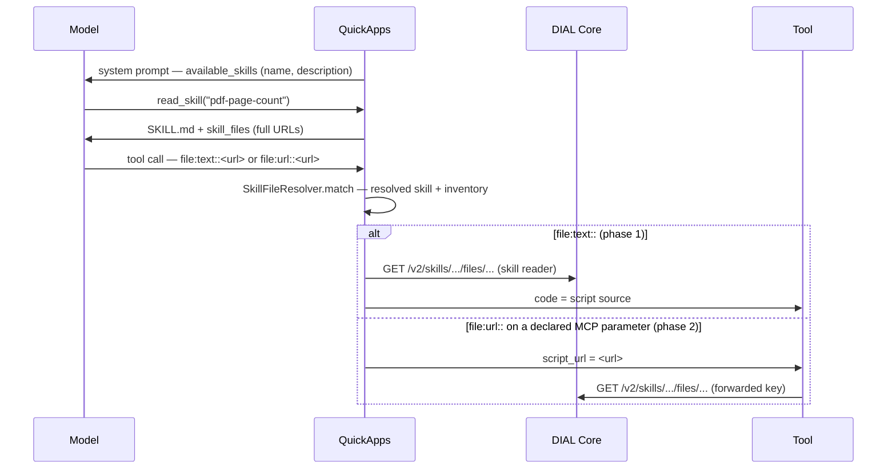

# Design: Skill File References in Tool Calls

- **Status:** Draft
- **Issue:** [epam/ai-dial-quickapps-backend#420](https://github.com/epam/ai-dial-quickapps-backend/issues/420)
  (epic [#421](https://github.com/epam/ai-dial-quickapps-backend/issues/421))
- **Dependencies:**
  - Code-interpreter boundary ([#424](https://github.com/epam/ai-dial-quickapps-backend/issues/424)) — see
    [Interpreter independence](#interpreter-independence): neither phase hard-codes an interpreter, so this design does
    not wait on that decision.
  - Phase 2 only: the tool must be able to read a skill file with the credentials it receives
    ([Open Questions](#open-questions) Q2).
  - Phase 2 only: the AWS code interpreter MCP declares skill support on `script_url` / `attachment_urls` with the
    capability marker (see [Capability declaration](#capability-declaration-phase-2-mcp)).

## Problem Statement

A DIAL skill resource can bundle scripts (`scripts/count_pages.py`), but the agent has no way to hand one to a tool:

- The model never sees where a skill lives. `<available_skills>` carries no URL; `read_skill` returns the manifest
  plus `<skill_files>` paths **relative** to the skill root. No URL, no bucket.
- The `file:` pipeline (`FileArgumentTransformer` → `FileLoaderService`) accepts `files/...` paths and external URLs
  only (`classify_url`). A `skills/...` URL classifies as `DIAL_APPDIR_RELATIVE`, and on MCP parameters marked
  `dial_url` it is rejected before the tool runs (`_collect_dial_url_files`).
- Code-execution tools take code either inline (`code`) or as a DIAL link (`script_url`, `attachment_urls`).

Observed on dev (2026-10-22, `pdf-page-count` skill + "Python Code Interpreter" toolset): the model either invents a
link (`script_url: "files/public/scripts/script.py"` → HTTP 404) and gives up, or falls back to writing its own code,
so the skill's tested script never runs. The working-today workaround — `read_skill(file_path=...)`, then paste the
source into `code` — costs a turn plus the script's tokens twice (read, then emit), and the model may alter the script
while copying it.

## Design Goals

- **G1 — Run the script unchanged.** The bytes the tool runs are the bytes in the skill.
- **G2 — Keep content out of the model.** The model handles a reference, never the script body: no extra
  `read_skill` turn, no script tokens in the context.
- **G3 — Interpreter independence.** QuickApps never knows which tool consumes a file. The internal `py_interpreter`
  today, an AWS AgentCore MCP interpreter tomorrow, a REST tool after that — all work without QuickApps changes, and a
  skill author does not target a specific tool. What QuickApps may know is what a tool **declares** about itself.
- **G4 — Contained.** Every skill URL QuickApps **delivers** — inlined, or forwarded as a link — resolves to a file in
  the inventory of a skill resolved for the current request, the same boundary `read_skill` enforces. A bare string on
  a parameter nobody declared stays opaque data, exactly as a bare `files/...` string is today.
- **G5 — No copies.** Skill files stay where they are; nothing is duplicated into file storage per user or per call.
- **G6 — One handle.** The model uses one string for a bundled file everywhere — `read_skill`, `file:text::`,
  `file:url::` — and that string is the URL DIAL Core serves the file under, so nothing has to translate it.

---

## Use Cases

### UC-1: Run a bundled script with any interpreter (phase 1)

**Trigger:** The user attaches `report.pdf` and asks for its page count; the `pdf-page-count` skill bundles
`scripts/count_pages.py`.
**Behavior:** The model reads the skill, copies the script's URL from `<skill_files>`, and calls the configured Python
tool with `code: "file:text::skills/<bucket>/pdf-page-count/files/scripts/count_pages.py"`.
**Outcome:** The tool receives the script source as `code`; the model's context holds only the URL.

### UC-2: One skill, two interpreters (verifies G3)

**Trigger:** The same skill is added to two apps: app 1 uses the internal `py_interpreter` (no skill support
declared), app 2 uses the AWS code interpreter MCP (skill support declared on `script_url`).
**Behavior:**
- App 1: the model inlines the script into `py_interpreter`'s `code` with `file:text::<url>`.
- App 2: the model may do the same with `execute_python`'s `code`, or pass `file:url::<url>` as
  `run_python_script`'s `script_url`, which QuickApps forwards for the interpreter to fetch.

**Outcome:** The script runs in both apps with the same `SKILL.md`, and QuickApps contains no code naming either
interpreter — only the skill-file resolver and the capability check.

### UC-3: A skill-aware tool fetches the file itself (phase 2)

**Trigger:** An MCP tool parameter declares skill support, and the skill needs `argv`, a binary asset, or several
files.
**Behavior:** The model writes `file:url::skills/<bucket>/pdf-page-count/files/scripts/count_pages.py`; QuickApps
checks containment and passes the URL on.
**Outcome:** The tool fetches the file from DIAL Core itself; nothing is copied.

### UC-4: Tool does not support skill URLs

**Trigger:** The model writes `file:url::<skill url>` for a parameter that did not declare skill support — any
parameter of a REST, internal or deployment tool, or an MCP parameter without `"skills"` in its marker.
**Behavior:** `FileArgumentTransformer` rejects the call before the tool runs.
**Outcome:** A parameter error telling the model to inline the file with `file:text::<url>` instead.

### UC-5: Out-of-scope or unreadable reference

**Trigger:** The model delivers a `skills/...` value that is not under a skill resolved for this request, a file not
in its inventory (including a skill that moved or was re-uploaded since an earlier turn), a file over
`file_max_bytes`, or a file Core fails to serve — with any `file:` prefix, or bare on a declared MCP parameter.
**Behavior:** The tool call (or `read_skill`) is rejected; the value never falls back to the generic file path.
**Outcome:** A skill-specific parameter error: for an inventory miss it names the skill and lists its current files,
as `read_skill` does today; for no matching skill it says the value is not a skill available in this request.

---

## Proposed Design

### End-to-end flow

| Step | Who | What the model sees / writes |
|---|---|---|
| 0 | Skill author | `SKILL.md` names files by **relative** path ("run `scripts/count_pages.py` … its URL is listed in `<skill_files>`"). The author cannot know the bucket, and one skill may live in several buckets. |
| 1 | System prompt | `<available_skills>` as today (name, description, optional frontmatter fields). |
| 2 | `read_skill(skill_name)` | Manifest + `<skill_files>` with **full URLs** (the only new content). |
| 3 | `read_skill(skill_name, file_path)` | Optional; `file_path` accepts the full URL or the relative path. |
| 4a | Any tool, phase 1 | `"code": "file:text::<skill file url>"` → QuickApps inlines the content. |
| 4b | Skill-aware MCP tool, phase 2 | `"script_url": "file:url::<skill file url>"` → QuickApps passes the URL on. |



### The skill file URL

Everything below matches and emits **one** string per file, defined here.

- **Canonical skill URL.** `DialSkillResolver` strips a trailing `/` from `DialSkillConfig.url` before deduplicating
  and resolving, so `ResolvedSkill.url` is canonical for app-configured skills as it already is for invocation chips
  (`_skill_reference.py`).
- **Files root.** The folder URL Core returns for the skill's `files` listing (`page.url`, normalized to end in `/`) —
  the prefix every listed item's URL already starts with (`_DialSkillsClient.list_text_files`). It is taken from
  Core, never assembled from `skills/<bucket>/<path>/files/`, so a `files` segment inside the skill path or the file
  path is never ambiguous.
- **File URL.** Each listed item's own `item.url`, **as Core returned it** (percent-encoded). `SkillInventory` keeps it
  next to the decoded relative path it already stores. This exact string is what `<skill_files>` advertises and what
  phase 2 forwards — so a name with a space, `#` or `?` reaches the tool already encoded.
- **Carried on `ResolvedSkill`.** Two new optional fields on the cross-source contract (`skills/skills_provider.py`):
  `files_root: str | None` and `file_urls: Mapping[str, str]` (decoded relative path → file URL).
  `DialSkillResolver._fetch_one` fills them from `SkillInventory`; predefined, DIAL prompt and invocation-only
  sources leave the defaults (`None`, empty), so their skills never match a URL.
- **Skill reference.** Any value starting with `skills/` (after stripping a `file:{prefix}::`). It is **claimed** by
  the resolver: it either resolves to a file or is rejected with a skill-specific error — it never falls back to
  today's handling. Nothing works with such a value in the `file:` pipeline or on a `dial_url` MCP parameter today
  (`FileLoaderService` and `_collect_dial_url_files` reject `DIAL_APPDIR_RELATIVE`), so claiming it there shadows
  nothing. `read_skill` is different — its `file_path` is skill-relative — and checks the inventory first (below).
- **Matching** (`SkillFileResolver.match`), three outcomes:

  | Value | Outcome |
  |---|---|
  | not a skill reference | `None` — the caller continues with today's handling |
  | a skill reference under a resolved skill's files root, in its inventory | `SkillFileRef` |
  | a skill reference otherwise | raises `SkillFileReferenceError` — names the skill and lists its inventory when a root matched; "not a skill available in this request" when none did |

  The rule: percent-decode the value and every resolved skill's files root; the value is under the skill whose
  decoded root it starts with (the root ends in `/`, so the match is segment-bounded); the **longest** root wins; the
  decoded remainder must be in that skill's inventory. The inventory check runs in `match` (no I/O), so `url`
  forwarding is contained without a read. Only skills that won `SkillsRegistry`'s merge take part, so a skill dropped
  by a name collision is unreachable here exactly as it is through `read_skill`.

### Advertising: full URLs in `<skill_files>`

- **What:** `_build_skill_files_block` lists each file by the line `SkillFileListFormat` returns — its file URL when
  the preview module is bound (see [Preview gating](#preview-gating)):

  ```
  <skill_files>
  skills/7EeD6LpY…/pdf-page-count/files/scripts/count_pages.py
  </skill_files>
  ```

- **Why per file, not a base URL once:** the model copies one line instead of joining a base and a path, which is
  where typos and missing `/` come from. Skills bundle few files, so the extra tokens are small (bounded by
  `max_files`).
- **Why not in `<available_skills>`:** it would add ~100 characters per skill to every system prompt; the URL is only
  needed once the skill is read.
- **Reach:** user-invoked skills get it automatically — their synthetic pair is produced by the real `read_skill`.

### `read_skill(file_path)` accepts both forms

- **What:** a `file_path` in the named skill's inventory is read as a relative path, as today — so a skill that
  bundles its own `skills/` folder keeps working. Only other values go to `SkillFileResolver.match`: a ref under the
  named skill is read by its relative path; `None` falls through to today's unknown-path error.
- **Semantics:** a ref under a **different** resolved skill fails with an error naming that skill; a
  `SkillFileReferenceError` is returned as the tool error. `skill_name` stays required.

### `SkillFileResolver` (the new component)

- **Contract:** `quickapp/skills/skill_file_resolver.py`, in the top-level contract package so `file_transfer/` and
  `mcp_tooling/` depend only on the contract:
  - `match(reference: str) -> SkillFileRef | None` — the three outcomes above; `SkillFileRef` carries the
    `ResolvedSkill`, the relative path, and the file URL.
  - `async read(ref: SkillFileRef) -> bytes` — `ResolvedSkill.reader.read_bundled_file`, UTF-8 encoded.
- **Companion contract:** `SkillFileListFormat.line(relative_path, file_url) -> str`, the `<skill_files>` line. It is
  separate and stateless because `DialSkillResolver` renders the block while resolving skills, before
  `SkillsRegistry` (which the resolver depends on) exists.
- **Implementations:**
  - GA, bound in `SkillsModule`: `_NoSkillFileResolver` (`match` always returns `None`) and a format returning the
    relative path — exactly today's behaviour.
  - Preview, in `skills/registry/skill_file_references_module.py` (`@preview_module`): `_SkillFileResolver`
    (`skills/registry/_skill_file_resolver.py`, request-scoped, over `SkillsRegistry`'s merged winners) and a format
    returning the file URL.
- **Errors:** `match` raises `SkillFileReferenceError`; `read` maps `SkillFileNotFoundError` (with the inventory),
  `DialSkillFileTooLargeError` and `DialSkillFileReadError`. Callers in the `file:` pipeline and `_MCPTool` re-raise
  each as `InvalidToolCallParameterException` with the parameter name.
- **Cache:** reads go through `DialSkillReader`'s own per-request cache; `FileLoaderService` does **not** store skill
  reads in `StateHolder`, so there is one cache per file.

### Phase 1 — resolution in the `file:` pipeline

`classify_url` is **not** changed: `skills/...` keeps classifying as `DIAL_APPDIR_RELATIVE`, so its other callers
(`WebContentFetcher`, `_GetContentTool`, `InputFileHandler`, `_AttachmentResolver`, `DialFilePromoter`) behave as
today. Skill references are recognized only where QuickApps delivers files — by asking `SkillFileResolver.match`
**before** `classify_url`:

- `FileLoaderService.load(url)` (`text`, `data`, `base64`): a ref → `SkillFileResolver.read`; `None` → today's
  dispatch; `SkillFileReferenceError` → parameter error (UC-5).
- `FileArgumentTransformer`, `url` prefix: a ref → reject (UC-4); `None` → today's pass-through;
  `SkillFileReferenceError` → parameter error (UC-5). Phase 2 relaxes the UC-4 rejection only for declared MCP
  parameters, which never reach this branch (see [Phase 2](#phase-2--declared-mcp-parameters)).

| Prefix on a skill file URL | Phase 1 | Phase 2 |
|---|---|---|
| `text` | file content | same |
| `data` | `data:<mime>;base64,…`, mime guessed from the file extension | same |
| `base64` | base64 of the file bytes | same |
| `url` | rejected (UC-4), every tool type | forwarded on MCP parameters declaring `"skills"`; rejected elsewhere |

**Precedence for values starting with `skills/`:** inside the `file:` pipeline (and on declared MCP parameters in
phase 2), the resolver claims them — a ref or a skill-specific error, never today's generic rejection. Everywhere else
(`_GetContentTool`'s agent-home reading included) they keep today's meaning.

- **Model visibility:** the transformer swaps the argument just before the call; the assistant message in the history
  keeps the URL the model wrote.
- **Phase-1 limitation:** `FILE_PATTERN` matches a whole value, so an inlined script cannot be combined with a prelude
  or `argv`; phase-1 scripts must run with no arguments. Phase 2 lifts this for tools that take `args`.

### Phase 2 — declared MCP parameters

#### Capability declaration (phase 2, MCP)

- **What:** `dial_url` widens from a boolean to the list of resource types the parameter accepts:
  `"dial_url": ["files", "skills"]`. A list (not a one-off `dial_skill_url` key) is chosen so the marker can grow into
  the general file-parameter descriptor — see [Evolution](#evolution-schema-declared-file-parameters).
- **Values:**

| Marker | Accepts |
|---|---|
| absent, `false`, `[]` | nothing — not a link parameter |
| `true` | `["files"]` (today's meaning) |
| `["files", "skills"]` | DIAL files and skill files |
| `["skills"]` | skill files only; a `files/...` value is rejected |
| unknown type in the list | ignored, with a warning log |

- **Scope:** MCP only. `dial_url` is read only in `_mcp_tool.py`; declarations on REST, internal and deployment tools
  are [out of scope](#out-of-scope) and belong to the follow-up design.
- **Why per parameter:** one tool may take a skill script (`script_url`) but only user files elsewhere, and no admin
  setting has to be kept in sync with what the tool really supports.
- **Current state:** the AWS code interpreter MCP (v0.1.2) already accepts `skills/<bucket>/<skill path>/files/<file
  path>` on `script_url` and `attachment_urls` and fetches it from `$DIAL_URL/v2/skills/...`, but marks both with plain
  `dial_url: true`.

#### Enforcement owner

`_MCPTool._pre_process_params` already holds the schema. Phase 2 adds one step **before** the transformers run:

1. For each parameter whose marker contains `"skills"`, each value (each element of a list), with a `file:url::`
   prefix or bare, goes through `SkillFileResolver.match`:
   - a ref → the prefix is stripped and the value becomes the file URL;
   - `None` (not a skill reference, e.g. `files/...`) → left for steps 2–3;
   - `SkillFileReferenceError` → parameter error (UC-5).
2. The transformers run. They see bare URLs on the matched values, so the `url`-prefix rejection (UC-4) never fires
   for them, and still fires for every undeclared parameter.
3. `_collect_dial_url_files` skips values matched in step 1 — no permission grant, because the forwarded per-request
   key reads the skill (Q2). For the remaining values it checks the marker: `files/...` is granted as today when the
   marker includes `"files"` (or is `true`), and rejected with a parameter error when it does not (`["skills"]`).

### Interpreter independence

Resolution happens in `FileArgumentTransformer`, which `StagedBaseTool._pre_process_params` runs for every tool type
(MCP, REST, DIAL deployment, internal) **before** the call leaves QuickApps. It rewrites **top-level** string and
list-of-string arguments; a value nested inside an object argument (e.g. a REST body field) is not resolved. Within
that reach:

- QuickApps never learns tool semantics. The model picks the prefix from the parameter's description, as it does for
  user files today (`tool-call-file-parameter-formatting` skill); for `url`, QuickApps additionally reads the MCP
  parameter's **declared** capability, never the tool's name.
- The value crosses any hop — an MCP interpreter sees an ordinary string (phase 1) or a DIAL URL (phase 2) — so
  #424's concern ("script references must survive an MCP hop") is met by construction.
- Skill authors write tool-agnostic instructions: "run `scripts/count_pages.py` with the Python execution tool", not
  "call `execute_python`".

### Preview gating

Phase 1 changes model-visible `<skill_files>` output for every DIAL skill resource, which is GA since #693. One
binding pair decides everything:

- **GA** `SkillsModule` binds `SkillFileResolver` → `_NoSkillFileResolver` and `SkillFileListFormat` → relative path.
  Every consumer (`FileLoaderService`, `FileArgumentTransformer`, `_SkillReaderTool`, `DialSkillResolver`, and
  `_MCPTool` in phase 2) injects the contracts, so they always resolve.
- **Preview** `SkillFileReferencesModule` (`@preview_module`), listed after `SkillsModule` in
  `skills_di.skills_module`, rebinds both to the real implementations. `AppFactory.build_di_modules` drops it when
  `ENABLE_PREVIEW_FEATURES=false`, and the GA bindings stand.
- **Flag off:** `match` never returns a ref, so `<skill_files>`, `read_skill`, the `file:` pipeline and the MCP step
  behave exactly as today. The marker parsing (bool or list) is GA; it changes nothing for `true`.
- **Ship GA, outside the gate:** the stage-display fix (it applies to today's user files too) and the
  `tool-call-file-parameter-formatting` example, which is static content and is worded conditionally ("a `skills/...`
  URL listed in `<skill_files>`"), so it is inert while `<skill_files>` lists relative paths.

### Options considered

| | **A. Inline by URL** (phase 1) | **C. URL to skill-aware tools** (phase 2) | B. Copy to a DIAL file | D. Model copies (today) | E. Script in `files/`, URL in SKILL.md |
|---|---|---|---|---|---|
| Tool receives | script text | `skills/...` URL | a `files/...` URL | script text (as copied) | a `files/...` URL |
| Bytes fetched by | QuickApps | the tool | the tool, after QuickApps copies | the model | the tool |
| G1 unchanged bytes | ✅ | ✅ | ✅ | ❌ | ✅ |
| G2 content out of model | ✅ | ✅ | ✅ | ❌ ~2× tokens + 1 turn | ✅ |
| G3 interpreter-independent | ✅ any top-level text param | ✅ any MCP tool that declares support | ✅ | ✅ | ✅ |
| G5 no copies | ✅ | ✅ | ❌ every asset, per user | ✅ | ❌ manual copy |
| Script args (`argv`) | ❌ | ✅ if the tool has `args` | ✅ | ✅ | ✅ |
| Binary assets | ❌ text inventory only | ✅ | ✅ | ❌ | ✅ |
| Tool changes | none | opt-in marker | none | none | none |

**Rejected:** **B** duplicates every asset into file storage for every user and needs a cache, retention and cleanup
(fails G5). **D** is what this design replaces. **E** duplicates the script outside the skill: versions drift, the URL
is per bucket, and a `public` copy needs publication.

**Short alias `skill:<name>/<path>` (considered):** shorter and needs no URL in context, but it is a QuickApps-only
pseudo-scheme that must be expanded before any tool sees it, depends on name-collision rules (#568), and gives the
model a second handle next to the real URL (fails G6). Rejected in favour of the full URL.

### Evolution: schema-declared file parameters

This design keeps the `file:{prefix}::` convention because that is how files reach tools today. A follow-up is
expected to invert it: the model passes **plain links** everywhere (`files/...`, `skills/.../files/...`,
`https://...`), and each parameter **declares** what it accepts — the link, the text, a `data:` URI, or base64 —
generalizing `dial_url` into a file-parameter descriptor. QuickApps converts deterministically; undeclared parameters
receive the string unchanged (or fall back to the prefix); third-party tools are covered by an app-config override.
That removes the always-injected `tool-call-file-parameter-formatting` skill and the model's prefix choice, and is
a separate design because it changes file transfer for every tool, not only skills:
[Schema-Declared File Parameters](schema_declared_file_parameters.md).

To make that follow-up additive, this design holds three guardrails:

| Guardrail | Why |
|---|---|
| The capability marker is `dial_url: [resource types]`, not a skill-specific key | It becomes the first field of the general descriptor; no rename later |
| The `file:` prefix only **dispatches** to `SkillFileResolver`; matching, inventory, decoding and reading live in the resolver | A schema declaration becomes a second trigger for the same resolver; the prefix becomes the fallback |
| Skills never mention a prefix — `SKILL.md` names relative paths and points at `<skill_files>` | No skill needs editing when the prefix is retired |

What survives the follow-up unchanged: full URLs in `<skill_files>`, `read_skill` accepting them, the resolver, the
capability marker, and the skipped grant for skill URLs. What it replaces: the model writing `file:text::<skill url>`
in phase 1, and that example in the built-in formatting skill.

---

## Secondary Fixes

### Show the reference, not the inlined content, in the stage

- **What:** an argument a **content** prefix resolved (`text`, `data`, `base64`) is shown in the stage as the value the
  model wrote, not as the resolved content — for skill files and for today's user files alike. `url` stripping keeps
  today's display, so existing `file:url::files/...` stages do not change.
- **Owner:** `StagedBaseTool._run_in_stage_report_success`, which keeps the pre-transform `kwargs` next to the
  processed `params` and hands the merged view to `_stage_parameters` (so `_MCPTool`'s override keeps working).
- **Lists:** replaced per element — only the elements a content prefix resolved show their original value.

---

## Out of Scope

| Item | Why deferred |
|---|---|
| Option B (copy to `files/`) | Rejected — duplicates every asset per user (G5) |
| Schema-declared file parameters (plain links, no prefix) | Changes file transfer for every tool; [separate design](schema_declared_file_parameters.md) |
| `dial_url` declarations on REST, internal and deployment tools | No reader outside `_mcp_tool.py`; the follow-up design covers all tool types |
| `argv` / preludes for inlined scripts | Phase 2 covers it for skill-aware tools; a composable inline reference is not planned |
| Binary bundled files | The inventory is text-only ([Skills as DIAL Resource](skills_as_dial_resource.md)); binary support changes listing and reading first |
| Skill URLs nested inside object arguments | `FileArgumentTransformer` rewrites top-level values only, for every `file:` reference |
| `read_skill` without `skill_name` (URL alone) | The resolver could look the skill up, but the stage title, name-first UX and predefined skills key on the name; revisit if models struggle to pair name and URL |
| Executing scripts inside QuickApps | QuickApps delegates execution to tools; it only delivers bytes or URLs |
| `allowed-tools` enforcement | Separate gap, tracked in the epic |

## Open Questions

1. **Capability marker** — `"dial_url": ["files", "skills"]` is proposed; agree the exact shape with the interpreter
   team before they ship it.
2. **Access for phase 2** — QuickApps reads skills with a request-scoped `AsyncDial` that sends both the per-request
   `api_key` and the `bearer_token` (`core/application/app_module.py`), while an MCP tool gets only the key
   (`forwardPerRequestKey`). Verify on dev with the AWS interpreter (v0.1.2) that a **key-only** read
   (`GET /v2/skills/.../files/...` with `Api-Key`, no bearer) succeeds for an app-configured skill owned by another
   user. If it fails, QuickApps must grant the toolset access to the skill (ai-dial-core#1633 sharing).
3. **Bucket visibility** — the URL carries the skill owner's bucket, so an app-configured skill's bucket becomes
   visible to end users in the stage and to the model. Bucket ids already appear in conversation and file URLs and
   Core still enforces access; confirm that is acceptable.

## Configuration / Usage Examples

`SKILL.md` before and after:

| Before (fails or wastes a turn) | After |
|---|---|
| "Run the script with `execute-python-script`: `script: scripts/script.py`" → model invents `script_url`, 404 | "Run `scripts/count_pages.py` with the Python execution tool (its URL is in `<skill_files>`), with the user's PDFs as attachments." |

`read_skill("pdf-page-count")` result (tail):

```
<skill_files>
skills/7EeD6LpY…/pdf-page-count/files/scripts/count_pages.py
</skill_files>
```

Phase 1 — any interpreter:

```json
{ "code": "file:text::skills/7EeD6LpY…/pdf-page-count/files/scripts/count_pages.py",
  "attachment_urls": ["file:url::files/<user-bucket>/uploads/report.pdf"] }
```

Phase 2 — an MCP interpreter whose `script_url` declares `"dial_url": ["files", "skills"]`:

```json
{ "script_url": "file:url::skills/7EeD6LpY…/pdf-page-count/files/scripts/count_pages.py",
  "args": ["--json"],
  "attachment_urls": ["file:url::files/<user-bucket>/uploads/report.pdf"] }
```

## Migration

### Breaking changes

None functionally. One display change: stages of calls whose arguments a content prefix resolved show the reference
instead of the content ([Secondary Fixes](#secondary-fixes)).

### Non-breaking changes

- `<available_skills>` and the system prompt are unchanged; prompt-cache prefixes of existing conversations survive.
- Old conversations keep relative paths in their history, and those stay valid: `read_skill(file_path)` still accepts
  them. Full URLs appear only in new `read_skill` results, so a conversation may hold both forms.
- The built-in `tool-call-file-parameter-formatting` skill is injected with `APPEND_IF_CHANGED`, so its updated
  examples reach existing conversations on their next turn.
- `dial_url: true` keeps its meaning. Today's check is truthy (`_mcp_tool.py`), so a list marker already behaves as
  `true`: the interpreter can ship `["files", "skills"]` before QuickApps' phase 2, and skill URLs stay rejected until
  phase 2 lands.
- Skills that already inline scripts via `read_skill` keep working; switching is a `SKILL.md` edit.

## Documentation

- `docs/skills.md` → DIAL skill resources: a new subsection on referencing a bundled file from a tool call (full URLs
  in `<skill_files>`), whose body opens with `> **Preview** — requires ENABLE_PREVIEW_FEATURES=true`, and a
  `### Known issues` subsection with workarounds for:
  - interpreters stage input files in different places (`input/` for the AWS MCP interpreter, the session working
    directory for `py_interpreter`) — a portable script discovers its inputs instead of hard-coding a directory;
  - phase-1 inlined scripts cannot take `argv` — give the script defaults, or use a tool with `script_url` + `args`.
- `docs/file_transfer.md`: skill file URLs as a source; `dial_url` resource-type lists.
- `docs/README.md` capability map: a new **Preview** table row, "Skill file references in tool calls", linking the
  `docs/skills.md` subsection and this design; the Stable "DIAL skill resources" row is unchanged until promotion.

## Summary of Changes

| Phase | Component | Change |
|---|---|---|
| 1 | `skills/skill_file_resolver.py` | **new** contracts: `SkillFileResolver.match` / `read`, `SkillFileRef`, `SkillFileListFormat`, `SkillFileReferenceError` |
| 1 | `skills/skills_provider.py` | `ResolvedSkill.files_root` and `file_urls`, empty by default |
| 1 | `skills/registry/skills_module.py` | GA bindings: `_NoSkillFileResolver`, relative-path format |
| 1 | `skills/registry/_skill_file_resolver.py`, `skill_file_references_module.py`; `skills/skills_di.py` | **new** request-scoped implementation over `SkillsRegistry`'s merged winners and URL format; `@preview_module` rebinding both, listed after `SkillsModule` |
| 1 | `skills/dial_resource/_dial_skill_resolver.py` | canonicalize `DialSkillConfig.url`; fill the new `ResolvedSkill` fields; `<skill_files>` lines from `SkillFileListFormat` |
| 1 | `skills/dial_resource/_dial_skills_client.py` | `SkillInventory` keeps each item's Core URL and the files root |
| 1 | `skills/registry/_skill_reader_tool.py` | `file_path` may be a file URL (via `SkillFileResolver.match`) |
| 1 | `file_transfer/_file_loader_service.py` | `SkillFileResolver.match` before `classify_url`; skill reads bypass `StateHolder` |
| 1 | `file_transfer/_file_argument_transformer.py` | `url` prefix: ref → reject (UC-4), `SkillFileReferenceError` → parameter error |
| 1 | `config/predefined/skills/tool-call-file-parameter-formatting` | document skill file URLs with a conditional example (GA) |
| 1 | `common/staged_base_tool.py` | stage shows the written value for content-prefix-resolved arguments (GA) |
| 1 | `docs/skills.md`, `docs/file_transfer.md`, `docs/README.md` | see [Documentation](#documentation) |
| 2 | `mcp_tooling/_mcp_tool.py` | parse `dial_url` as bool or resource-type list; pre-transform skill step; `_collect_dial_url_files` skips matched skill URLs and rejects `files/...` on `["skills"]` |
| 2 | AWS code interpreter MCP | declare `"dial_url": ["files", "skills"]` on `script_url` / `attachment_urls` |

---

## Review Notes — Round 1

- **Reviewer:** Claude (quickapps-design-review skill)
- **Date:** 2026-10-28

### Verdict

`Blocking issues must be addressed`

The problem is well grounded. Every code claim in *Problem Statement* checks out: `skills/...` classifies as
`DIAL_APPDIR_RELATIVE`, `_collect_dial_url_files` rejects it, and `FILE_PATTERN` matches a whole value. The goals are
sharp, the options table is a real comparison, and the evolution guardrails are a good way to keep the follow-up
additive. Approval is blocked by three things the design leaves undefined: which component knows a parameter's
declaration (UC-4 cannot be enforced where the doc puts it), what a new `UrlScheme.SKILL` value does to the six other
`classify_url` consumers, and the exact form (encoding, trailing slash) of the URL that G6 calls "the file's real DIAL
URL".

### Blocking issues

1. **[Reference resolution / `dial_url` handling (phase 2) / UC-4]** The declared-support check has no owner that can
   perform it. *Summary of Changes* puts "`url` + `SKILL` → pass through on declared parameters, else reject" in
   `file_transfer/_file_prefix_handlers.py`. But `ToolArgumentTransformer.transform(kwargs)`
   (`common/abstract/base_tool_argument_transformer.py:12`) only receives argument values, never the tool's schema.
   Today the `url` branch returns `file_url_part` with no check at all (`_file_argument_transformer.py:81-87`). The
   only place that reads a schema is `_MCPTool._collect_dial_url_files`, which runs **after** the transformers
   (`_mcp_tool.py:91-95`) and skips any parameter without `dial_url` (`_mcp_tool.py:124`). Two consequences:
   - `file:url::skills/...` on an undeclared MCP parameter, or on any REST, internal or deployment parameter, reaches
     the tool unchecked. That contradicts UC-4, and G4 is never enforced for it.
   - A bare `skills/...` value with no prefix, written to a declared parameter, never reaches the `file:` dispatch.
     If containment runs only in the `url` handler, a bare value skips it. The doc's "after the containment check"
     does not say which component runs it.

   **Suggestion:** Split the two checks and give each an owner. Containment for `url` + `SKILL` needs no schema and
   can live in the transformer for every tool type. The declared-support check needs the schema: either pass
   `args_schema` into `ToolArgumentTransformer.transform` (an interface change; list it in *Summary of Changes*), or
   enforce it post-transform in `StagedBaseTool`. Also state that `_collect_dial_url_files` re-runs containment for
   bare `skills/...` values. If UC-4 is meant for MCP only, say so and state what other tool types do.

2. **[Reference resolution — `classify_url` gains `UrlScheme.SKILL`]** The new enum value changes the result for
   every `classify_url` caller, but the design only covers `FileLoaderService`. The consumer `if` chains are not
   exhaustive, so in phase 1 (before the phase-2 `_mcp_tool.py` change) a `SKILL` value falls through:
   - `_MCPTool._collect_dial_url_files` rejects only `EXTERNAL`, `UNSUPPORTED` and `DIAL_APPDIR_RELATIVE`
     (`_mcp_tool.py:133-153`). A `skills/...` value on a `dial_url: true` parameter is then added to
     `files_to_share` and sent to `grant_permissions_to_files`. Today it is rejected.
   - `WebContentFetcher.fetch_external` guards only `DIAL`, `DIAL_APPDIR_RELATIVE` and `UNSUPPORTED`
     (`shared/external_fetch/web_content_fetcher.py:46-55`). `SKILL` falls through to `ExternalUrlFetcher.fetch`.
   - `_GetContentTool._resolve_attachment` (`_get_content_tool.py:155`) resolves `DIAL_APPDIR_RELATIVE` against the
     agent home. Any home-relative path shaped like `skills/<x>/.../files/<y>` changes meaning, because the new
     grammar shadows part of the appdir-relative namespace.
   - `input_file_handler.py`, `_attachment_resolver.py` and `dial_file_promoter.py` hit their
     `unsupported_scheme_error` branches. That is acceptable, but it should be stated.

   **Suggestion:** Add a short per-consumer table to the reference-resolution concern giving each consumer's behaviour
   for `SKILL` in phase 1 and phase 2. At minimum, `_collect_dial_url_files` must reject `SKILL` until phase 2 lands.
   State the precedence between `SKILL` and `DIAL_APPDIR_RELATIVE` for paths starting with `skills/`.

3. **[Advertising: full URLs in `<skill_files>` / G6]** The advertised string is underspecified, and the doc's premise
   about it is wrong:
   - *"built from `ResolvedSkill.url` (canonical, no trailing slash)"* does not hold for app-configured skills.
     `ResolvedSkill.url` is `config.url` verbatim (`_dial_skill_resolver.py:121`), and `DialSkillConfig.url`
     (`config/skill.py:21`) has no normalizer. Only invocation chips strip the trailing slash
     (`_skill_reference.py:118`). A configured `skills/<b>/pdf-page-count/` would advertise `…//files/…`.
   - Inventory paths are percent-**decoded** (`_dial_skills_client.py:156`), while the skill URL may be encoded. The
     advertised line is therefore a mix and is not necessarily Core's URL. Phase 2 forwards it "unchanged" to a tool
     that issues `GET $DIAL_URL/v2/skills/...`. A file name containing a space, `#` or `?` (none of which the
     appdir-name rules forbid) then breaks the tool's fetch.
   - The grammar `skills/<bucket>/<path>/files/<filePath>` is ambiguous when `<path>` or `<filePath>` contains a
     `files` segment. *Containment* says "whose URL is a prefix" without fixing the boundary.

   **Suggestion:** Define the advertised form exactly. Canonicalize the skill URL at resolution time, and emit Core's
   encoded form (for example, the listing's own `item.url`, which is what Core will serve). State that this exact
   string is what phase 2 forwards. Specify the matching rule: `<canonical skill url>/files/` as a segment-bounded
   prefix, longest match wins, and decoding applied symmetrically.

### Suggestions

1. **[Reference resolution — Prefixes table]** Phase-1 behaviour is undefined for `data` and `base64`, and for the
   resolver's failure modes:
   - `handle_base64` and `handle_data` call the same `FileLoaderService.load` as `handle_text`. Once `load`
     dispatches `SKILL`, `file:data::skills/...` and `file:base64::skills/...` work implicitly for text files. The
     table's "later" is not a defined behaviour, so state explicitly whether phase 1 rejects or allows them.
   - `read_bundled_file` returns `str` while `load` returns `bytes`, and `load` writes every result into
     `StateHolder.store_file_data` (`_file_loader_service.py:111`), duplicating `DialSkillReader`'s own cache. Say
     whether the `SKILL` branch bypasses it.
   - `SkillFileNotFoundError` is a `FileNotFoundError`, not an `InvalidToolCallParameterException`
     (`skills/exceptions.py:28`), so UC-5's "listing the skill's current files" error needs an explicit mapping to a
     parameter-aware exception. Also add the oversize case (`DialSkillFileTooLargeError`) and the unreadable case
     (`DialSkillFileReadError`) to the error use cases.

2. **[Reference resolution — What]** The central new component is unnamed: "a request-scoped resolver in the skills
   package" is all the doc says. Name its contract, which should live in the top-level `quickapp.skills` package so
   `file_transfer` depends only on the contract. Also name the module that binds it, and confirm that it matches
   against `SkillsRegistry`'s merged winners, so a skill that lost a name collision is rejected exactly as
   `read_skill` would reject it.

3. **[`read_skill(file_path)` accepts both forms vs Out of Scope]** The doc says "a URL under a different skill fails
   with an error naming the skill it belongs to". That requires a URL→skill lookup, which `DialSkillReader` (given
   one `ResolvedSkill`) does not have. The new resolver must build exactly that lookup for containment. That
   undercuts the Out-of-Scope reason for "`read_skill` without `skill_name`" ("would need a URL→skill index in
   `SkillsRegistry`"). Either reuse the resolver for the error message and restate the deferral reason (stage title,
   predefined skills), or drop the "naming the skill it belongs to" promise.

4. **[Capability declaration]** "internal and REST tools declare it in their schema the same way" has no reader
   behind it. `dial_url` is read only in `_mcp_tool.py` (`docs/file_transfer.md` § "MCP-Specific: `dial_url`
   Permission Grants"), and phase 2's *Summary of Changes* touches only MCP. Either scope phase 2 to MCP explicitly
   (and move REST/internal to *Out of Scope*) or list the change. Also specify how these are handled: `[]`,
   `["skills"]` without `"files"`, `false`, and unknown resource types. One useful fact is worth stating in
   *Migration*: today's truthy check (`_mcp_tool.py:124`) treats a list as `true`, so the interpreter can ship the
   marker before QuickApps does.

5. **[Secondary Fixes — stage display]** `_stage_parameters(params)` only receives post-transform values, and
   `_MCPTool` overrides it (`_mcp_tool.py:111`). The change belongs in
   `StagedBaseTool._run_in_stage_report_success`, which must keep the pre-transform `kwargs`. Two scope points to
   state. First, `file:url::` stripping is also "a transformer replaced", so every existing `file:url::files/...` stage
   would start showing the prefixed form; decide whether that is intended or restrict the fix to content-inlining
   prefixes. Second, list arguments are replaced per element.

6. **[Open Questions — Q2]** The phase-2 access argument assumes QuickApps reads skills with the per-request key
   alone. The request-scoped `AsyncDial` sends both `api_key` and `bearer_token`
   (`core/application/app_module.py:112-125`), so QuickApps' successful read does not prove that the forwarded key
   alone suffices. Make the dev verification exercise a key-only read.

7. **[Preview gating]** The doc is silent on `ENABLE_PREVIEW_FEATURES`. Phase 1 changes model-visible
   `<skill_files>` output for every GA `dial-skill`, which was just promoted in #693, and it adds a new URL scheme.
   State whether this ships GA or behind the preview flag (for example, gate the resolver and full-URL advertising
   together).

8. **[Documentation hierarchy]** Two environment-specific limitations surface here: interpreters stage inputs
   differently (`input/` vs the session directory), and phase-1 scripts cannot take `argv`. Per
   `docs/designs/README.md` they belong in a `### Known issues` subsection of `docs/skills.md` (DIAL skill resources),
   with a workaround. Neither `docs/skills.md` nor `docs/file_transfer.md` has one today. Turn Q4 into a commitment
   and name that subsection in *Summary of Changes*. Also add this design to the Design (L3) column of the
   `docs/README.md` capability map (the "DIAL skill resources" or "File transfer" row).

### Nits

1. **[Several sections]** Some sentences exist only to list non-changes and can be cut outside *Migration*:
   - "predefined and DIAL-prompt skills have no bundled files and are unchanged" (*Advertising — Reach*; also covered
     by the Out-of-Scope row)
   - "so existing tools are unaffected" (*Capability declaration*; repeated in *Migration*)
   - "`files/...` values keep today's grant" (*`dial_url` handling*)
   - the "**unchanged**" step-1 row of the flow table

2. **[Interpreter independence / Options table]** "for every tool type" and "✅ any text param" overstate the reach.
   `_FileArgumentTransformer.transform` rewrites only top-level string and list-of-string arguments, so a REST tool
   that takes the script inside a nested body object is not covered. Qualify both.

3. **[Diagrams]** `docs/designs/skill_file_references.drawio` sits next to the doc but is not referenced, and
   `docs/README.md` keeps draw.io sources under `content/svg/`. Either link an exported SVG or drop the file.

4. **[Migration]** The template has a `### Breaking changes` subsection. Add it with "None" (or with the stage-display
   change from Secondary Fixes, if it counts) so the omission is explicit.

---

## Review Notes — Round 2

- **Reviewer:** Claude (quickapps-design-review skill)
- **Date:** 2026-10-28

### Verdict

`Blocking issues must be addressed`

The revision resolves all three Round 1 blockers and nearly every suggestion. The URL definition (Core's `page.url` as
the files root, the encoded `item.url` as the handle, a segment-bounded longest-root match with symmetric decoding) is
now exact. The split between the schema-free UC-4 rejection and the `_MCPTool` pre-transform step gives each check an
owner. Leaving `classify_url` alone removes the consumer fallout. Two new gaps block approval, and both are small to
fix. First, the preview gate has no DI mechanism: GA modules would inject a contract that only a preview module binds.
Second, `match` returns `None` both for "not a skill reference" and for "failed containment", so UC-5's error and G4's
guarantee do not hold on the fallback path.

### Blocking issues

1. **[Preview gating / `SkillFileResolver` — Implementation]** The gate cannot be built as described. *Preview gating*
   puts the resolver binding, the full-URL advertising and the `read_skill` URL form in "one preview module
   (`@preview_module`)". *Implementation* binds the resolver in `skills/registry/skills_module.py`, but that file holds
   the GA `SkillsModule` (`skills_module.py:22`). Every consumer also lives in a GA module:
   - `FileLoaderService` and `_FileArgumentTransformer` (`FileTransferModule`)
   - `_SkillReaderTool` (`SkillsModule`)
   - `DialSkillResolver._fetch_one`, which renders `<skill_files>` (`DialSkillsModule`)
   - in phase 2, `_MCPTool` (`MCPToolingModule`)

   `AppFactory.build_di_modules` drops preview modules wholesale (`app_factory.py:76`). With the flag off, the abstract
   `SkillFileResolver` therefore has no binding, injector fails to build those consumers, and nothing tells
   `DialSkillResolver` which `<skill_files>` form to emit. There is no precedent to copy: the modules promoted in #693
   bound their own concrete classes and were consumed only through multiproviders. Two more changes are outside any
   module, so the gate does not cover them: the built-in `tool-call-file-parameter-formatting` example (static content,
   re-injected via `APPEND_IF_CHANGED`) and the stage-display Secondary Fix.
   **Suggestion:** Bind a no-op `SkillFileResolver` in GA `SkillsModule` that never matches and advertises relative
   paths. A `@preview_module` placed after it in `skills_di.skills_module` then rebinds the contract to the real
   implementation. Have `_build_skill_files_block` take its line format from the bound resolver, so one binding governs
   advertising, `read_skill` and the `file:` pipeline. State whether the formatting-skill example and the stage-display
   fix ship GA, and add the GA fallback binding to *Summary of Changes*.

2. **[The skill file URL — Matching / Phase 1 / UC-5 / G4]** `match(reference) -> SkillFileRef | None` uses `None` for
   two cases: "not a skill reference" and "a skill reference that fails containment". Every `None` falls back to
   today's dispatch, which has three consequences:
   - **`file:text::` / `data` / `base64`.** An inventory miss or a stale skill URL (the skill moved, per UC-5) reaches
     `FileLoaderService`'s `unsupported_scheme_error` (`_file_loader_service.py:104-105`). Its message says "Only DIAL
     file paths (e.g. files/bucket/foo.pdf) and http(s) URLs are accepted" (`url_classification.py:121-127`). That
     contradicts UC-5 ("for an inventory miss it lists the skill's current files") and steers the model away from skill
     URLs altogether.
   - **`file:url::`.** An unmatched skill URL takes today's `url` branch, which returns the value unchecked
     (`_file_argument_transformer.py:81-87`), on every tool type. UC-4 rejects only "a match", so an out-of-scope skill
     URL is forwarded. That contradicts UC-5 and G4 ("every skill URL QuickApps delivers … forwarded as a link …
     resolves to a file in the inventory").
   - **`SkillFileNotFoundError`.** *Errors* maps it, but for `url` and phase 2 the inventory check has to run in
     `match`, which is sync and never reads. The doc does not say whether `match` or `read` raises it.

   The *Precedence* rationale for routing non-matches to the old path does not apply inside the `file:` pipeline.
   `FileLoaderService` has no agent-home reading: it rejects `DIAL_APPDIR_RELATIVE` outright, and the `url` branch
   passes the value through untouched. Agent-home resolution exists only in `_GetContentTool`, which this design leaves
   alone.
   **Suggestion:** Separate "is a skill reference" from "is contained". For example, treat any path starting with
   `skills/` as a skill reference. In the `file:` pipeline and on declared MCP parameters, a skill reference must match
   or be rejected with a skill-specific parameter error: name the skill and list its inventory when a files root
   matched, or say "not a skill available in this request" when none did. This shadows nothing that works today.
   Define `match`'s three outcomes (ref / not a skill reference / raise), and restate *Precedence* in those terms.

### Suggestions

1. **[`SkillFileResolver` / Summary of Changes]** The resolver is built over `SkillsRegistry`'s winners, which are
   `ResolvedSkill` objects. `ResolvedSkill` carries only `url` and the decoded relative `files`
   (`skills_provider.py:29-32`). `DialSkillResolver._fetch_one` copies only `inventory.files` into it
   (`_dial_skill_resolver.py:119-126`). So the files root and the per-file Core URLs that *Summary of Changes* adds to
   `SkillInventory` never reach the resolver. Name the new `ResolvedSkill` fields (files root, relative path → file
   URL), give their default for predefined and dial-prompt skills (absent, so they never match), and add
   `skills/skills_provider.py` to *Summary of Changes*. It is the cross-source contract.

2. **[Enforcement owner / Capability declaration]** The *Values* table says `["skills"]` rejects a `files/...` value.
   Step 3 says `_collect_dial_url_files` "handles `files/...` as today", which means granting access. Name the step that
   rejects it. Step 1's "each value … that is a skill file URL" also needs the predicate from Blocking 2. Without it,
   step 1 reads as "every value goes through `match`", which would reject `files/...` on a `["files", "skills"]`
   parameter.

3. **[Documentation — capability map]** The feature ships behind `ENABLE_PREVIEW_FEATURES`, but *Documentation* adds
   the design only to the L3 column of the **Stable** "DIAL skill resources" row. A reader of that table would take
   full-URL `<skill_files>` as GA behaviour. Add a row to the Preview table that links to the new `docs/skills.md`
   subsection and to this design. Put a `> **Preview** — requires ENABLE_PREVIEW_FEATURES=true` callout in the body of
   that subsection, not in its heading.

### Nits

1. **[Phase 1 / Enforcement owner / Preview gating]** With `classify_url` untouched, the "Effect on the other
   `classify_url` callers" table now lists only non-changes. Round 1 asked for it when `SKILL` was a new enum value;
   that is no longer the design. Collapse it to one sentence and keep only the `_collect_dial_url_files` phase-2 row,
   which is a real change. Cut "No interface change: …" (*Enforcement owner*) and "Graduation to GA follows the usual
   promotion." (*Preview gating*) for the same reason.

2. **[Problem Statement]** "`<available_skills>` carries name and description only" overstates the case.
   `generate_skills_xml` also emits license, compatibility, `allowed_tools` and metadata (`_xml.py:24-41`), as step 1
   of the flow table says. "Carries no URL" is the point.

### Changes since previous round

- **Blocking 1 — resolved.** The checks are split by owner. The UC-4 rejection is schema-free in
  `FileArgumentTransformer` for every tool type. Declared parameters are handled in `_MCPTool._pre_process_params`
  before `super()` runs the transformers (`_mcp_tool.py:90-92`). Bare values are covered by step 1, and the
  `_collect_dial_url_files` skip is stated. Unmatched `file:url::` skill URLs remain a gap, tracked as the new
  Blocking 2.
- **Blocking 2 — resolved.** `classify_url` is unchanged and the resolver is consulted first. The callers table covers
  all seven call sites. Its precedence rationale is revisited in the new Blocking 2.
- **Blocking 3 — resolved.** `DialSkillConfig.url` is canonicalized, the files root comes from Core's `page.url`, the
  advertised string is the encoded `item.url`, matching is defined, and phase 2 forwards the same string.
- **Suggestion 1 — resolved.** `data` and `base64` are defined. `data` goes through `load_with_content_type`, which
  calls `load`, so one dispatch point covers all three. The `StateHolder` bypass is stated. The error mapping also
  covers `DialSkillFileNotTextError`, which subclasses `DialSkillFileReadError`.
- **Suggestion 2 — resolved.** The contract path, the implementation and the merged-winners scope are named. The
  binding location is tracked as the new Blocking 1.
- **Suggestion 3 — resolved.** The different-skill error reuses the resolver, and the Out-of-Scope reason is restated.
- **Suggestion 4 — resolved.** The marker is MCP-only, the values table is added, and the truthy-check fact is in
  *Migration*.
- **Suggestion 5 — resolved.** The owner is `_run_in_stage_report_success`. The fix covers content prefixes only, `url`
  keeps today's display, and lists are replaced per element.
- **Suggestion 6 — resolved.** Q2 now asks for a key-only read.
- **Suggestion 7 — partially addressed.** The doc now chooses preview, but the mechanism is missing (new Blocking 1).
- **Suggestion 8 — resolved for Known issues.** Where the capability-map entry goes is covered by the new
  Suggestion 3.
- **Nit 1 — resolved.** The four cited sentences are gone. New instances are covered by the new Nit 1.
- **Nit 2 — resolved.** Both places now say "top-level".
- **Nit 3 — still open.** The author chose to leave the `.drawio` file as is, so it is not raised again.
- **Nit 4 — resolved.** The `### Breaking changes` subsection is present.

---

## Review Notes — Round 3

- **Reviewer:** Claude (quickapps-design-review skill)
- **Date:** 2026-10-29

### Verdict

`Blocking issues must be addressed`

Both Round 2 blockers are resolved, and so are all of the Round 2 suggestions and nits. The preview gate now has a
real DI mechanism: a GA no-op pair in `SkillsModule`, rebound by a later `@preview_module`. Injector keeps the last
`bind`, and `build_di_modules` filters the spliced `skills_module` like any other module. `match` has three outcomes, so
containment holds on every delivery path. One new gap blocks approval, and it is a one-sentence fix: claiming every
`skills/...` value is safe in the `file:` pipeline but shadows valid relative paths in `read_skill`. The other
findings cover consistency (binary assets, which sources fill the new fields, the error's file list) and the scope of
the open questions.

### Blocking issues

1. **[`read_skill(file_path)` accepts both forms / The skill file URL — Skill reference]** `read_skill` "first asks
   `SkillFileResolver.match(file_path)`", and `match` claims "any value starting with `skills/`… it never falls back to
   today's handling". The rationale ("Nothing works with such a value in the `file:` pipeline today … so claiming it
   shadows nothing") holds for the `file:` pipeline. It does not hold for `read_skill`, whose `file_path` is
   skill-relative. A skill may bundle a top-level `skills/` folder: `_is_advertisable` puts no rule on the first
   segment (`_dial_skills_client.py:158-170`), and `DialSkillReader` reads by inventory membership alone
   (`_dial_skill_reader.py:38-39`). Today `read_skill("router", "skills/billing.md")` works. With the preview on,
   `match` claims the value, no files root matches, and it raises "not a skill available in this request". That
   contradicts *Migration* ("Old conversations keep relative paths … `read_skill(file_path)` still accepts them").
   **Suggestion:** In `read_skill`, read a `file_path` that is in the named skill's inventory as a relative path, before
   asking `match`. Run `match` (ref / `None` / raise, as now) only for other values. Scope the "shadows nothing"
   sentence to the `file:` pipeline and declared MCP parameters.

### Suggestions

1. **[UC-3 / Options considered]** UC-3's trigger is "the skill needs `argv`, a binary asset, or several files", and
   the options table gives C "Binary assets ✅". But `match` requires that "the decoded remainder must be in that
   skill's inventory", and the inventory admits only `_TEXT_EXTENSIONS` (`_dial_skills_client.py:25-45`, `:170`).
   *Out of Scope* also defers binary files ("The inventory is text-only"). So phase 2 rejects a binary asset like any
   other inventory miss. Drop "a binary asset" from UC-3 and mark C ❌ (or "after binary inventory") in the table, so
   the comparison does not credit phase 2 with something it cannot do.

2. **[The skill file URL — Carried on `ResolvedSkill`]** The doc says "predefined, DIAL prompt and invocation-only
   sources leave the defaults (`None`, empty), so their skills never match a URL". Invoked skills are not a separate
   source. `_SkillInvocationInitializer` resolves chips through `DialSkillResourceResolver`
   (`_skill_invocation_initializer.py:75`), which is `DialSkillResolver._fetch_one`, so invoked skills carry
   `files_root` and `file_urls` like any app-configured skill. They must, because *Advertising — Reach* promises them
   full URLs. Read literally, the sentence leaves invoked skills advertising URLs that `match` then rejects. Name only
   predefined and DIAL prompt skills.

3. **[UC-5 / `SkillFileResolver` — Errors]** UC-5 lists the skill's current files "as `read_skill` does today", and
   `SkillFileNotFoundError` lists decoded relative paths (`skills/exceptions.py:35-41`). In the `file:` pipeline, the
   model's natural retry is then `file:text::scripts/count_pages.py`. That value is not a skill reference, so it
   reaches the generic `unsupported_scheme_error` ("Only DIAL file paths … and http(s) URLs are accepted",
   `url_classification.py:114-128`), which steers the model away from skills. G6 exists to prevent exactly this. Have
   the resolver's inventory-miss error list files through `SkillFileListFormat`, the same lines `<skill_files>` shows.

4. **[UC-5 / Phase 2 — Enforcement owner]** UC-5 includes "a file over `file_max_bytes`, or a file Core fails to
   serve — with any `file:` prefix, or bare on a declared MCP parameter". *Matching* says `url` forwarding is
   "contained without a read", so QuickApps cannot detect size or read failures there. The tool hits them on its own
   fetch. Limit those two triggers to the content prefixes, and state that a forwarded URL is checked for inventory
   membership only.

5. **[Open Questions]** Two scope gaps:
   - Q1 asks only the interpreter team to agree the marker shape. Q1 of the companion
     [Schema-Declared File Parameters](schema_declared_file_parameters.md) says DIAL Core "reads `dial_url` for
     permission semantics". If that is true, a list-valued `dial_url` also needs Core's agreement. *Migration*'s "the
     interpreter can ship `["files", "skills"]` before QuickApps' phase 2" rests only on QuickApps' truthy check. Add
     Core to Q1, or correct the companion doc.
   - Q1 and Q2 gate phase 2 only, as the header *Dependencies* says. Q3 (bucket visibility) gates phase 1: if the
     answer is "not acceptable", full URLs in `<skill_files>` and G6 fall with it. Close Q3, or record it as a phase-1
     dependency, before approval.

### Nits

1. **[`SkillFileResolver` — Implementations / Summary of Changes]** `_SkillFileResolver` works "over
   `SkillsRegistry`'s merged winners". The registry exposes those only through the private `_get_merged().entries`,
   and its public API looks skills up by name only (`_skills_registry.py:43-94`). Name the new public accessor and
   add `skills/registry/_skills_registry.py` to *Summary of Changes*.

2. **[Preview gating — Ship GA]** The trailing-slash canonicalization in `DialSkillResolver` runs unconditionally, so
   it is GA. It changes `ResolvedSkill.url`, the `DialSkillReader` cache key and the Core read path for configs with
   a trailing slash. List it next to the stage fix and the formatting example, or under *Non-breaking changes*.

3. **[The skill file URL — Skill reference]** `FILE_PATTERN` tolerates a leading `/` before `file:`
   (`file_reference_pattern.py:4`), and `read_skill` already strips a leading `/` and `./` from `file_path`
   (`_dial_skill_reader.py:10-12`). State whether `match` normalizes the same way, so that `file:text::/skills/…`
   counts as a skill reference rather than raising a generic scheme error.

4. **[Documentation]** "the Stable 'DIAL skill resources' row is unchanged until promotion" lists a non-change. Cut it.

### Changes since previous round

- **Blocking 1 — resolved.** GA `SkillsModule` binds `_NoSkillFileResolver` and a relative-path
  `SkillFileListFormat`, and `SkillFileReferencesModule` (`@preview_module`, after `SkillsModule` in
  `skills_di.skills_module`) rebinds both. Injector keeps the last `bind`, and `build_di_modules` filters preview
  modules out of the spliced list (`app_factory.py:63`, `:76`). `<skill_files>` lines come from the bound format. The
  formatting example and the stage fix are declared GA. The GA bindings are in *Summary of Changes*.
- **Blocking 2 — resolved.** A `skills/` prefix is the skill-reference predicate, and `match` has three outcomes.
  *Precedence* is restated, so an unmatched `file:url::skills/...` is now a parameter error and G4 holds. The inventory
  check sits in `match`. The predicate's reach into `read_skill` is the new Blocking 1.
- **Suggestion 1 — resolved.** `files_root` and `file_urls` are named with their defaults, and `skills_provider.py` is
  in *Summary of Changes*. The list of sources that keep the defaults is inaccurate (new Suggestion 2).
- **Suggestion 2 — resolved.** Step 1 uses `match`'s outcomes (`None` for `files/...`), and step 3 rejects
  `files/...` on a `["skills"]` marker.
- **Suggestion 3 — resolved.** A Preview capability-map row is committed, and the `> **Preview**` callout sits in the
  subsection body, not in its heading.
- **Nit 1 — resolved.** The callers table is now one sentence, and both cited sentences are cut.
- **Nit 2 — resolved.** *Problem Statement* now says "carries no URL".
