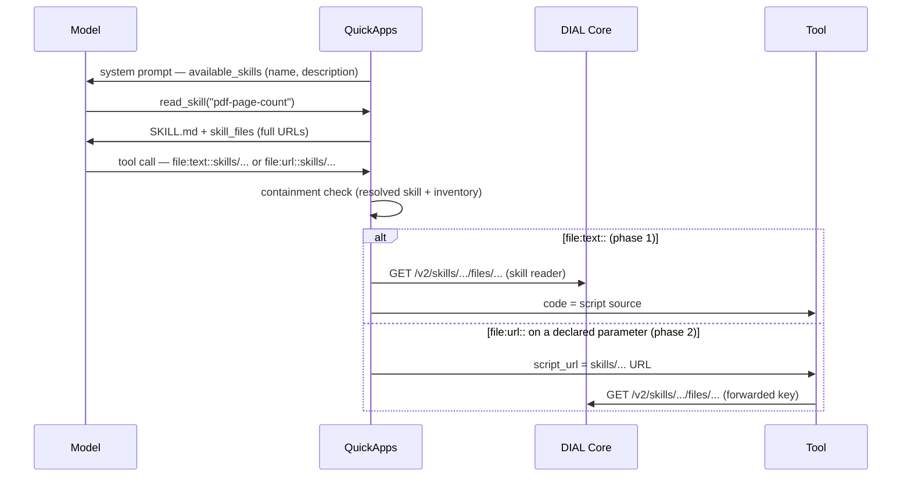

# Design: Skill File References in Tool Calls

- **Status:** Draft
- **Issue:** [epam/ai-dial-quickapps-backend#420](https://github.com/epam/ai-dial-quickapps-backend/issues/420)
  (epic [#421](https://github.com/epam/ai-dial-quickapps-backend/issues/421))
- **Dependencies:**
  - Code-interpreter boundary ([#424](https://github.com/epam/ai-dial-quickapps-backend/issues/424)) — see
    [Interpreter independence](#interpreter-independence): neither phase hard-codes an interpreter, so this design does
    not wait on that decision.
  - Phase 2 only: the tool must be able to read a skill file with the credentials it receives. QuickApps reads skills
    with the per-request key, which `forwardPerRequestKey` passes to MCP tools, so this is expected to hold — to be
    verified on dev ([Open Questions](#open-questions) Q2).
  - Phase 2 only: the AWS code interpreter MCP declares skill support on `script_url` / `attachment_urls` with a
    capability marker (see [Capability declaration](#capability-declaration)).

## Problem Statement

A DIAL skill resource can bundle scripts (`scripts/count_pages.py`), but the agent has no way to hand one to a tool:

- The model never sees where a skill lives. `<available_skills>` carries name and description only; `read_skill`
  returns the manifest plus `<skill_files>` paths **relative** to the skill root. No URL, no bucket.
- The `file:` pipeline (`FileArgumentTransformer` → `FileLoaderService`) accepts `files/...` paths and external URLs
  only (`classify_url`). A `skills/...` URL classifies as `DIAL_APPDIR_RELATIVE`, and on MCP parameters marked
  `dial_url` it is rejected before the tool runs (`_collect_dial_url_files`).
- Code-execution tools take code either inline (`code`) or as a DIAL link (`script_url`, `attachment_urls`).

Observed on dev (2026-10-22, `pdf-page-count` skill + "Python Code Interpreter" toolset): the model either invents a
link (`script_url: "files/public/scripts/script.py"` → HTTP 404) and gives up, or falls back to writing its own code,
so the skill's tested script never runs. The working-today workaround — `read_skill(file_path=...)`, then paste the
source into `code` — costs a turn plus the script's tokens twice (read, then emit), and the model may alter the script
while copying it.

## Design Goals

- **G1 — Run the script unchanged.** The bytes the tool runs are the bytes in the skill.
- **G2 — Keep content out of the model.** The model handles a reference, never the script body: no extra
  `read_skill` turn, no script tokens in the context.
- **G3 — Interpreter independence.** QuickApps never knows which tool consumes a file. The internal `py_interpreter`
  today, an AWS AgentCore MCP interpreter tomorrow, a REST tool after that — all work without QuickApps changes, and a
  skill author does not target a specific tool. What QuickApps may know is what a tool **declares** about itself.
- **G4 — Contained.** A reference resolves only to a file in the inventory of a skill resolved for the current
  request — the same boundary `read_skill` enforces.
- **G5 — No copies.** Skill files stay where they are; nothing is duplicated into file storage per user or per call.
- **G6 — One handle.** The model uses one string for a bundled file everywhere — `read_skill`, `file:text::`,
  `file:url::` — and that string is the file's real DIAL URL, so nothing has to translate it.

---

## Use Cases

### UC-1: Run a bundled script with any interpreter (phase 1)

**Trigger:** The user attaches `report.pdf` and asks for its page count; the `pdf-page-count` skill bundles
`scripts/count_pages.py`.
**Behavior:** The model reads the skill, copies the script's URL from `<skill_files>`, and calls the configured Python
tool with `code: "file:text::skills/<bucket>/pdf-page-count/files/scripts/count_pages.py"`.
**Outcome:** The tool receives the script source as `code`; the model's context holds only the URL.

### UC-2: One skill, two interpreters (verifies G3)

**Trigger:** The same skill is added to two apps: app 1 uses the internal `py_interpreter` (no skill support
declared), app 2 uses the AWS code interpreter MCP (skill support declared on `script_url`).
**Behavior:**
- App 1: the model inlines the script into `py_interpreter`'s `code` with `file:text::<url>`.
- App 2: the model may do the same with `execute_python`'s `code`, or pass `file:url::<url>` as
  `run_python_script`'s `script_url`, which QuickApps forwards unchanged for the interpreter to fetch.

**Outcome:** The script runs in both apps with the same `SKILL.md`, and QuickApps contains no code naming either
interpreter — only the skill-URL resolver and the capability check.

### UC-3: A skill-aware tool fetches the file itself (phase 2)

**Trigger:** A tool parameter declares skill support, and the skill needs `argv`, a binary asset, or several files.
**Behavior:** The model writes `file:url::skills/<bucket>/pdf-page-count/files/scripts/count_pages.py`; QuickApps
checks containment and passes the URL on.
**Outcome:** The tool fetches the file from DIAL Core itself; nothing is copied.

### UC-4: Tool does not support skill URLs

**Trigger:** The model writes `file:url::skills/...` for a parameter that did not declare skill support.
**Behavior:** The call is rejected before the tool runs.
**Outcome:** A parameter error telling the model to inline the file with `file:text::<url>` instead.

### UC-5: Out-of-scope reference

**Trigger:** The model references a URL that is not under a skill resolved for this request, or a file not in its
inventory (including a skill that moved or was re-uploaded since an earlier turn).
**Behavior:** The tool call (or `read_skill`) is rejected.
**Outcome:** An error naming the reference and listing the skill's current files, as `read_skill` does today.

---

## Proposed Design

### End-to-end flow

| Step | Who | What the model sees / writes |
|---|---|---|
| 0 | Skill author | `SKILL.md` names files by **relative** path ("run `scripts/count_pages.py` … its URL is listed in `<skill_files>`"). The author cannot know the bucket, and one skill may live in several buckets. |
| 1 | System prompt | `<available_skills>` — **unchanged** (name, description, optional frontmatter fields). |
| 2 | `read_skill(skill_name)` | Manifest + `<skill_files>` with **full URLs** (the only new content). |
| 3 | `read_skill(skill_name, file_path)` | Optional; `file_path` accepts the full URL or the relative path. |
| 4a | Any tool, phase 1 | `"code": "file:text::skills/<bucket>/<skill>/files/<path>"` → QuickApps inlines the content. |
| 4b | Skill-aware tool, phase 2 | `"script_url": "file:url::skills/<bucket>/<skill>/files/<path>"` → QuickApps passes the URL on. |



### Advertising: full URLs in `<skill_files>`

- **What:** `_build_skill_files_block` lists each file by its full URL, `<skill url>/files/<relative path>`, built from
  `ResolvedSkill.url` (canonical, no trailing slash):

  ```
  <skill_files>
  skills/7EeD6LpY…/pdf-page-count/files/scripts/count_pages.py
  </skill_files>
  ```

- **Why per file, not a base URL once:** the model copies one line instead of joining a base and a path, which is
  where typos and missing `/` come from. Skills bundle few files, so the extra tokens are small (bounded by
  `max_files`).
- **Why not in `<available_skills>`:** it would add ~100 characters per skill to every system prompt; the URL is only
  needed once the skill is read.
- **Reach:** user-invoked skills get it automatically — their synthetic pair is produced by the real `read_skill`.
  Only DIAL skill resources carry URLs; predefined and DIAL-prompt skills have no bundled files and are unchanged.

### `read_skill(file_path)` accepts both forms

- **What:** `DialSkillReader` normalizes `file_path` by stripping the skill's own `<url>/files/` prefix (after
  percent-decoding) before the inventory check. Relative paths keep working.
- **Semantics:** a URL under a different skill fails with an error naming the skill it belongs to; `skill_name` stays
  required, so the stage title, collision rules, and predefined skills behave as today.

### Reference resolution in the `file:` pipeline

- **What:** `classify_url` gains `UrlScheme.SKILL` for `skills/<bucket>/<path>/files/<filePath>`; `FileLoaderService`
  dispatches it to a request-scoped resolver in the skills package.
- **Containment (G4):** the resolver finds the resolved skill whose URL is a prefix of the reference, then checks the
  remainder against that skill's inventory — the same rule as `read_skill`, matched by URL instead of name. Both sides
  are percent-decoded before comparing (Core URLs encode spaces as `%20`; the inventory stores decoded paths).
- **Prefixes:**

| Prefix | Phase | Behavior |
|---|---|---|
| `text` | 1 | Read through `ResolvedSkill.reader.read_bundled_file` (cached, `file_max_bytes`-capped); the content replaces the value |
| `data` / `base64` | later | Need a bytes read; follow binary inventory support |
| `url` | 2 | Passed through unchanged to a parameter that declares skill support; rejected otherwise (UC-4) |

- **Model visibility:** the transformer swaps the argument just before the call; the assistant message in the history
  keeps the URL the model wrote.
- **Stage display:** the stage shows the *processed* parameters unless it adopted the streamed arguments, so a
  non-streamed stage would print the whole script — see [Secondary Fixes](#secondary-fixes).
- **Phase-1 limitation:** `FILE_PATTERN` matches a whole value, so an inlined script cannot be combined with a prelude
  or `argv`; phase-1 scripts must run with no arguments. Phase 2 lifts this for tools that take `args`.

### Capability declaration

The only thing QuickApps needs to know about a tool is **whether a parameter accepts skill files**.

- **What:** `dial_url` widens from a boolean to the list of resource types the parameter accepts:
  `"dial_url": ["files", "skills"]`. `dial_url: true` keeps meaning `["files"]`, so existing tools are unaffected. A
  list (not a one-off `dial_skill_url` key) is chosen so the marker can grow into the general file-parameter
  descriptor — see [Evolution](#evolution-schema-declared-file-parameters).
- **Owner:** the tool. An MCP server sets it in `inputSchema`; internal and REST tools declare it in their schema the
  same way.
- **Why per parameter, not per toolset:** one tool may take a skill script (`script_url`) but only user files
  elsewhere, and no admin setting has to be kept in sync with what the tool really supports.
- **Current state:** the AWS code interpreter MCP (v0.1.2) already accepts `skills/<bucket>/<skill path>/files/<file
  path>` on `script_url` and `attachment_urls` and fetches it from `$DIAL_URL/v2/skills/...`, but marks both with plain
  `dial_url: true`. Adding the marker is a one-line schema change per parameter on their side.

### `dial_url` handling for skill URLs (phase 2)

- `_collect_dial_url_files` accepts `skills/...` on a parameter that declares skill support, after the containment
  check, and **skips the permission grant** for it: the forwarded per-request key already reads the skills QuickApps
  resolved with it (Q2). `files/...` values keep today's grant.

### Interpreter independence

Resolution happens in `FileArgumentTransformer`, which runs in `StagedBaseTool._pre_process_params` for every tool
type (MCP, REST, DIAL deployment, internal) **before** the call leaves QuickApps. Consequences:

- QuickApps never learns tool semantics. The model picks the prefix from the parameter's description, as it does for
  user files today (`tool-call-file-parameter-formatting` skill); for `url`, QuickApps additionally reads the tool's
  **declared** capability, never its name.
- The value crosses any hop — an MCP interpreter sees an ordinary string (phase 1) or a DIAL URL (phase 2) — so
  #424's concern ("script references must survive an MCP hop") is met by construction.
- Skill authors write tool-agnostic instructions: "run `scripts/count_pages.py` with the Python execution tool", not
  "call `execute_python`".

Not covered here: interpreters differ in where staged input files land (`input/` for the AWS MCP interpreter, the
session working directory for `py_interpreter`). A portable script must discover its inputs instead of hard-coding a
directory — a skill-authoring guideline (Q4).

### Options considered

| | **A. Inline by URL** (phase 1) | **C. URL to skill-aware tools** (phase 2) | B. Copy to a DIAL file | D. Model copies (today) | E. Script in `files/`, URL in SKILL.md |
|---|---|---|---|---|---|
| Tool receives | script text | `skills/...` URL | a `files/...` URL | script text (as copied) | a `files/...` URL |
| Bytes fetched by | QuickApps | the tool | the tool, after QuickApps copies | the model | the tool |
| G1 unchanged bytes | ✅ | ✅ | ✅ | ❌ | ✅ |
| G2 content out of model | ✅ | ✅ | ✅ | ❌ ~2× tokens + 1 turn | ✅ |
| G3 interpreter-independent | ✅ any text param | ✅ any tool that declares support | ✅ | ✅ | ✅ |
| G5 no copies | ✅ | ✅ | ❌ every asset, per user | ✅ | ❌ manual copy |
| Script args (`argv`) | ❌ | ✅ if the tool has `args` | ✅ | ✅ | ✅ |
| Binary assets | ⚠️ later | ✅ | ✅ | ❌ | ✅ |
| Tool changes | none | opt-in marker | none | none | none |

**Rejected:** **B** duplicates every asset into file storage for every user and needs a cache, retention and cleanup
(fails G5). **D** is what this design replaces. **E** duplicates the script outside the skill: versions drift, the URL
is per bucket, and a `public` copy needs publication.

**Short alias `skill:<name>/<path>` (considered):** shorter and needs no URL in context, but it is a QuickApps-only
pseudo-scheme that must be expanded before any tool sees it, depends on name-collision rules (#568), and gives the
model a second handle next to the real URL (fails G6). Rejected in favour of the full URL.

### Evolution: schema-declared file parameters

This design keeps the `file:{prefix}::` convention because that is how files reach tools today. A follow-up is
expected to invert it: the model passes **plain links** everywhere (`files/...`, `skills/.../files/...`,
`https://...`), and each parameter **declares** what it accepts — the link, the text, a `data:` URI, or base64 —
generalizing `dial_url` into a file-parameter descriptor. QuickApps converts deterministically; undeclared parameters
receive the string unchanged (or fall back to the prefix); third-party tools are covered by an app-config override.
That removes the always-injected `tool-call-file-parameter-formatting` skill and the model's prefix choice, and is
a separate design because it changes file transfer for every tool, not only skills:
[Schema-Declared File Parameters](schema_declared_file_parameters.md).

To make that follow-up additive, this design holds three guardrails:

| Guardrail | Why |
|---|---|
| The capability marker is `dial_url: [resource types]`, not a skill-specific key | It becomes the first field of the general descriptor; no rename later |
| The `file:` prefix only **dispatches** to the skill-URL resolver; containment, inventory, decoding and reading live in the resolver | A schema declaration becomes a second trigger for the same resolver; the prefix becomes the fallback |
| Skills never mention a prefix — `SKILL.md` names relative paths and points at `<skill_files>` | No skill needs editing when the prefix is retired |

What survives the follow-up unchanged: full URLs in `<skill_files>`, `read_skill` accepting them, the resolver, the
capability marker, and the skipped grant for skill URLs. What it replaces: the model writing `file:text::<skill url>`
in phase 1, and that example in the built-in formatting skill.

---

## Secondary Fixes

### Show the reference, not the inlined content, in the stage

A resolved skill-URL argument should be displayed as the reference the model wrote, not as the script body. The same
applies to today's `file:text::` / `file:data::` user files, whose resolved content is equally noisy in the "Request"
block. Fix in `_stage_parameters`: show pre-transform values for arguments a transformer replaced.

---

## Out of Scope

| Item | Why deferred |
|---|---|
| Option B (copy to `files/`) | Rejected — duplicates every asset per user (G5) |
| Schema-declared file parameters (plain links, no prefix) | Changes file transfer for every tool; [separate design](schema_declared_file_parameters.md) |
| `argv` / preludes for inlined scripts | Phase 2 covers it for skill-aware tools; a composable inline reference is not planned |
| Binary bundled files for phase 1 | The inventory is text-only today ([Skills as DIAL Resource](skills_as_dial_resource.md)); `data`/`base64` follow that change |
| `read_skill` without `skill_name` (URL alone) | Would need a URL→skill index in `SkillsRegistry`; revisit if models struggle to pair name and URL |
| References from predefined / DIAL-prompt skills | They carry no bundled files |
| Executing scripts inside QuickApps | QuickApps delegates execution to tools; it only delivers bytes or URLs |
| `allowed-tools` enforcement | Separate gap, tracked in the epic |

## Open Questions

1. **Capability marker** — `"dial_url": ["files", "skills"]` is proposed; agree the exact shape with the interpreter
   team before they ship it.
2. **Access for phase 2** — QuickApps reads skills with the per-request key and `forwardPerRequestKey` hands the same
   key to the tool, so the tool should read what QuickApps read. Verify on dev with the AWS interpreter (v0.1.2) for an
   app-configured skill owned by another user; if it fails, QuickApps must grant the toolset access to the skill
   (ai-dial-core#1633 sharing).
3. **Bucket visibility** — the URL carries the skill owner's bucket, so an app-configured skill's bucket becomes
   visible to end users in the stage and to the model. Bucket ids already appear in conversation and file URLs and
   Core still enforces access; confirm that is acceptable.
4. **Input discovery across interpreters** — publish a skill-authoring guideline ("discover inputs, take no required
   args") in `docs/skills.md`?

## Configuration / Usage Examples

`SKILL.md` before and after:

| Before (fails or wastes a turn) | After |
|---|---|
| "Run the script with `execute-python-script`: `script: scripts/script.py`" → model invents `script_url`, 404 | "Run `scripts/count_pages.py` with the Python execution tool (its URL is in `<skill_files>`), with the user's PDFs as attachments." |

`read_skill("pdf-page-count")` result (tail):

```
<skill_files>
skills/7EeD6LpY…/pdf-page-count/files/scripts/count_pages.py
</skill_files>
```

Phase 1 — any interpreter:

```json
{ "code": "file:text::skills/7EeD6LpY…/pdf-page-count/files/scripts/count_pages.py",
  "attachment_urls": ["file:url::files/<user-bucket>/uploads/report.pdf"] }
```

Phase 2 — an interpreter whose `script_url` declares skill support:

```json
{ "script_url": "file:url::skills/7EeD6LpY…/pdf-page-count/files/scripts/count_pages.py",
  "args": ["--json"],
  "attachment_urls": ["file:url::files/<user-bucket>/uploads/report.pdf"] }
```

## Migration

### Non-breaking changes

- `<available_skills>` and the system prompt are unchanged; prompt-cache prefixes of existing conversations survive.
- Old conversations keep relative paths in their history, and those stay valid: `read_skill(file_path)` still accepts
  them. Full URLs appear only in new `read_skill` results, so a conversation may hold both forms.
- The built-in `tool-call-file-parameter-formatting` skill is injected with `APPEND_IF_CHANGED`, so its updated
  examples reach existing conversations on their next turn.
- `dial_url: true` keeps its current meaning; skill support is opt-in per tool parameter.
- Skills that already inline scripts via `read_skill` keep working; switching is a `SKILL.md` edit.

## Summary of Changes

| Phase | Component | Change |
|---|---|---|
| 1 | `skills/dial_resource/_dial_skill_resolver.py` | `<skill_files>` lists full URLs |
| 1 | `skills/dial_resource/_dial_skill_reader.py` | `file_path` accepts the skill's full URL (prefix stripped, percent-decoded) |
| 1 | `common/url_classification.py` | `UrlScheme.SKILL` for `skills/.../files/...` |
| 1 | `file_transfer/_file_loader_service.py` | dispatch `SKILL` to the skills resolver |
| 1 | `skills/` | request-scoped resolver: URL → resolved skill → inventory check → `read_bundled_file` |
| 1 | `config/predefined/skills/tool-call-file-parameter-formatting` | document skill URLs with an example |
| 1 | `common/staged_base_tool.py` | stage shows pre-transform values for replaced arguments |
| 1 | `docs/skills.md`, `docs/file_transfer.md` | user-facing docs; authoring guideline for portable scripts |
| 2 | `file_transfer/_file_prefix_handlers.py` | `url` + `SKILL` → pass through on declared parameters, else reject |
| 2 | `mcp_tooling/_mcp_tool.py` | read `dial_url` as a bool or a list of resource types; `_collect_dial_url_files` accepts `skills/...` and skips the grant |
| 2 | AWS code interpreter MCP | declare the marker on `script_url` / `attachment_urls` |
| 2 | other interpreters (opt-in) | declare the marker; fetch `skills/...` via `/v2/skills/.../files/...` |
