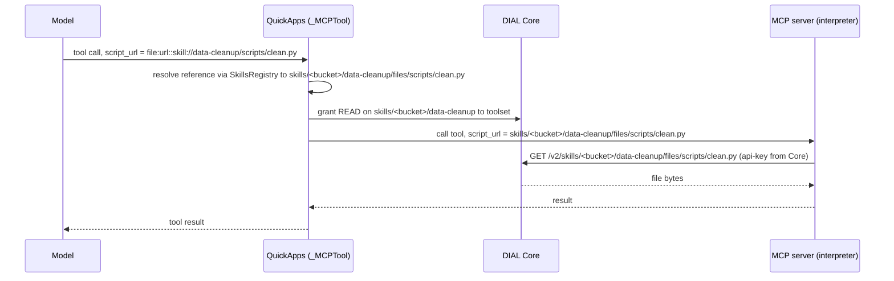

# Design: Skill File References for Tool Calls

- **Status:** Draft
- **Issue:** [epam/ai-dial-quickapps-backend#420](https://github.com/epam/ai-dial-quickapps-backend/issues/420)
- **Scope:** An agent refers to a file bundled with a DIAL skill (typically a script) in a tool call, and the file
  reaches an **external MCP server** (a code interpreter) unchanged, without its content passing through the model.
  Executing the file is the receiving server's job.
- **Dependencies:**
  - [`skills_as_dial_resource.md`](skills_as_dial_resource.md) — `DialSkillResolver`, `DialSkillReader`, the
    `<skill_files>` inventory (#418).
  - [`skills_and_file_transfer.md`](skills_and_file_transfer.md) — the `file:` argument transformers and prefixes.
  - [`skill_invocation.md`](skill_invocation.md) — skills picked by the user in a message (chips) are ordinary
    registry entries.
  - [#424](https://github.com/epam/ai-dial-quickapps-backend/issues/424) — the code interpreter becomes an external
    MCP application; a reference must survive that hop. This design targets that boundary.
  - `ai-dial-core` — per-request permission grants on a skill root and the toolset setting `forwardPerRequestKey`
    (see [Validated Assumptions](#validated-assumptions)). Long-term guarantees are tracked in core#1633.

## Problem Statement

A skill can bundle executable files (`scripts/…`). QuickApps lists them in `<skill_files>` and lets the agent read
them through `read_skill(skill_name, file_path)`, but there is no way to hand such a file to another tool. To run a
bundled script on a code interpreter, the agent has to read it and retype the whole text into the tool's `code`
argument. That costs output tokens proportional to the script size and gives the model a chance to alter code that
the skill author wrote and tested.

The generic `file:` mechanism does not help: `FileLoaderService` only understands DIAL files and external URLs, and a
skill path is neither (a bare `skills/<bucket>/<name>/files/<path>` is classified as an agent-home-relative path, and
MCP `dial_url` parameters reject it). Granting an external MCP server access to the file is also not possible the
usual way, because DIAL Core treats a skill as one resource and rejects a permission grant on a single file inside it.

## Design Goals

1. The agent writes a short reference to a skill file; the file's content reaches the tool without passing through the
   model, byte-identical to what the skill stores.
2. For an MCP tool parameter flagged `dial_url`, the MCP server downloads the file itself from DIAL Core, with
   permission granted by QuickApps.
3. For a tool that wants the file's content, the content can be inlined into a parameter (for example `code: str`) or
   sent as base64, using the existing `file:text::` / `file:base64::` / `file:data::` prefixes.
4. The model learns the reference syntax from QuickApps itself, not from per-app prompt text: every skill file is shown
   to it as a ready-to-copy reference.
5. The `file_transfer` package has no knowledge of skills. With the skills feature removed, `file:` references behave
   exactly as before and a `skill://` value is rejected like any other unsupported scheme.
6. Skills picked by the user in a message (chips) work the same as skills configured on the agent.

---

## Use Cases

### UC-1: Run a bundled script on an external interpreter

**Trigger:** The agent has a skill `data-cleanup` with `scripts/clean.py`. The skill's instructions say "run
`scripts/clean.py` on the interpreter". The interpreter's MCP tool has a parameter `script_url` with `"dial_url": true`.
**Behavior:** The model sends `script_url = "file:url::skill://data-cleanup/scripts/clean.py"`. QuickApps resolves the
reference to the skill file's DIAL URL, grants the interpreter's toolset read access to the skill, and calls the tool
with the URL. The server downloads the file from DIAL Core and runs it.
**Outcome:** The script arrives unchanged; the model emitted about ten tokens instead of the script text.

### UC-2: Script text into a `code` parameter

**Trigger:** The tool has `code: str` and no `dial_url` parameter.
**Behavior:** The model sends `code = "file:text::skill://data-cleanup/scripts/clean.py"`. QuickApps replaces it with
the file's text before the call.
**Outcome:** The tool receives the script as if the model had typed it, with no risk of mutation.

### UC-3: Server cannot reach DIAL — base64 fallback

**Trigger:** An MCP parameter wants file bytes (`"base64-encoded contents"`).
**Behavior:** The model sends `file:base64::skill://data-cleanup/scripts/clean.py`; QuickApps inlines the encoded
file.
**Outcome:** The file is delivered without the server needing any DIAL access.

### UC-4: Skill picked by the user in a message

**Trigger:** The user picks a skill that is not in the agent's config; Core shares it to the app's per-request key.
**Behavior:** The skill is a registry entry like any other; its files are listed as `skill://…` references; the grant
for the interpreter's toolset is issued from the app's per-request key.
**Outcome:** Same as UC-1. Validated on a skill owned by another user ([Validated Assumptions](#validated-assumptions)).

### UC-5: Reference to a file the skill does not have

**Trigger:** The model sends `skill://data-cleanup/scripts/missing.py` or an unknown skill name.
**Behavior:** Resolution fails with a parameter error that names the problem and lists the skill's available files.
**Outcome:** The tool is not called; the model corrects the reference on the next iteration.

### UC-6: Skill without bundled files

**Trigger:** The reference names a predefined or DIAL-prompt skill.
**Behavior:** Those sources have no bundled files, so resolution fails with "Skill '…' has no bundled files".
**Outcome:** Same recovery path as UC-5.

---

## Proposed Design



### Concern 1: The reference and its resolution

- **What:** The reference syntax `skill://<skill_name>/<file_path>`, always written behind a `file:` prefix
  (`file:url::`, `file:text::`, `file:base64::`, `file:data::`). `<skill_name>` is the name under which the skill is
  registered in `SkillsRegistry`; `<file_path>` is a path from that skill's `<skill_files>` inventory.
- **Owner:** `skills/`. A new sub-package `skills/file_reference/` holds the feature and its own DI module
  (`SkillFileReferenceModule`), appended to `skills_module` in `skills/skills_di.py`. `SkillsRegistry` gains
  `resolve_file_url(skill_name, file_path)`; a leaf module `skills/skill_file_url.py` holds the pure parsing helpers so
  other packages can use them without importing the registry.
- **Semantics:** `resolve_file_url` looks the skill up by name, requires that its source supports bundled files, and
  requires the (normalized) path to be a member of the skill's inventory — traversal, encoded separators and hidden
  files are impossible for the same reason as in `DialSkillReader`. It returns
  `skills/<bucket>/<path>/files/<url-encoded file_path>`. Failures raise the existing `SkillFileNotFoundError` /
  `SkillFilesNotSupportedError`, which list what is available.
- **Argument transformer:** a `ToolArgumentTransformer` in the same package rewrites `skill://…` (bare, or behind
  `file:url::`) to the file URL and converts resolution errors to `InvalidToolCallParameterException`. It joins the
  global transformer chain through a multiprovider, so it applies to every tool type like the other transformers.
- **Change:** new sub-package and module; `resolve_file_url` on the registry.

### Concern 2: Delivery by link with a permission grant

- **What:** For MCP parameters flagged `"dial_url": true`, a value that is a skill file URL
  (`skills/<bucket>/<path>/files/<file_path>`) is passed to the server as is, and the grant is issued on the **skill
  root** (`skills/<bucket>/<path>`), not on the file.
- **Owner:** `mcp_tooling/` — `_MCPTool._collect_dial_url_files`. The recognition of a skill file URL and its root
  comes from `skills/skill_file_url.py`.
- **Semantics:** Roots are de-duplicated so several files of one skill cost one grant. The grant goes through the
  existing `DialFileService.grant_permissions_to_files` with `receiver = dial_toolset_id`, so it is available only for
  `DialMCPToolSet`; a plain `MCPToolSet` fails with the existing "dial_toolset_id is not configured" error.
  Validation of other `dial_url` values (external URL, unsupported URL) is unchanged.
- **Change:** `_MCPTool` splits the per-value logic into "grant resource for a value" and "validate a DIAL file".

### Concern 3: Delivery by content (`text`, `base64`, `data`)

- **What:** A source-of-files extension point in `file_transfer/` and one implementation in `skills/file_reference/`.
- **Owner:** `file_transfer/` owns the interface; `skills/` owns the implementation, so the dependency points from
  skills to file transfer and never back.
- **Semantics:** A `FileSource` interface with two operations: whether it handles a URL, and loading its bytes.
  `FileLoaderService.load` consults the registered sources before classifying the URL by scheme; the `file_transfer`
  module declares the multibinding so it resolves to an empty list when no feature contributes. The skills
  implementation handles `skill://…`, resolves the file through the registry, and reads it through the skill's reader
  (so it inherits the inventory check, the size cap `DIAL_SKILLS_FILE_MAX_BYTES`, the UTF-8 requirement and the
  per-request cache). The text is encoded back to UTF-8 bytes, so `text`, `base64` and `data` all work through the
  existing prefix handlers and the per-request bytes cache; the MIME type for `data` comes from the file name.
- **Change:** new interface and multibinding in `file_transfer/`; `FileLoaderService` takes the list of sources;
  new `SkillFileSource` in `skills/file_reference/`.

### Concern 4: Teaching the model the syntax

- **What:** Three coordinated parts, all owned by the skills feature.
  1. **Instruction skill.** A new predefined skill `tool-call-skill-file-references`
     (`config/predefined/skills/…/SKILL.md`), injected as a synthetic `read_skill` call by its own injector, by the same
     mechanism as the file-transfer instruction. It is injected on every conversation, unconditionally: its text is
     static, so it sits in the prompt-cache prefix and costs little. It says: a skill file is referenced as
     `skill://<skill_name>/<path>` behind a `file:` prefix; use `url` only for a `dial_url` parameter of an MCP tool,
     `text` when a parameter wants the code itself, `base64`/`data` when the server cannot reach DIAL; the prefix is
     chosen as described by the file-transfer instruction.
  2. **Ready-made references in `<skill_files>`.** Each line of the block is rendered as the full reference
     (`skill://<name>/<path>`) instead of a bare path, so the model copies a string rather than composing one. The
     reference is shown without a `file:` prefix because the prefix depends on the target parameter and is chosen by
     the model per the instruction.
  3. **`read_skill` accepts both forms.** The parameter `file_path` is documented as "written as listed in
     `<skill_files>`"; because the listing now shows references, `DialSkillReader` strips a leading
     `skill://<same name>/` before the inventory check and the tool description is updated.
- **Owner:** `skills/file_reference/` for the injector; `skills/dial_resource/` for the `<skill_files>` rendering and
  the reader; `skills/registry/` for the tool description.
- **Semantics:** The name in a reference is always the registry key (`SkillMetadata.name`), never a separate copy, so
  the displayed reference and the resolvable reference cannot diverge. The block is built once when a skill is
  resolved and is part of the `read_skill` result stored in conversation history; the reference text depends only on
  the skill name and the relative path, so it does not change between turns and does not invalidate the cache.
- **Change:** new predefined skill and injector; `_build_skill_files_block` and `DialSkillReader` as described.

### Concern 5: Contract for the receiving MCP server

What an MCP server (for example a code interpreter) must do to accept a skill file through a `dial_url` parameter:

| Item | Requirement |
|------|-------------|
| Toolset in DIAL Core | Registered as a toolset with `forwardPerRequestKey` enabled; the QuickApp config references it as a `dial-mcp` toolset (`deployment_id: toolsets/<name>`). |
| Tool schema | The parameter that takes the file has `"dial_url": true` in its JSON schema. |
| Credential | The call carries the per-request key in the `api-key` header (no `Authorization` header). |
| Download | `GET {DIAL_URL}/v2/<value of the parameter>` with that header. The value is `skills/<bucket>/<path>/files/<file_path>`. |
| Execution | Entirely the server's concern: environment, runtime, run arguments. |

---

## Alternatives Considered

- **Inline the script into `code` always.** Contradicts the issue's intent for interpreters that can run a file, and
  loses the "executed when the interpreter supports it" path. Kept only as the `file:text::` fallback.
- **Upload the file to DIAL files and pass that URL.** Works with the existing `dial_url` path, but creates copies
  that need naming, ownership and cleanup, and adds a write per call. Not needed since a grant on the skill root works.
- **Grant on the file.** Rejected by Core (HTTP 403); a skill is one resource.
- **A new `file:skill::` prefix.** Multiplies with the existing `url/text/base64/data` choices. A scheme inside the
  existing prefixes composes with all of them and keeps the prefix choice in one place.
- **Extend `tool-call-file-parameter-formatting` with skill rules.** Couples the file-transfer instruction to the
  skills feature; the instruction would mention something that does not exist when skills are removed.
- **Inject the new instruction only when some skill has bundled files.** It would depend on the skills' resolution
  order and add a changing prompt part; a static always-on text is simpler and cache-friendly.

## Out of Scope

- **Predefined and DIAL-prompt skills.** They have no bundled files. Supporting them needs a source of files for those
  providers; the `FileSource` extension point does not need to change for it.
- **Built-in `py_interpreter`.** It takes only conversation attachments by DIAL URL and has no "run file" operation;
  it may be removed from the project.
- **Executing the file and passing run arguments.** The receiving server decides; QuickApps only delivers.
- **Binary files in skills.** Only text-allowlisted files from the inventory (limit `DIAL_SKILLS_FILE_MAX_BYTES`) are
  readable today; binary assets would require reading raw bytes and a different inventory rule.
- **MCP servers not registered in DIAL Core.** The grant needs a `dial_toolset_id`; such servers use the
  `file:text::` / `file:base64::` fallbacks.

## Validated Assumptions

A throwaway MCP server (one tool with a `dial_url` parameter, toolset with `forwardPerRequestKey` enabled) against a
local DIAL Core confirmed:

| Assumption | Result |
|------------|--------|
| A grant on the skill root for `toolsets/<name>` is accepted. | Yes. |
| A grant on a single file of the skill is accepted. | No, HTTP 403. |
| The server receives the per-request key as the `api-key` header and can `GET /v2/skills/.../files/...`. | Yes: HTTP 200, size and SHA-256 equal to the stored file. |
| The same download without the grant works. | No, HTTP 403: the grant is required. |
| The grant works for a skill that reached the app only through a chip (skill owned by another user, not in the app config). | Yes, HTTP 200. |

Still to confirm: that the colleagues' interpreter server accepts a DIAL URL in its `dial_url` parameter and handles the
file as expected, and that Core keeps this permission behavior (core#1633).

## Configuration / Usage Examples

No configuration fields are added. An agent that uses a bundled script needs the skill and the interpreter toolset:

```json
{
  "skills": [{ "type": "dial-skill", "url": "skills/<bucket>/data-cleanup" }],
  "tool_sets": [{ "type": "dial-mcp", "name": "interpreter", "deployment_id": "toolsets/interpreter" }]
}
```

Reference forms the model writes, depending on the tool parameter:

| Tool parameter | Value |
|----------------|-------|
| `script_url`, schema `"dial_url": true` | `file:url::skill://data-cleanup/scripts/clean.py` |
| `code`, "the python code to run" | `file:text::skill://data-cleanup/scripts/clean.py` |
| `file_contents`, "base64-encoded file" | `file:base64::skill://data-cleanup/scripts/clean.py` |

## Migration

### Breaking changes

None.

### Non-breaking changes

- `read_skill` output for DIAL skills with bundled files shows references instead of bare paths; conversations that
  already hold the old rendering keep it and still resolve, since `read_skill` accepts both forms.
- A new instruction is injected once per conversation; an existing conversation may pay a one-time prompt-cache miss
  when it first appears (depends on where the injector inserts it; to be checked during implementation).
  Integration-test fixtures that record conversations with skills may need re-recording.

## Summary of Changes

| Component | Change |
|-----------|--------|
| `skills/skill_file_url.py` (new) | Parse `skill://` references; derive the skill root from a skill file URL. |
| `skills/file_reference/` (new sub-package) | `SkillFileReferenceModule`, argument transformer, `SkillFileSource`, instruction injector. |
| `skills/skills_di.py` | Registers `SkillFileReferenceModule`. |
| `SkillsRegistry` | `resolve_file_url(skill_name, file_path)`. |
| `skills/dial_resource` | `<skill_files>` rendered as references; `DialSkillReader` accepts `skill://<name>/` prefix. |
| `skills/registry/_tool_configs.py` | `file_path` description of `read_skill` mentions both forms. |
| `config/predefined/skills/tool-call-skill-file-references/` (new) | Instruction skill for the model. |
| `file_transfer/` | `FileSource` interface and multibinding; `FileLoaderService` consults sources before scheme classification. |
| `mcp_tooling/_mcp_tool.py` | Grant on the skill root for skill file URLs; de-duplicated grant resources. |
| Docs | `docs/skills.md`, `docs/file_transfer.md`, capability row in `docs/README.md`. |
