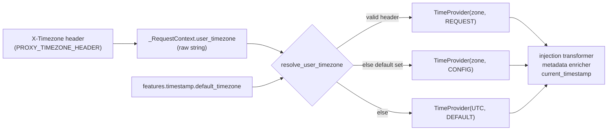

# Design: User Time Zone

- **Status:** Draft
- **Issue:** [I#649](https://github.com/epam/ai-dial-quickapps-backend/issues/649)
- **Dependencies:**
  - [Time Awareness](time_awareness.md)

## Problem Statement

Time awareness ([time_awareness.md](time_awareness.md)) always works in UTC. `TimestampModule` binds
`TimeProvider` with its constructor defaults, `ZoneInfo("UTC")` and `TimestampSource.DEFAULT`, so:

- the timestamp injected before every user turn is UTC;
- every tool result is annotated with a UTC time, and the annotation has no offset
  (`[Timestamp: 2026-10-29 11:36:12 UTC]`);
- `current_timestamp` without an argument returns UTC, and its description tells the model "Defaults to UTC".

The user's time zone is never used. "Today", "tomorrow morning" or "this evening" resolve against UTC, so near
midnight the agent gets the date wrong. Times passed to calendar-like tools are off by the user's UTC offset unless
the user names their zone in every conversation. Asked "What time is it now?" from a browser in Kyiv, the agent
answers "11:36:12 UTC" instead of 13:36 local time (verified on a local stack, 2026-10-29).

The time awareness design deferred this because "DIAL Core does not currently pass timezone in request headers".
That is no longer true:

| Hop | Behaviour today |
|-----|-----------------|
| DIAL Chat → Core | Chat sends the browser's `Intl.DateTimeFormat().resolvedOptions().timeZone` as the `X-Timezone` header on every completion request ([ai-dial-chat I#8442](https://github.com/epam/ai-dial-chat/issues/8442), released in Chat 1.1.0 and also on `development-0.x`). Chat's `chat-api` rejects values that `Intl.DateTimeFormat` does not accept. |
| Core → application | `BaseDeploymentPostController.sendProxyRequest` copies every request header except hop-by-hop, trace, API-key and application-properties headers, so `X-Timezone` reaches the app unchanged. |
| QuickApps | `extract_x_headers_from_request` puts `x-timezone` into `ForwardedHeaders`, which are already passed on to the orchestrator LLM, MCP, REST and DIAL deployment tools. Nothing reads it for time. |

No Chat or Core change is needed. The header has been observed arriving at QuickApps (`forwarded_headers=['x-timezone', …]`
in the request log).

## Design Goals

- When a request carries a valid IANA time zone in `X-Timezone`, the injected timestamp, the tool-result annotations
  and `current_timestamp` (called without an argument) all use that zone.
- An app can declare a fallback zone in `features.timestamp.default_timezone`, used when the request has no usable
  zone (API clients, scheduled runs).
- With neither, behaviour stays UTC.
- An invalid header value never fails the request: it is ignored with a warning and resolution moves to the next
  source.
- Every timestamp the model sees carries an explicit UTC offset, so mixed-zone history stays unambiguous.

---

## Use Cases

### UC-1: Chat user asks a date-relative question

**Trigger:** A user in Kyiv opens DIAL Chat at 00:30 local time (22:30 UTC the previous day) and asks "What's on my
calendar today?".
**Behavior:** Chat sends `X-Timezone: Europe/Kyiv`. The injected timestamp is
`2026-10-30T00:30:00+02:00 (Europe/Kyiv, source=request)`.
**Outcome:** The agent queries the calendar for 30 October, not 29 October.

### UC-2: API client without the header, app has a default

**Trigger:** A backend integration calls the app through Core without `X-Timezone`. The app config sets
`"default_timezone": "Europe/Warsaw"`.
**Behavior:** The zone resolves to `Europe/Warsaw` with `source=config`.
**Outcome:** The agent reasons in Warsaw time. A client that wants another zone sends `X-Timezone` itself.

### UC-3: Invalid header value

**Trigger:** A client sends `X-Timezone: UTC+3` (not an IANA name).
**Behavior:** The value is ignored and a warning is logged (without the value). Resolution falls back to
`default_timezone`, then UTC.
**Outcome:** The request succeeds, and the agent sees the fallback zone.

### UC-4: User asks about another zone

**Trigger:** A user in Kyiv asks "What time is it in Tokyo?".
**Behavior:** The agent calls `current_timestamp` with `{"timezone": "Asia/Tokyo"}` as today. Without an argument
the tool now returns Kyiv time.
**Outcome:** Unchanged from today for explicit zones.

### UC-5: Zone changes inside a conversation

**Trigger:** A user continues a conversation after travelling from Kyiv to New York.
**Behavior:** Earlier synthetic timestamps and tool results keep the zone they were produced in; the new turn uses
`America/New_York`.
**Outcome:** The model sees `…+02:00 (Europe/Kyiv…)` and `…-04:00 (America/New_York…)` side by side. Each carries
its offset, so ordering and elapsed time stay computable.

---

## Proposed Design



### 1. Reading the header

- **What:** New `ProxySettings.timezone_header` (env `PROXY_TIMEZONE_HEADER`, default `x-timezone`); new
  `_RequestContext.user_timezone` field; new DI key `USER_TIMEZONE = Annotated[str | None, "USER_TIMEZONE"]` in
  `common/_di_types.py`, provided by `AppModule` from the context.
- **Owner:** `core/application` (`_RequestContextSetup`, `AppModule`).
- **Semantics:** `_RequestContextSetup.setup_context` reads `request.headers.get(timezone_header)` next to
  `accept_language`, and stores the raw value, or `None` when the header is absent. No validation happens here. The
  context holds what the client sent, and the timestamp feature decides what it means. The header name is
  configurable for the same reason as `PROXY_LANGUAGE_HEADER`: a reverse proxy may rename it.
- **Change:** One settings field, one context field with a provider, one line in `setup_context`. The header stays
  in `ForwardedHeaders`, so tools keep receiving it.

### 2. Resolving and validating the zone

- **What:** A pure function `resolve_user_timezone(header_value, default_timezone) -> tuple[ZoneInfo, TimestampSource]`
  in `timestamp_tooling`, plus a shared `is_valid_iana_timezone(name)` helper in `common/` used by both the resolver
  and the config validator.
- **Owner:** `timestamp_tooling`.
- **Semantics:**
  - Precedence: valid header → `(zone, REQUEST)`; else `default_timezone` → `(zone, CONFIG)`; else
    `(UTC, DEFAULT)`. The user's own zone wins over the app default, because the default exists for callers that
    cannot supply one.
  - A name is valid when it is in `zoneinfo.available_timezones()`, computed once and cached. Validating against the
    set, not by calling `ZoneInfo(name)` and catching errors, matters because `ZoneInfo` probes the filesystem with
    the raw string. On a case-insensitive filesystem (macOS) it accepts `europe/warsaw`, and on some Linux images
    `localtime` resolves to the server's zone. Set membership is exact, case-sensitive and platform-independent
    within one tzdata version.
  - Legacy aliases such as `Europe/Kiev` (which Chrome still reports) and `Asia/Calcutta` are in the set and are
    accepted. They resolve to the same rules as their canonical names.
  - An empty or whitespace-only header is treated as absent. An invalid one logs a `WARNING` with the header name
    and value length only. The value is client-supplied and stays out of logs (CODESTYLE §9).
- **Change:** New module-level function and helper; no state.

### 3. Building `TimeProvider`

- **What:** Replace `binder.bind(TimeProvider, to=TimeProvider, scope=request_scope)` in `TimestampModule` with a
  request-scoped `@provider` that takes `USER_TIMEZONE` and `ApplicationConfig`, calls `resolve_user_timezone`,
  and returns `TimeProvider(tz, source)`.
- **Owner:** `TimestampModule`.
- **Semantics:** `TimeProvider` keeps its interface. It is the seam the time-awareness design reserved for this.
  The zone is resolved once per request. It is first constructed when `_MessagesSetup.run_transformers` resolves
  `list[MessagesTransformer]` through `ProviderOf`, which happens after `setup_context` has populated the
  context and config. The comment in `TimestampModule._provide_message_transformers` claims the list is resolved
  during `_RequestContextSetup` construction. That has been stale since `_MessagesSetup` switched to `ProviderOf`,
  and is corrected as part of this change. A unit test pins the ordering: a request whose header is set must
  produce a non-UTC injected timestamp.
  `default_timezone` is read from `features.timestamp`; when `features` or `timestamp` is `None` the feature is
  off and only the always-registered injection transformer touches `TimeProvider`, which then returns no content.
- **Change:** One provider method instead of one binding.

### 4. What the model sees

- **What:** `TimestampSource` gains `CONFIG = "config"`. The tool-result annotation adds the offset. The
  `current_timestamp` description changes.
- **Owner:** `timestamp_tooling`, `common/message_metadata.py`.
- **Semantics:**

  | Surface | Today | After (Kyiv user) |
  |---------|-------|-------------------|
  | Injected timestamp | `2026-10-29T11:36:12+00:00 (UTC, source=default)` | `2026-10-29T13:36:12+02:00 (Europe/Kyiv, source=request)` |
  | Tool-result annotation | `[Timestamp: 2026-10-29 11:36:12 UTC]` | `[Timestamp: 2026-10-29 13:36:12+02:00 Europe/Kyiv]` |
  | `current_timestamp` description (`timezone` param) | "Defaults to UTC." | "Defaults to the user's time zone when known, otherwise UTC." |

  The injected format already includes the ISO offset and zone name, so only the source value is new there. The
  annotation switches from `strftime('%Y-%m-%d %H:%M:%S')` to the same rendering plus `%:z`. The zone name is
  what the client sent: `Europe/Kiev` stays `Europe/Kiev`, and no canonicalization is attempted.
  `source=request` versus `source=config` lets the model tell "this is the user's zone" from "this is the app's
  assumption", and it is already recorded per result in `TimestampMetadata.timestamp_source`.
- **Change:** One enum member, one format string, one description string.

### 5. App-level default

- **What:** `ToolCallTimestampConfig.default_timezone: str | None = None`.
- **Owner:** `config/timestamp.py`.
- **Semantics:** `None` means no app default (UTC fallback). A non-`None` value must pass `is_valid_iana_timezone`,
  or config validation fails, like the other semantic config checks (for example hook template expressions). That
  is deliberately stricter than the header. A typo in the app config is the author's error, and it should surface
  the first time the author runs the app, not be silently replaced by UTC for every user. The JSON
  schema exposes it as a plain string with an example. Inlining ~600 zone names as an `enum` would bloat the schema
  for little gain.
- **Change:** One field; `make dump_app_schema` regenerates the schema.

---

## Secondary Fixes

### `current_timestamp` with an invalid `timezone` argument

`_CurrentTimestampTool._run_in_stage_async` passes the model-supplied string straight to `ZoneInfo`. On an invalid
name the raised `ZoneInfoNotFoundError` / `ValueError` is caught by `StagedBaseTool` and the raw exception text goes
back to the model, which works but reads poorly. The same filesystem-probing quirks apply: `europe/warsaw` succeeds on
macOS and fails on Linux. Validate with `is_valid_iana_timezone` and return a clear tool error ("Unknown IANA time
zone '…'; use names like 'Europe/Warsaw'") so the model can retry.

---

## Out of Scope

### Agent learns the zone from conversation

The time-awareness design deferred "I'm in Warsaw → use Warsaw from now on". With the header available on every
Chat request, the remaining gap is API clients. They can send the header or rely on `default_timezone`. Persisting a
learned zone across turns would need new state for a case that is now rare. Revisit if API-only apps report it.

### Editor surface for `default_timezone`

The Quick Apps editor (epam/ai-dial-chat) has no field for it yet; authors can set it in the JSON config. A
follow-up editor issue will add a zone picker under the timestamp feature.

### Per-user persisted preference

A zone stored in user settings would override the browser, for example for users whose OS zone is wrong. That
belongs to Chat or Core user settings, not QuickApps, and nobody has asked for it.

---

## Configuration / Usage Examples

App config with a fallback zone:

```json
{
  "features": {
    "timestamp": {
      "injection_strategy": "tool_call",
      "default_timezone": "Europe/Warsaw"
    }
  }
}
```

API client choosing its zone:

```bash
curl "$DIAL_URL/openai/deployments/my-app/chat/completions?api-version=2024-02-01" \
  -H "Api-Key: $KEY" -H "X-Timezone: America/New_York" \
  -d '{"messages":[{"role":"user","content":"What day is it?"}]}'
```

Resolution summary:

| `X-Timezone` | `default_timezone` | Zone used | `source` |
|--------------|--------------------|-----------|----------|
| `Europe/Kyiv` | any | `Europe/Kyiv` | `request` |
| absent / empty | `Europe/Warsaw` | `Europe/Warsaw` | `config` |
| `UTC+3` (invalid) | `Europe/Warsaw` | `Europe/Warsaw` | `config` (warning logged) |
| absent / invalid | unset | `UTC` | `default` |

---

## Migration

### Breaking changes

None for configs. Behaviour changes for every Chat user with time awareness enabled (the default): timestamps the
model sees switch from UTC to the browser's zone. That is the intended fix. An app whose system prompt assumes
UTC (for example "all times are UTC") should drop that assumption. The release notes call this out.

### Non-breaking changes

- `default_timezone` is optional; existing configs validate unchanged.
- `TimestampSource.CONFIG` is additive. Persisted metadata with `default` / `request` still parses.
- Integration-test cached LLM responses that include the `current_timestamp` tool description or tool-result
  annotations are invalidated by the new strings and must be re-recorded.

## Summary of Changes

| Component | Change |
|-----------|--------|
| `core/application/_proxy_settings.py` | Added `timezone_header` (`PROXY_TIMEZONE_HEADER`, default `x-timezone`) |
| `core/application/_request_context.py` | Added `user_timezone` |
| `core/application/_request_context_setup.py` | Reads the header into the context |
| `core/application/app_module.py` | Provides `USER_TIMEZONE` |
| `common/_di_types.py` | Added `USER_TIMEZONE` |
| `common/` (new helper) | `is_valid_iana_timezone` |
| `common/message_metadata.py` | Added `TimestampSource.CONFIG` |
| `config/timestamp.py` | Added `default_timezone` with validator |
| `timestamp_tooling/timestamp_module.py` | `TimeProvider` built by a provider from `resolve_user_timezone`; stale comment fixed |
| `timestamp_tooling/` (new) | `resolve_user_timezone` |
| `timestamp_tooling/_timestamp_annotation_transformer.py` | Annotation includes UTC offset |
| `timestamp_tooling/_tool_configs.py` | `timezone` parameter description |
| `timestamp_tooling/_current_timestamp_tool.py` | Validates the `timezone` argument |
| `CONFIGURATION.md` | `PROXY_TIMEZONE_HEADER` env var; `default_timezone` field |
| `docs/time_awareness.md` | Describes local-zone behaviour, resolution order and the `X-Timezone` header |
| App schema | Regenerated |
