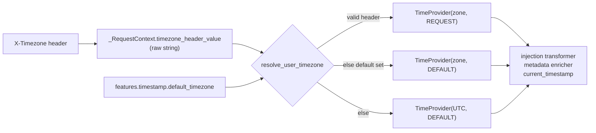

# Design: User Time Zone

- **Status:** Draft
- **Issue:** [I#649](https://github.com/epam/ai-dial-quickapps-backend/issues/649)
- **Dependencies:**
  - [Time Awareness](time_awareness.md)

## Problem Statement

Time awareness ([time_awareness.md](time_awareness.md)) always works in UTC. `TimestampModule` binds
`TimeProvider` with its constructor defaults, `ZoneInfo("UTC")` and `TimestampSource.DEFAULT`, so:

- the timestamp injected before every user turn is UTC;
- every tool result is annotated with a UTC time, and the annotation has no offset
  (`[Timestamp: 2026-10-29 11:36:12 UTC]`);
- `current_timestamp` without an argument returns UTC, and its description tells the model "Defaults to UTC".

The user's time zone is never used. "Today", "tomorrow morning" or "this evening" resolve against UTC, so near
midnight the agent gets the date wrong. Times passed to calendar-like tools are off by the user's UTC offset unless
the user names their zone in every conversation. Asked "What time is it now?" from a browser in Kyiv, the agent
answers "11:36:12 UTC" instead of 13:36 local time (verified on a local stack, 2026-10-29).

The time awareness design deferred this because "DIAL Core does not currently pass timezone in request headers".
That is no longer true:

| Hop | Behaviour today |
|-----|-----------------|
| DIAL Chat → Core | Chat sends the browser's `Intl.DateTimeFormat().resolvedOptions().timeZone` as the `X-Timezone` header on every completion request ([ai-dial-chat I#8442](https://github.com/epam/ai-dial-chat/issues/8442), released in Chat 1.1.0 and also on `development-0.x`). Chat's `chat-api` rejects values that `Intl.DateTimeFormat` does not accept. |
| Core → application | `BaseDeploymentPostController.sendProxyRequest` copies every request header except hop-by-hop, trace, API-key and application-properties headers, so `X-Timezone` reaches the app unchanged. |
| QuickApps | `extract_x_headers_from_request` puts `x-timezone` into `ForwardedHeaders`, which are already passed on to the orchestrator LLM, MCP, REST and DIAL deployment tools. Nothing reads it for time. |

No Chat or Core change is needed. The header has been observed arriving at QuickApps (`forwarded_headers=['x-timezone', …]`
in the request log).

## Design Goals

- When a request carries a valid IANA time zone in `X-Timezone`, the injected timestamp, the tool-result annotations
  and `current_timestamp` (called without an argument) all use that zone.
- An app can declare a fallback zone in `features.timestamp.default_timezone`, used when the request has no usable
  zone (API clients, scheduled runs).
- With neither, behaviour stays UTC.
- An invalid header value never fails the request: it is ignored and resolution moves to the next
  source.
- Every timestamp the model sees carries an explicit UTC offset, so mixed-zone history stays unambiguous.

---

## Use Cases

### UC-1: Chat user asks a date-relative question

**Trigger:** A user in Kyiv opens DIAL Chat at 00:30 local time (22:30 UTC the previous day) and asks "What's on my
calendar today?".
**Behavior:** Chat sends `X-Timezone: Europe/Kyiv`. The injected timestamp is
`2026-10-30T00:30:00+02:00 (Europe/Kyiv, source=request)`.
**Outcome:** The agent queries the calendar for 30 October, not 29 October.

### UC-2: API client without the header, app has a default

**Trigger:** A backend integration calls the app through Core without `X-Timezone`. The app config sets
`"default_timezone": "Europe/Warsaw"`.
**Behavior:** The zone resolves to `Europe/Warsaw` with `source=default`.
**Outcome:** The agent reasons in Warsaw time. A client that wants another zone sends `X-Timezone` itself.

### UC-3: Invalid header value

**Trigger:** A client sends `X-Timezone: UTC+3` (not an IANA name).
**Behavior:** The value is ignored and a DEBUG record is logged (header name and value length only). Resolution
falls back to `default_timezone`, then UTC.
**Outcome:** The request succeeds, and the agent sees the fallback zone.

### UC-4: User asks about another zone

**Trigger:** A user in Kyiv asks "What time is it in Tokyo?".
**Behavior:** The agent calls `current_timestamp` with `{"timezone": "Asia/Tokyo"}`. Without an argument the tool
returns Kyiv time, the zone of the injected timestamp.
**Outcome:** The agent answers with the Tokyo time. The Tokyo result is a model-made call with an explicit argument,
so a later turn does not mistake it for the user's zone, which keeps coming from the injected timestamp.

### UC-5: Zone changes inside a conversation

**Trigger:** A user continues a conversation after travelling from Kyiv to New York.
**Behavior:** Earlier synthetic timestamps and tool results keep the zone they were produced in; the new turn uses
`America/New_York`.
**Outcome:** The model sees `…+02:00 (Europe/Kyiv…)` and `…-04:00 (America/New_York…)` side by side. Each carries
its offset, so ordering and elapsed time stay computable.

---

## Proposed Design



### 1. Reading the header

- **What:** A constant `TIMEZONE_HEADER = "X-Timezone"`, a new `_RequestContext.timezone_header_value` field, and
  a new DI key `TIMEZONE_HEADER_VALUE = Annotated[str | None, "TIMEZONE_HEADER_VALUE"]`, all in
  `common/_di_types.py`, which `AppModule` provides from the context.
- **Owner:** `core/application` (`_RequestContextSetup`, `AppModule`).
- **Semantics:** `_RequestContextSetup.setup_context` reads `request.headers.get(TIMEZONE_HEADER)` next to
  `accept_language` and stores the raw value, or `None` when the header is absent. It does no validation. The key
  name says "raw header value" so that no consumer uses it unvalidated. The name is fixed, unlike
  `PROXY_LANGUAGE_HEADER`, because no proxy is known to rewrite `X-Timezone`. An env override can be added if one
  turns up.
- **Change:** One constant, one context field with its provider, and one line in `setup_context`.

### 2. Resolving and validating the zone

- **What:** A pure function `resolve_user_timezone(header_value, default_timezone) -> tuple[ZoneInfo, TimestampSource]`
  in `timestamp_tooling`, plus a shared `is_valid_iana_timezone(name)` helper in `common/` used by both the resolver
  and the config validator.
- **Owner:** `timestamp_tooling`.
- **Semantics:**
  - Precedence: valid header → `(zone, REQUEST)`; else `default_timezone` → `(zone, DEFAULT)`; else
    `(UTC, DEFAULT)`. The user's own zone wins over the app default, because the default exists for callers that
    cannot supply one. `TimestampSource` keeps its two existing values with these meanings: `request` means the
    zone was given explicitly, either by the `X-Timezone` header or as a `current_timestamp` argument (§4), and
    `default` means it is an assumption, either the app default or UTC.
  - A name is valid when it is in a set built once at import: the 598 names in the `tzdata` package's `zones` list
    (read with `importlib.resources`), minus `Factory`. The list has no `localtime` or `posixrules`. Calling
    `ZoneInfo(name)` and catching errors is not enough, because it probes TZPATH with the raw string.
    On a case-insensitive filesystem (macOS) it accepts `europe/warsaw`, which then
    fails on Linux, and wherever a `localtime` file exists under TZPATH it resolves to the server's zone. Building
    the set from the `tzdata` package, not the system TZPATH, makes it the same on every image for a given `tzdata`
    version. The runtime image is `python:3.13-alpine`. `tzdata` becomes a direct dependency in `pyproject.toml`
    (today pandas pulls it in transitively).
  - Legacy aliases such as `Europe/Kiev` (which Chrome still reports) and `Asia/Calcutta` are in the set and are
    accepted. They resolve to the same rules as their canonical names.
  - Surrounding whitespace is stripped. An empty value is treated as absent. An invalid value logs a DEBUG record
    with the header name and value length only. That is a routine rejection under CODESTYLE §9, and the value is
    client-supplied, so it stays out of logs.
- **Change:** New module-level function and helper; no state.

### 3. Building `TimeProvider`

- **What:** Replace `binder.bind(TimeProvider, to=TimeProvider, scope=request_scope)` in `TimestampModule` with a
  request-scoped `@provider` that takes `TIMEZONE_HEADER_VALUE` and `ApplicationConfig`, calls `resolve_user_timezone`,
  and returns `TimeProvider(tz, source)`. When the timestamp feature is off, the provider returns
  `TimeProvider()` (UTC) without resolving, so an app with `"timestamp": null` never logs header rejections.
- **Owner:** `TimestampModule`.
- **Semantics:** This is the seam the time-awareness design reserved.
  The zone is resolved once per request. It is first constructed when `_MessagesSetup.run_transformers` resolves
  `list[MessagesTransformer]` through `ProviderOf`, which happens after `setup_context` has populated the
  context and config. The comment in `TimestampModule._provide_message_transformers` claims the list is resolved
  during `_RequestContextSetup` construction. That has been stale since `_MessagesSetup` switched to `ProviderOf`,
  and is corrected as part of this change. A unit test pins the ordering: a request whose header is set must
  produce a non-UTC injected timestamp.
  `default_timezone` is read from `features.timestamp`.
- **Change:** One provider method instead of one binding.

### 4. What the model sees

- **What:** The tool-result annotation adds the offset, and the `current_timestamp` description changes.
- **Owner:** `timestamp_tooling`.
- **Semantics:**

  | Surface | Today | After (Kyiv user) |
  |---------|-------|-------------------|
  | Injected timestamp | `2026-10-29T11:36:12+00:00 (UTC, source=default)` | `2026-10-29T13:36:12+02:00 (Europe/Kyiv, source=request)` |
  | Tool-result annotation | `[Timestamp: 2026-10-29 11:36:12 UTC]` | `[Timestamp: 2026-10-29 13:36:12+02:00 Europe/Kyiv]` |
  | `current_timestamp` description (`timezone` param) | "Defaults to UTC." | "Defaults to the time zone of the injected current timestamp." |

  The injected format already carries the ISO offset, the zone name and the source. The annotation switches from
  `strftime('%Y-%m-%d %H:%M:%S')` to the same rendering plus `%:z`. The zone name is what the client sent:
  `Europe/Kiev` stays `Europe/Kiev`, and no canonicalization is attempted.
  `TimestampSource` gets no new value. A new value would not parse on an older pod, because
  `get_metadata_from_state` raises on an unknown `timestamp_source`, so a rolling deploy or rollback would fail every
  request whose history has such a result. Explicit `current_timestamp` conversions keep `source=request`. The model
  tells them apart from the user's zone by the tool-call argument (`{"timezone": "Asia/Tokyo"}` against the
  argument-less injected call).
- **Change:** One format string and one description string.

### 5. App-level default

- **What:** `ToolCallTimestampConfig.default_timezone: str | None = PreviewField(default=None)`.
- **Owner:** `config/timestamp.py`.
- **Semantics:** `None` means no app default (UTC fallback). A non-`None` value must pass `is_valid_iana_timezone`,
  or config validation fails, like the other semantic config checks (for example hook template expressions). That
  is deliberately stricter than the header. A typo in the app config is the author's error, and it should surface
  the first time the author runs the app, not be silently replaced by UTC for every user. The JSON
  schema exposes it as a plain string with an example. Inlining ~600 zone names as an `enum` would bloat the schema
  for little gain.
  The field is preview-gated with `PreviewField`, like other new config fields. Header-driven resolution is not
  gated. It fixes a Stable feature, has no config surface to gate, and an app that must stay on UTC can turn the
  feature off with `"timestamp": null` (see *Out of Scope → App-pinned zone*).
- **Change:** One field; `make dump_app_schema` regenerates the schema.

---

## Secondary Fixes

### `current_timestamp` with an invalid `timezone` argument

`_CurrentTimestampTool._run_in_stage_async` passes the model-supplied string straight to `ZoneInfo`. On an invalid
name the raised `ZoneInfoNotFoundError` / `ValueError` is caught by `StagedBaseTool` and the raw exception text goes
back to the model, which works but reads poorly. The same filesystem-probing quirks apply: `europe/warsaw` succeeds on
macOS and fails on Linux. Apply the header's normalization first: strip whitespace and treat an empty string as an
absent argument. Models often send `""` for an optional parameter, and that must not cost a retry. Then validate
with `is_valid_iana_timezone`, and on failure raise
`InvalidToolCallParameterException("timezone", …)`. `StagedBaseTool` already turns that into a retry instruction for
the model.

---

## Out of Scope

### Agent learns the zone from conversation

The time-awareness design deferred "I'm in Warsaw → use Warsaw from now on". With the header available on every
Chat request, the remaining gap is API clients. They can send the header or rely on `default_timezone`. Persisting a
learned zone across turns would need new state for a case that is now rare. Revisit if API-only apps report it.

### Editor surface for `default_timezone`

The Quick Apps editor (epam/ai-dial-chat) has no field for it yet; authors can set it in the JSON config. A
follow-up editor issue will add a zone picker under the timestamp feature.

### App-pinned zone

An app cannot force a zone over the user's: the header always wins over `default_timezone`. An app that reasons in
one fixed zone (for example an ops agent that reads UTC logs) can say so in its system prompt or call
`current_timestamp` with that zone. No such app has been reported, so a `fixed` mode would be speculative. If one
appears, a `timezone_mode: fallback | fixed` field next to `default_timezone` adds it without breaking anything.

### Per-user persisted preference

A zone stored in user settings would override the browser, for example for users whose OS zone is wrong. That
belongs to Chat or Core user settings, not QuickApps, and nobody has asked for it.

---

## Configuration / Usage Examples

App config with a fallback zone:

```json
{
  "features": {
    "timestamp": {
      "injection_strategy": "tool_call",
      "default_timezone": "Europe/Warsaw"
    }
  }
}
```

API client choosing its zone:

```bash
curl "$DIAL_URL/openai/deployments/my-app/chat/completions?api-version=2024-02-01" \
  -H "Api-Key: $KEY" -H "X-Timezone: America/New_York" \
  -d '{"messages":[{"role":"user","content":"What day is it?"}]}'
```

Resolution summary:

| `X-Timezone` | `default_timezone` | Zone used | `source` |
|--------------|--------------------|-----------|----------|
| `Europe/Kyiv` | any | `Europe/Kyiv` | `request` |
| absent / empty | `Europe/Warsaw` | `Europe/Warsaw` | `default` |
| `UTC+3` (invalid) | `Europe/Warsaw` | `Europe/Warsaw` | `default` (DEBUG record) |
| absent / invalid | unset | `UTC` | `default` |

---

## Migration

### Breaking changes

None for configs. Behaviour changes for every Chat user with time awareness enabled (the default): timestamps the
model sees switch from UTC to the browser's zone. That is the intended fix. An app whose system prompt assumes
UTC (for example "all times are UTC") should drop that assumption. The release notes call this out.

### Non-breaking changes

- `default_timezone` is optional; existing configs validate unchanged.
- Integration-test cached LLM responses that include the `current_timestamp` tool description or tool-result
  annotations are invalidated by the new strings and must be re-recorded.

### Known issues (recorded in `docs/time_awareness.md`)

| What happens | Where | Workaround |
|--------------|-------|------------|
| No header, so the zone falls back to `default_timezone` or UTC | API clients and scheduled runs that do not send `X-Timezone`; Chat releases older than the one that added it | Send `X-Timezone`, or set `default_timezone` |
| A valid but wrong zone arrives and overrides `default_timezone` | Browsers that spoof the zone, such as Firefox with `privacy.resistFingerprinting` or Tor Browser (both report `UTC`), or an OS with the wrong zone set | Fix the browser or OS setting; or the user states their zone and the agent passes it to `current_timestamp` |

## Summary of Changes

| Component | Change |
|-----------|--------|
| `core/application/_request_context.py` | Added `timezone_header_value` |
| `core/application/_request_context_setup.py` | Reads the header into the context |
| `core/application/app_module.py` | Provides `TIMEZONE_HEADER_VALUE` |
| `common/_di_types.py` | Added `TIMEZONE_HEADER` constant and `TIMEZONE_HEADER_VALUE` key |
| `common/` (new helper) | `is_valid_iana_timezone` |
| `config/timestamp.py` | Added `default_timezone` (`PreviewField`) with validator |
| `pyproject.toml` | `tzdata` declared as a direct dependency |
| `timestamp_tooling/timestamp_module.py` | `TimeProvider` built by a provider from `resolve_user_timezone` (UTC when the feature is off); stale comment fixed |
| `timestamp_tooling/` (new) | `resolve_user_timezone` |
| `timestamp_tooling/_timestamp_annotation_transformer.py` | Annotation includes UTC offset |
| `timestamp_tooling/_tool_configs.py` | `timezone` parameter description |
| `timestamp_tooling/_current_timestamp_tool.py` | Validates the `timezone` argument |
| `CONFIGURATION.md` | `default_timezone` field |
| `docs/time_awareness.md` | Describes local-zone behaviour, resolution order and the `X-Timezone` header; new `### Known issues` subsection (see *Migration → Known issues*) |
| `docs/README.md` | Time awareness row: add this design to the L3 column |
| App schema | Regenerated |

---

## Review Notes — Round 1

- **Reviewer:** Claude (quickapps-design-review skill)
- **Date:** 2026-10-29

### Verdict

`Blocking issues must be addressed`

The problem is well grounded: every code claim in *Problem Statement* checks out (`TimestampModule` binds
`TimeProvider` with its UTC/`DEFAULT` defaults, the annotation and tool description read as quoted, and
`extract_x_headers_from_request` already forwards `x-timezone`). The precedence rule, the before/after table in §4 and
the decision to log only the value length are clear. One issue blocks approval. The design gives the existing
`source=request` label a second meaning, and that breaks its own argument that the label tells the model which zone
belongs to the user. Several suggestions tighten the validation rationale, migration safety and the user-facing docs.

### Blocking issues

1. **[Proposed Design §4, UC-4]** — `source=request` already has a different meaning. `_CurrentTimestampTool._run_in_stage_async`
   (`src/quickapp/timestamp_tooling/_current_timestamp_tool.py:56-58`) sets `TimestampSource.REQUEST` whenever the
   model passes an explicit `timezone` argument. After this change, a Kyiv user who asks about Tokyo gets
   `…+09:00 (Asia/Tokyo, source=request)` right next to the injected `…+02:00 (Europe/Kyiv, source=request)`, and
   `TimestampMetadata.timestamp_source` stores `request` for both. That contradicts §4's claim that "`source=request`
   versus `source=config` lets the model tell 'this is the user's zone' from 'this is the app's assumption'". It also
   means history from UC-4 (explicit conversion) looks the same as history from UC-5 (the user moved), so a later
   turn can read a Tokyo lookup as the user's zone.
   **Suggestion:** Give explicit conversions their own source (for example `TimestampSource.ARGUMENT = "argument"`)
   and carry it through §4's table, UC-4, *Migration* and *Summary of Changes*. If you keep `request` for both cases
   instead, remove the §4 claim and explain why the model does not need the distinction.

### Suggestions

1. **[Proposed Design §2 — validation rationale]** — Set membership does not deliver the guarantees the doc claims.
   CPython's `zoneinfo._tzpath.available_timezones()` leaves out only the `right/` and `posix/` directories and
   `posixrules`. Any image where `ZoneInfo("localtime")` resolves therefore has a `localtime` file under the TZPATH
   root, and the same walk adds `localtime` to the set. `Factory` is in the set as well (checked on Python 3.13.11).
   The set is also the union of the `tzdata` wheel and the system TZPATH, so it is not "platform-independent". Today
   `tzdata` is only a transitive dependency of `pandas` (`pyproject.toml` does not declare it), and the runtime image
   is `python:3.13-alpine`.
   **Suggestion:** Correct the rationale. Then either build the set from the `tzdata` package's `zones` list and
   declare `tzdata` as a direct dependency (CODESTYLE §11), or explicitly reject `localtime` and `Factory`.
2. **[Migration — Non-breaking changes]** — "`TimestampSource.CONFIG` is additive" holds in only one direction. The
   current `get_metadata_from_state` raises `ValidationError` on an unknown `timestamp_source` (confirmed with
   `"config"`). It is called from `_TimestampAnnotationTransformer.transform`, which `_ChatCompletionConfigBuilder`
   runs before every LLM call without catching errors (`_chat_completion_config_builder.py:178-179`). During a
   rolling deploy, or after a rollback, older pods fail every request whose history contains a `config`-stamped tool
   result. Any new source value added to fix the blocking issue has the same problem.
   **Suggestion:** State this rollback limit in *Migration*. In this release, also make `timestamp_source` tolerant
   of unknown values (map them to `None`), so later additions are safe.
3. **[Proposed Design §3 — feature-off path]** — With `"timestamp": null`, `_TimestampInjectionTransformer` is still
   built, because `_provide_message_transformers` is always registered. Building it injects `TimeProvider`
   (`_timestamp_injection_transformer.py:25-26`), so `resolve_user_timezone` runs and logs the invalid-header warning
   for an app with the feature turned off. The doc already notes that the reason for always registering it, the
   comment at `timestamp_module.py:64-66`, is stale.
   **Suggestion:** Gate `_provide_message_transformers` on `_is_timestamp_feature_enabled`, like the other three
   providers, and drop the self-gate in `get_content`. Alternatively, have the `TimeProvider` provider return UTC
   without resolving when the feature is off. Update §3 and *Summary of Changes* to match.
4. **[Migration — Breaking changes / Out of Scope]** — An app cannot pin its zone. The header always wins over
   `default_timezone`, so the only compatibility step offered for apps that rely on UTC is "drop that assumption" in
   the prompt. Some apps legitimately want a fixed zone, such as an ops agent that reads UTC logs or an app built for
   one office. This is a default-on behaviour change to a Stable feature.
   **Suggestion:** Either add a pinning option (for example `timezone_mode: fallback | fixed`) or record "app-pinned
   zone" in *Out of Scope*, saying why it is deferred and what the workaround is. The design does not discuss
   preview gating either. Add one sentence explaining why this ships without `PreviewField`.
5. **[Documentation hierarchy]** — Two gaps:
   - Known issues are stated only in this design. The design names environments where the user's zone is missing or
     wrong: clients that do not send the header (Chat before 1.1.0, non-Chat clients) and users whose OS zone is
     wrong. To these, add privacy-hardened browsers (for example Firefox with `privacy.resistFingerprinting`, or
     Tor Browser), which report a spoofed zone. Such a zone arrives as a valid header with `source=request` and
     overrides `default_timezone`. These belong in a `### Known issues` subsection of `docs/time_awareness.md` (the
     L2 guide), with what happens and the workaround (send `X-Timezone`, or rely on `default_timezone`).
   - *Summary of Changes* does not mention `docs/README.md`. The **Time awareness** row in the Stable capability map
     should link this design in its L3 column.

### Nits

1. **[Proposed Design §4]** — The new `current_timestamp` description, "Defaults to the user's time zone when known,
   otherwise UTC", is wrong when the zone comes from `default_timezone`. Something like "Defaults to the time zone of
   the injected current timestamp" is accurate for all three sources.
2. **[Proposed Design §1, §3; UC-4]** — Some sentences only describe what is not changing: "`TimeProvider` keeps its
   interface", "The header stays in `ForwardedHeaders`, so tools keep receiving it", and UC-4's Outcome "Unchanged
   from today for explicit zones". The last is also inaccurate, because the description and source label do change.
   Cut them or move them to *Migration*.
3. **[Proposed Design §2 — logging]** — CODESTYLE §9's level table puts routine rejections at DEBUG. A client that
   always sends `UTC+3` would log a WARNING on every request. Consider DEBUG. Also say whether surrounding
   whitespace is stripped before the lookup (` Europe/Kyiv `).
4. **[Proposed Design §1]** — `USER_TIMEZONE` holds the raw, unvalidated header, but the name suggests a resolved
   zone. A name that says what it holds, such as `TIMEZONE_HEADER_VALUE`, stops future consumers from using it
   unvalidated. `PROXY_TIMEZONE_HEADER` is speculative: no proxy is known to rename `X-Timezone`. Consider dropping
   it until one does.
5. **[Secondary Fixes]** — Name the existing mechanism. Raising `InvalidToolCallParameterException("timezone", …)`
   (`common/exceptions/invalid_tool_call_parameter.py`) already becomes a retry instruction in
   `StagedBaseTool.__run_tool_body`, so a new error path is not needed.

---

## Review Notes — Round 2

- **Reviewer:** Claude (quickapps-design-review skill)
- **Date:** 2026-10-29

### Verdict

`Ready for approval pending minor suggestions`

All Round 1 findings are addressed. Keeping `TimestampSource` at two values is the right trade-off. It avoids the
rollback break, and the zone the model should treat as the user's is the one in the argument-less injected
`current_timestamp` pair. `_TimestampInjectionTransformer` appends that pair on every turn (`InjectionFrequency.ALWAYS`,
with `get_arguments()` returning `{}`). The new claims hold against the code and the locked packages:

- `tzdata` 2026.4 lists 598 zones. `Factory`, `Europe/Kiev` and `Asia/Calcutta` are in the list, and `localtime` and
  `posixrules` are not.
- A persisted `response_timestamp` keeps its offset through the `TimestampMetadata` round-trip, so `%:z` renders
  correctly for both old and new history.
- Older pods render the new metadata without errors.
- `LazyOnDemandStrategyModule.provide_message_transformers` already injects `ApplicationConfig` directly into a
  `MessagesTransformer` provider, so the new `TimeProvider` provider is safe at the point §3 names.

Nothing below blocks approval.

### Suggestions

1. **[Secondary Fixes]** — The `timezone` argument does not get the normalization that §2 gives the header. Models
   often fill an optional string parameter with `""`. `ZoneInfo("")` raises `ValueError` today. After this change it
   raises `InvalidToolCallParameterException`, which costs a retry round-trip for a call that only wanted the default
   zone.
   **Suggestion:** Use the header's rule: strip whitespace, and treat an empty value as absent (that is, use the
   `TimeProvider` zone).

### Nits

1. **[Proposed Design §2 vs §4]** — §2 says "`request` means the zone came from the request", but §4 says explicit
   `current_timestamp` conversions also keep `source=request`. Make §2's definition cover both cases, for example
   "`request` means the zone was given explicitly, by the `X-Timezone` header or by the tool's `timezone` argument".
2. **[Summary of Changes; formatting]** — The `docs/time_awareness.md` row says "new `### Known issues` subsection
   (see below)", but that table is above it, under *Migration*. Line 128 (the §2 validation bullet, 178 characters) and
   line 68 (UC-3 *Behavior*) are much wider than the wrap width the rest of the doc uses.

### Changes since previous round

- **Blocking 1 (`source=request` overload)** — **resolved.** The doc keeps two values and drops the §4 claim. It
  explains how the model tells the cases apart (by the tool-call argument) and gives the rollback reason for not adding
  a value. One wording leftover is Nit 1.
- **Suggestion 1 (validation set)** — **resolved.** The set is built from the `tzdata` `zones` list minus `Factory`,
  and `tzdata` becomes a direct dependency. Checked against tzdata 2026.4.
- **Suggestion 2 (unknown enum value on older pods)** — **resolved (moot).** No new value is added, and §4 gives the
  rollback limit as the reason.
- **Suggestion 3 (feature-off path)** — **resolved.** The provider returns UTC without resolving, and §3 and
  *Summary of Changes* agree.
- **Suggestion 4 (pinning and gating)** — **resolved.** *Out of Scope → App-pinned zone* gives the workaround and the
  future shape. `default_timezone` is a `PreviewField`, and §5 explains why header resolution is not gated.
- **Suggestion 5 (documentation hierarchy)** — **resolved.** The known-issues table is aimed at
  `docs/time_awareness.md`. That guide has no Troubleshooting table, so no row is needed there. The `docs/README.md` L3
  link is listed in *Summary of Changes*.
- **Nits 1–5** — **resolved.**
