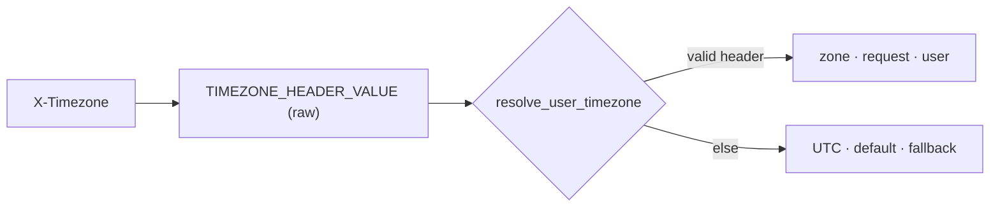

# Design: User Time Zone

- **Status:** Implemented
- **Approved:** 2026-10-29
- **User-facing:** [CONFIGURATION - Timestamp](../../CONFIGURATION.md#timestamp-configuration),
  [Time awareness - Time zone](../time_awareness.md#time-zone)
- **Issue:** [I#649](https://github.com/epam/ai-dial-quickapps-backend/issues/649)
- **Dependencies:**
  - [Time Awareness](time_awareness.md)

## Problem Statement

`TimestampModule` binds `TimeProvider` with its defaults (`UTC`, `TimestampSource.DEFAULT`). The injected timestamp,
the tool-result annotations and `current_timestamp` therefore all use UTC. "Today" or "tomorrow morning" resolves
against UTC, so near midnight the date is wrong, and times sent to calendar tools are off by the user's offset.

The user's zone already reaches QuickApps. The reason time awareness deferred this ("Core does not pass a time zone")
no longer holds:

| Hop | Today |
|-----|-------|
| Chat → Core | Chat sends the browser zone as `X-Timezone` ([ai-dial-chat I#8442](https://github.com/epam/ai-dial-chat/issues/8442); Chat 1.1.0+ and `development-0.x`) |
| Core → app | `ProxyUtil.copyHeaders` forwards it unchanged |
| QuickApps | Lands in `ForwardedHeaders` (observed: `forwarded_headers=['x-timezone', …]`); not used for time |

No Chat or Core change is needed.

## Design Goals

- A valid `X-Timezone` drives the injected timestamp, the tool-result annotations and `current_timestamp` called
  without an argument.
- Without a valid header, UTC is used, as today.
- An invalid header never fails the request.
- Every timestamp the model sees carries its UTC offset.

---

## Use Cases

| # | Trigger | Outcome |
|---|---------|---------|
| UC-1 | A Kyiv user asks "what's on my calendar today?" at 00:30 local (22:30 UTC) | Injected `2026-10-30T00:30:00+02:00 (Europe/Kyiv, source=user)`; the agent queries 30 Oct |
| UC-2 | An API client sends no header | UTC, `source=fallback` |
| UC-3 | The header is `UTC+3` (invalid) | Ignored with a DEBUG record; falls back to UTC |
| UC-4 | A Kyiv user asks for the time in Tokyo | `current_timestamp({"timezone": "Asia/Tokyo"})` returns `…+09:00 (Asia/Tokyo)`, no source; with no argument it returns Kyiv time |
| UC-5 | The user's zone changes mid-conversation | Old entries keep their zone and offset; the new turn uses the new zone |

---

## Proposed Design

### 1. Reading the header

- `common/_di_types.py`: constant `TIMEZONE_HEADER = "X-Timezone"` and DI key
  `TIMEZONE_HEADER_VALUE = Annotated[str | None, "TIMEZONE_HEADER_VALUE"]`.
- `_RequestContextSetup.setup_context` stores the raw header value in `_RequestContext.timezone_header_value`, next
  to `accept_language`. `AppModule` provides it, and no validation happens at this point.
- The header name is fixed, with no `PROXY_*` env override, because no proxy is known to rewrite it.

### 2. Resolving and validating (`timestamp_tooling`)

- `resolve_user_timezone(header_value) -> TimeProvider` sets the zone and the label the model sees; the stored
  `TimestampSource` is derived from the label.

  | Zone from | Stored `timestamp_source` | Label shown to the model |
  |-----------|---------------------------|--------------------------|
  | `X-Timezone` header | `request` | `source=user` |
  | UTC fallback | `default` | `source=fallback` |
  | `current_timestamp` argument from the LLM | `None` | none: `(Asia/Tokyo)` |

- Stored values stay within what older pods can parse: `get_metadata_from_state` rejects unknown enum values,
  and `None` is already allowed. `request` returns to the original design's meaning ("provided in the request").
  The label says whose zone it is, which is what the model reasons about. An LLM-argument result needs no label,
  because its call arguments show where the zone came from. Nothing reads `timestamp_source` for logic.
- `is_valid_iana_timezone(name)` in `common/` checks membership in the `tzdata` package's `zones` list (598 names)
  minus `Factory`. It does not use `ZoneInfo(name)`, which probes the filesystem: that call accepts `europe/warsaw`
  on macOS and resolves `localtime` to the server's zone. `tzdata` becomes a direct dependency.
- Aliases such as `Europe/Kiev` (still reported by Chrome) are accepted as sent.
- The value is stripped, and an empty value counts as absent. An invalid value is logged at DEBUG with the header
  name and value length only (CODESTYLE §9).

### 3. Building `TimeProvider` (`TimestampModule`)

- A request-scoped `@provider` replaces the class binding. It builds `TimeProvider` from `resolve_user_timezone`,
  or uses UTC/`fallback` without resolving when the feature is off. `TimeProvider` gains a non-persisted
  `label` (`TimezoneLabel`), which `format_timestamp` renders.
- Independent of the injection strategy: injectors only call `TimeProvider` (`tz`, `label`,
  `format_timestamp`), so the `<app_context>` delivery planned in
  [I#661](https://github.com/epam/ai-dial-quickapps-backend/issues/661) reuses the resolved zone as is.
- Ordering: `TimeProvider` is first resolved through `ProviderOf` in `_MessagesSetup.run_transformers` (from
  `setup_messages`), after `setup_context`. Fix the stale comment in `_provide_message_transformers` that says
  otherwise. A unit test pins this.

### 4. What the model sees

| Surface | Today | After (Kyiv) |
|---------|-------|--------------|
| Injected timestamp | `2026-10-29T11:36:12+00:00 (UTC, source=default)` | `2026-10-29T13:36:12+02:00 (Europe/Kyiv, source=user)` |
| `current_timestamp` with an LLM argument | `…+09:00 (Asia/Tokyo, source=request)` | `…+09:00 (Asia/Tokyo)`; stored `timestamp_source` is `None` |
| Tool-result annotation | `[Timestamp: 2026-10-29 11:36:12 UTC]` | `[Timestamp: 2026-10-29 13:36:12+02:00 Europe/Kyiv]` (adds `%:z`) |
| `current_timestamp` `timezone` description | "Defaults to UTC." | "Defaults to the time zone of the injected current timestamp." |

---

## Secondary Fixes

- `current_timestamp` passes the model's `timezone` argument straight to `ZoneInfo`. Apply the header's
  normalization instead: strip the value, and treat an empty string as absent (models often send `""`). Then call
  `is_valid_iana_timezone` and raise `InvalidToolCallParameterException("timezone", …)`, so the model retries.

---

## Out of Scope

| Item | Why deferred |
|------|--------------|
| Learn the zone from conversation | Chat already sends the header, and API clients can send it |
| App-level default zone (`default_timezone`) for requests without the header | No demand: Chat sends the header, API clients can send it, and UTC stays the fallback as today. Can be added later without breaking changes |
| App-pinned zone (override the user's) | No demand. Workaround: system prompt or an explicit `current_timestamp` zone. Can be added later as `timezone_mode: fallback \| fixed` |
| Per-user stored preference | Belongs in Chat or Core user settings |

---

## Configuration / Usage Examples

No configuration is added.

| `X-Timezone` | Zone | Model sees |
|--------------|------|------------|
| `Europe/Kyiv` | `Europe/Kyiv` | `source=user` |
| absent / empty / invalid | `UTC` | `source=fallback` |

API clients set `X-Timezone` themselves; Core forwards it.

---

## Migration

### Breaking changes

- Behaviour change: Chat users see local time instead of UTC. Apps whose prompts assume UTC should drop that
  assumption. Call this out in the release notes.

### Non-breaking changes

- No configuration or schema change.
- No new `TimestampSource` value, so a rolling deploy or rollback is safe.
- Old chats keep their stored text (`source=default`, `source=request`) next to new turns (`source=user`). Each
  entry carries its own zone and offset, so nothing needs migrating.
- Integration-test LLM caches stay valid: the cache key covers only system, user and assistant text.

### Known issues (to record in `docs/time_awareness.md`)

| What happens | Where | Workaround |
|--------------|-------|------------|
| No header, so UTC is used | API clients, scheduled runs, Chat older than I#8442 | Send `X-Timezone` |
| A valid but wrong zone is used | Firefox `resistFingerprinting` / Tor Browser (`UTC` or `Atlantic/Reykjavik`), or a misconfigured OS | Fix the browser or OS; or name the zone so the agent passes it to `current_timestamp` |

## Summary of Changes

| Component | Change |
|-----------|--------|
| `common/_di_types.py` | `TIMEZONE_HEADER`, `TIMEZONE_HEADER_VALUE` |
| `common/` | `is_valid_iana_timezone` |
| `core/application/` | `_RequestContext.timezone_header_value`; read in `setup_context`; provided by `AppModule` |
| `common/time_provider.py` | `TimezoneLabel`; `label`, rendered by `format_timestamp` |
| `timestamp_tooling/` | `resolve_user_timezone`; `TimeProvider` provider; offset in the annotation; tool description; argument validation; LLM-argument results store `None` with no source text; stale comment fixed |
| `pyproject.toml` | `tzdata` as a direct dependency |
| `CONFIGURATION.md`, `docs/time_awareness.md` | Local-zone behaviour; known issues |
| `docs/README.md` | Time awareness row: add this design to the L3 column |
| Internal tools schema | Regenerated (tool description) |
