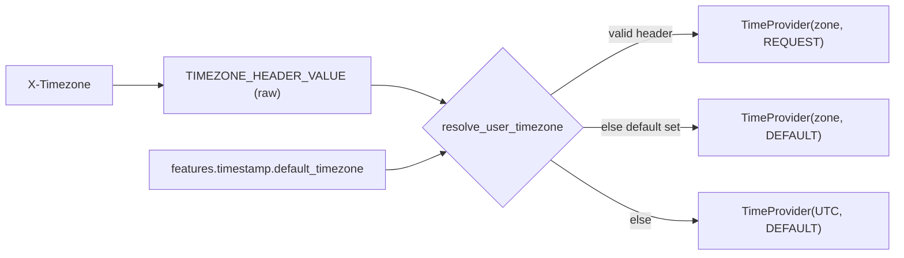

# Design: User Time Zone

- **Status:** Draft
- **Issue:** [I#649](https://github.com/epam/ai-dial-quickapps-backend/issues/649)
- **Dependencies:**
  - [Time Awareness](time_awareness.md)

## Problem Statement

`TimestampModule` binds `TimeProvider` with its defaults (`UTC`, `TimestampSource.DEFAULT`). The injected timestamp,
the tool-result annotations and `current_timestamp` therefore all use UTC. "Today" or "tomorrow morning" resolves
against UTC, so near midnight the date is wrong, and times sent to calendar tools are off by the user's offset.

The user's zone already reaches QuickApps. The reason time awareness deferred this ("Core does not pass a time zone")
no longer holds:

| Hop | Today |
|-----|-------|
| Chat → Core | Chat sends the browser zone as `X-Timezone` ([ai-dial-chat I#8442](https://github.com/epam/ai-dial-chat/issues/8442); Chat 1.1.0+ and `development-0.x`) |
| Core → app | `ProxyUtil.copyHeaders` forwards it unchanged |
| QuickApps | Lands in `ForwardedHeaders` (observed: `forwarded_headers=['x-timezone', …]`); not used for time |

No Chat or Core change is needed.

## Design Goals

- A valid `X-Timezone` drives the injected timestamp, the tool-result annotations and `current_timestamp` called
  without an argument.
- `features.timestamp.default_timezone` is the fallback when the request has none; UTC otherwise.
- An invalid header never fails the request.
- Every timestamp the model sees carries its UTC offset.

---

## Use Cases

| # | Trigger | Outcome |
|---|---------|---------|
| UC-1 | A Kyiv user asks "what's on my calendar today?" at 00:30 local (22:30 UTC) | Injected `2026-10-30T00:30:00+02:00 (Europe/Kyiv, source=request)`; the agent queries 30 Oct |
| UC-2 | An API client sends no header; the app sets `default_timezone: Europe/Warsaw` | Warsaw time, `source=default` |
| UC-3 | The header is `UTC+3` (invalid) | Ignored with a DEBUG record; falls back to `default_timezone`, then UTC |
| UC-4 | A Kyiv user asks for the time in Tokyo | `current_timestamp({"timezone": "Asia/Tokyo"})` as today; with no argument it returns Kyiv time |
| UC-5 | The user's zone changes mid-conversation | Old entries keep their zone and offset; the new turn uses the new zone |

---

## Proposed Design



### 1. Reading the header

- `common/_di_types.py`: constant `TIMEZONE_HEADER = "X-Timezone"` and DI key
  `TIMEZONE_HEADER_VALUE = Annotated[str | None, "TIMEZONE_HEADER_VALUE"]`.
- `_RequestContextSetup.setup_context` stores the raw header value in `_RequestContext.timezone_header_value`, next
  to `accept_language`. `AppModule` provides it, and no validation happens at this point.
- The header name is fixed, with no `PROXY_*` env override, because no proxy is known to rewrite it.

### 2. Resolving and validating (`timestamp_tooling`)

- `resolve_user_timezone(header_value, default_timezone) -> tuple[ZoneInfo, TimestampSource]`:
  valid header → `REQUEST`; else `default_timezone` → `DEFAULT`; else UTC → `DEFAULT`. The user's zone wins over
  the app default.
- `TimestampSource` keeps its two values: `request` means the zone was given explicitly (header or
  `current_timestamp` argument), and `default` means it was assumed. A new value would break older pods during a
  rollout, because `get_metadata_from_state` rejects unknown values.
- `is_valid_iana_timezone(name)` in `common/` checks membership in the `tzdata` package's `zones` list (598 names)
  minus `Factory`. It does not use `ZoneInfo(name)`, which probes the filesystem: that call accepts `europe/warsaw`
  on macOS and resolves `localtime` to the server's zone. `tzdata` becomes a direct dependency.
- Aliases such as `Europe/Kiev` (still reported by Chrome) are accepted as sent.
- The value is stripped, and an empty value counts as absent. An invalid value is logged at DEBUG with the header
  name and value length only (CODESTYLE §9).

### 3. Building `TimeProvider` (`TimestampModule`)

- A request-scoped `@provider` replaces the class binding. It returns `TimeProvider(*resolve_user_timezone(...))`,
  or plain UTC without resolving when the feature is off.
- Ordering: `TimeProvider` is first resolved through `ProviderOf` in `_MessagesSetup.run_transformers`, after
  `setup_context`. Fix the stale comment in `_provide_message_transformers` that says otherwise. A unit test pins
  this.

### 4. What the model sees

| Surface | Today | After (Kyiv) |
|---------|-------|--------------|
| Injected timestamp | `2026-10-29T11:36:12+00:00 (UTC, source=default)` | `2026-10-29T13:36:12+02:00 (Europe/Kyiv, source=request)` |
| Tool-result annotation | `[Timestamp: 2026-10-29 11:36:12 UTC]` | `[Timestamp: 2026-10-29 13:36:12+02:00 Europe/Kyiv]` (adds `%:z`) |
| `current_timestamp` `timezone` description | "Defaults to UTC." | "Defaults to the time zone of the injected current timestamp." |

### 5. App-level default (`config/timestamp.py`)

- Add `ToolCallTimestampConfig.default_timezone: str | None = PreviewField(default=None)`.
- An invalid value fails config validation. A typo by the app author should be loud, not silently UTC.
- In the schema it is a plain string; no enum of about 600 names.
- Only the field is preview-gated. Header resolution fixes a Stable feature, and `"timestamp": null` turns it off.

---

## Secondary Fixes

- `current_timestamp` passes the model's `timezone` argument straight to `ZoneInfo`. Apply the header's
  normalization instead: strip the value, and treat an empty string as absent (models often send `""`). Then call
  `is_valid_iana_timezone` and raise `InvalidToolCallParameterException("timezone", …)`, so the model retries.

---

## Out of Scope

| Item | Why deferred |
|------|--------------|
| Learn the zone from conversation | Chat already sends the header, and API clients can send it or rely on `default_timezone` |
| Editor field for `default_timezone` | JSON config works today; tracked as a follow-up editor issue |
| App-pinned zone (override the user's) | No demand. Workaround: system prompt or an explicit `current_timestamp` zone. Can be added later as `timezone_mode: fallback \| fixed` |
| Per-user stored preference | Belongs in Chat or Core user settings |

---

## Configuration / Usage Examples

```json
{ "features": { "timestamp": { "default_timezone": "Europe/Warsaw" } } }
```

| `X-Timezone` | `default_timezone` | Zone | `source` |
|--------------|--------------------|------|----------|
| `Europe/Kyiv` | any | `Europe/Kyiv` | `request` |
| absent / empty / invalid | `Europe/Warsaw` | `Europe/Warsaw` | `default` |
| absent / empty / invalid | unset | `UTC` | `default` |

API clients set `X-Timezone` themselves; Core forwards it.

---

## Migration

### Breaking changes

- Behaviour change: Chat users see local time instead of UTC. Apps whose prompts assume UTC should drop that
  assumption. Call this out in the release notes.

### Non-breaking changes

- `default_timezone` is optional.
- Integration-test LLM caches that include the tool description or annotations must be re-recorded.

### Known issues (to record in `docs/time_awareness.md`)

| What happens | Where | Workaround |
|--------------|-------|------------|
| No header, so `default_timezone` or UTC is used | API clients, scheduled runs, Chat older than I#8442 | Send `X-Timezone` or set `default_timezone` |
| A valid but wrong zone overrides `default_timezone` | Firefox `resistFingerprinting` / Tor Browser (`UTC` or `Atlantic/Reykjavik`), or a misconfigured OS | Fix the browser or OS; or name the zone so the agent passes it to `current_timestamp` |

## Summary of Changes

| Component | Change |
|-----------|--------|
| `common/_di_types.py` | `TIMEZONE_HEADER`, `TIMEZONE_HEADER_VALUE` |
| `common/` | `is_valid_iana_timezone` |
| `core/application/` | `_RequestContext.timezone_header_value`; read in `setup_context`; provided by `AppModule` |
| `config/timestamp.py` | `default_timezone` (`PreviewField`) with validator |
| `timestamp_tooling/` | `resolve_user_timezone`; `TimeProvider` provider; offset in the annotation; tool description; argument validation; stale comment fixed |
| `pyproject.toml` | `tzdata` as a direct dependency |
| `CONFIGURATION.md`, `docs/time_awareness.md` | `default_timezone`; local-zone behaviour; known issues |
| `docs/README.md` | Time awareness row: add this design to the L3 column |
| App schema | Regenerated |

---

## Review Notes — Round 1

- **Reviewer:** Claude (quickapps-design-review skill)
- **Date:** 2026-10-29

### Verdict

`Blocking issues must be addressed`

The problem is well grounded: every code claim in *Problem Statement* checks out (`TimestampModule` binds
`TimeProvider` with its UTC/`DEFAULT` defaults, the annotation and tool description read as quoted, and
`extract_x_headers_from_request` already forwards `x-timezone`). The precedence rule, the before/after table in §4 and
the decision to log only the value length are clear. One issue blocks approval. The design gives the existing
`source=request` label a second meaning, and that breaks its own argument that the label tells the model which zone
belongs to the user. Several suggestions tighten the validation rationale, migration safety and the user-facing docs.

### Blocking issues

1. **[Proposed Design §4, UC-4]** — `source=request` already has a different meaning. `_CurrentTimestampTool._run_in_stage_async`
   (`src/quickapp/timestamp_tooling/_current_timestamp_tool.py:56-58`) sets `TimestampSource.REQUEST` whenever the
   model passes an explicit `timezone` argument. After this change, a Kyiv user who asks about Tokyo gets
   `…+09:00 (Asia/Tokyo, source=request)` right next to the injected `…+02:00 (Europe/Kyiv, source=request)`, and
   `TimestampMetadata.timestamp_source` stores `request` for both. That contradicts §4's claim that "`source=request`
   versus `source=config` lets the model tell 'this is the user's zone' from 'this is the app's assumption'". It also
   means history from UC-4 (explicit conversion) looks the same as history from UC-5 (the user moved), so a later
   turn can read a Tokyo lookup as the user's zone.
   **Suggestion:** Give explicit conversions their own source (for example `TimestampSource.ARGUMENT = "argument"`)
   and carry it through §4's table, UC-4, *Migration* and *Summary of Changes*. If you keep `request` for both cases
   instead, remove the §4 claim and explain why the model does not need the distinction.

### Suggestions

1. **[Proposed Design §2 — validation rationale]** — Set membership does not deliver the guarantees the doc claims.
   CPython's `zoneinfo._tzpath.available_timezones()` leaves out only the `right/` and `posix/` directories and
   `posixrules`. Any image where `ZoneInfo("localtime")` resolves therefore has a `localtime` file under the TZPATH
   root, and the same walk adds `localtime` to the set. `Factory` is in the set as well (checked on Python 3.13.11).
   The set is also the union of the `tzdata` wheel and the system TZPATH, so it is not "platform-independent". Today
   `tzdata` is only a transitive dependency of `pandas` (`pyproject.toml` does not declare it), and the runtime image
   is `python:3.13-alpine`.
   **Suggestion:** Correct the rationale. Then either build the set from the `tzdata` package's `zones` list and
   declare `tzdata` as a direct dependency (CODESTYLE §11), or explicitly reject `localtime` and `Factory`.
2. **[Migration — Non-breaking changes]** — "`TimestampSource.CONFIG` is additive" holds in only one direction. The
   current `get_metadata_from_state` raises `ValidationError` on an unknown `timestamp_source` (confirmed with
   `"config"`). It is called from `_TimestampAnnotationTransformer.transform`, which `_ChatCompletionConfigBuilder`
   runs before every LLM call without catching errors (`_chat_completion_config_builder.py:178-179`). During a
   rolling deploy, or after a rollback, older pods fail every request whose history contains a `config`-stamped tool
   result. Any new source value added to fix the blocking issue has the same problem.
   **Suggestion:** State this rollback limit in *Migration*. In this release, also make `timestamp_source` tolerant
   of unknown values (map them to `None`), so later additions are safe.
3. **[Proposed Design §3 — feature-off path]** — With `"timestamp": null`, `_TimestampInjectionTransformer` is still
   built, because `_provide_message_transformers` is always registered. Building it injects `TimeProvider`
   (`_timestamp_injection_transformer.py:25-26`), so `resolve_user_timezone` runs and logs the invalid-header warning
   for an app with the feature turned off. The doc already notes that the reason for always registering it, the
   comment at `timestamp_module.py:64-66`, is stale.
   **Suggestion:** Gate `_provide_message_transformers` on `_is_timestamp_feature_enabled`, like the other three
   providers, and drop the self-gate in `get_content`. Alternatively, have the `TimeProvider` provider return UTC
   without resolving when the feature is off. Update §3 and *Summary of Changes* to match.
4. **[Migration — Breaking changes / Out of Scope]** — An app cannot pin its zone. The header always wins over
   `default_timezone`, so the only compatibility step offered for apps that rely on UTC is "drop that assumption" in
   the prompt. Some apps legitimately want a fixed zone, such as an ops agent that reads UTC logs or an app built for
   one office. This is a default-on behaviour change to a Stable feature.
   **Suggestion:** Either add a pinning option (for example `timezone_mode: fallback | fixed`) or record "app-pinned
   zone" in *Out of Scope*, saying why it is deferred and what the workaround is. The design does not discuss
   preview gating either. Add one sentence explaining why this ships without `PreviewField`.
5. **[Documentation hierarchy]** — Two gaps:
   - Known issues are stated only in this design. The design names environments where the user's zone is missing or
     wrong: clients that do not send the header (Chat before 1.1.0, non-Chat clients) and users whose OS zone is
     wrong. To these, add privacy-hardened browsers (for example Firefox with `privacy.resistFingerprinting`, or
     Tor Browser), which report a spoofed zone. Such a zone arrives as a valid header with `source=request` and
     overrides `default_timezone`. These belong in a `### Known issues` subsection of `docs/time_awareness.md` (the
     L2 guide), with what happens and the workaround (send `X-Timezone`, or rely on `default_timezone`).
   - *Summary of Changes* does not mention `docs/README.md`. The **Time awareness** row in the Stable capability map
     should link this design in its L3 column.

### Nits

1. **[Proposed Design §4]** — The new `current_timestamp` description, "Defaults to the user's time zone when known,
   otherwise UTC", is wrong when the zone comes from `default_timezone`. Something like "Defaults to the time zone of
   the injected current timestamp" is accurate for all three sources.
2. **[Proposed Design §1, §3; UC-4]** — Some sentences only describe what is not changing: "`TimeProvider` keeps its
   interface", "The header stays in `ForwardedHeaders`, so tools keep receiving it", and UC-4's Outcome "Unchanged
   from today for explicit zones". The last is also inaccurate, because the description and source label do change.
   Cut them or move them to *Migration*.
3. **[Proposed Design §2 — logging]** — CODESTYLE §9's level table puts routine rejections at DEBUG. A client that
   always sends `UTC+3` would log a WARNING on every request. Consider DEBUG. Also say whether surrounding
   whitespace is stripped before the lookup (` Europe/Kyiv `).
4. **[Proposed Design §1]** — `USER_TIMEZONE` holds the raw, unvalidated header, but the name suggests a resolved
   zone. A name that says what it holds, such as `TIMEZONE_HEADER_VALUE`, stops future consumers from using it
   unvalidated. `PROXY_TIMEZONE_HEADER` is speculative: no proxy is known to rename `X-Timezone`. Consider dropping
   it until one does.
5. **[Secondary Fixes]** — Name the existing mechanism. Raising `InvalidToolCallParameterException("timezone", …)`
   (`common/exceptions/invalid_tool_call_parameter.py`) already becomes a retry instruction in
   `StagedBaseTool.__run_tool_body`, so a new error path is not needed.

---

## Review Notes — Round 2

- **Reviewer:** Claude (quickapps-design-review skill)
- **Date:** 2026-10-29

### Verdict

`Ready for approval pending minor suggestions`

All Round 1 findings are addressed. Keeping `TimestampSource` at two values is the right trade-off. It avoids the
rollback break, and the zone the model should treat as the user's is the one in the argument-less injected
`current_timestamp` pair. `_TimestampInjectionTransformer` appends that pair on every turn (`InjectionFrequency.ALWAYS`,
with `get_arguments()` returning `{}`). The new claims hold against the code and the locked packages:

- `tzdata` 2026.4 lists 598 zones. `Factory`, `Europe/Kiev` and `Asia/Calcutta` are in the list, and `localtime` and
  `posixrules` are not.
- A persisted `response_timestamp` keeps its offset through the `TimestampMetadata` round-trip, so `%:z` renders
  correctly for both old and new history.
- Older pods render the new metadata without errors.
- `LazyOnDemandStrategyModule.provide_message_transformers` already injects `ApplicationConfig` directly into a
  `MessagesTransformer` provider, so the new `TimeProvider` provider is safe at the point §3 names.

Nothing below blocks approval.

### Suggestions

1. **[Secondary Fixes]** — The `timezone` argument does not get the normalization that §2 gives the header. Models
   often fill an optional string parameter with `""`. `ZoneInfo("")` raises `ValueError` today. After this change it
   raises `InvalidToolCallParameterException`, which costs a retry round-trip for a call that only wanted the default
   zone.
   **Suggestion:** Use the header's rule: strip whitespace, and treat an empty value as absent (that is, use the
   `TimeProvider` zone).

### Nits

1. **[Proposed Design §2 vs §4]** — §2 says "`request` means the zone came from the request", but §4 says explicit
   `current_timestamp` conversions also keep `source=request`. Make §2's definition cover both cases, for example
   "`request` means the zone was given explicitly, by the `X-Timezone` header or by the tool's `timezone` argument".
2. **[Summary of Changes; formatting]** — The `docs/time_awareness.md` row says "new `### Known issues` subsection
   (see below)", but that table is above it, under *Migration*. Line 128 (the §2 validation bullet, 178 characters) and
   line 68 (UC-3 *Behavior*) are much wider than the wrap width the rest of the doc uses.

### Changes since previous round

- **Blocking 1 (`source=request` overload)** — **resolved.** The doc keeps two values and drops the §4 claim. It
  explains how the model tells the cases apart (by the tool-call argument) and gives the rollback reason for not adding
  a value. One wording leftover is Nit 1.
- **Suggestion 1 (validation set)** — **resolved.** The set is built from the `tzdata` `zones` list minus `Factory`,
  and `tzdata` becomes a direct dependency. Checked against tzdata 2026.4.
- **Suggestion 2 (unknown enum value on older pods)** — **resolved (moot).** No new value is added, and §4 gives the
  rollback limit as the reason.
- **Suggestion 3 (feature-off path)** — **resolved.** The provider returns UTC without resolving, and §3 and
  *Summary of Changes* agree.
- **Suggestion 4 (pinning and gating)** — **resolved.** *Out of Scope → App-pinned zone* gives the workaround and the
  future shape. `default_timezone` is a `PreviewField`, and §5 explains why header resolution is not gated.
- **Suggestion 5 (documentation hierarchy)** — **resolved.** The known-issues table is aimed at
  `docs/time_awareness.md`. That guide has no Troubleshooting table, so no row is needed there. The `docs/README.md` L3
  link is listed in *Summary of Changes*.
- **Nits 1–5** — **resolved.**

---

## Review Notes — Round 3

- **Reviewer:** Claude (quickapps-design-review skill)
- **Date:** 2026-10-29

### Verdict

`Approval-ready`

All Round 2 findings are resolved, and the new text holds against the code. The `current_timestamp` normalization
in *Secondary Fixes* makes an empty or whitespace-only argument fall into the existing `timezone_str is None` branch
of `_CurrentTimestampTool._run_in_stage_async`, which takes both the zone and the source from `TimeProvider`. So a
`{"timezone": ""}` call returns the same result as an argument-less one, and §2's two-way definition of
`source=request` stays true. Re-checked on Python 3.13: `%:z` renders `+02:00` both on a live `ZoneInfo` datetime
and after the `TimestampMetadata` JSON round-trip. The UC-1 and UC-5 offsets are correct for the dates used: Kyiv is
`+02:00` after 25 October 2026 and New York is `-04:00` until 1 November 2026. Only one factual nit remains, and it
does not block approval.

### Nits

1. **[Migration — Known issues, row 2]** — "(they report `UTC` or `Atlantic/Reykjavik`, both UTC+00:00)" is out of date. Tor Browser switched its spoofed
   zone from `UTC` to `Atlantic/Reykjavik` in early 2024 (tor-browser bug 42397), because sites block
   `Atlantic/Reykjavik` less often than plain `UTC`. Mozilla's own description of `resistFingerprinting` says the zone is
   reported as "UTC or Icelandic". The behaviour the row describes is still right: either value is a valid IANA name,
   so the header wins over `default_timezone`, with a +00:00 offset. This row is going to be copied into
   `docs/time_awareness.md`, so it should name the right value. Suggested wording: "(report `UTC` or
   `Atlantic/Reykjavik`, both UTC+00:00)".

### Changes since previous round

- **Suggestion 1 (empty `timezone` argument)** — **resolved.** *Secondary Fixes* now strips the argument and treats
  an empty value as absent before validation, so the call does not cost a retry.
- **Nit 1 (§2 definition of `request`)** — **resolved.** §2 now says the zone was "given explicitly, either by the
  `X-Timezone` header or as a `current_timestamp` argument". This matches §4 and the tool code.
- **Nit 2 (Summary pointer; line width)** — **resolved.** The `docs/time_awareness.md` row now points to
  *Migration → Known issues*. The UC-3 *Behavior* line and the §2 validation bullet are wrapped. The remaining wide
  lines are table rows, apart from lines 32 and 85, which are only a few characters over the wrap width.
